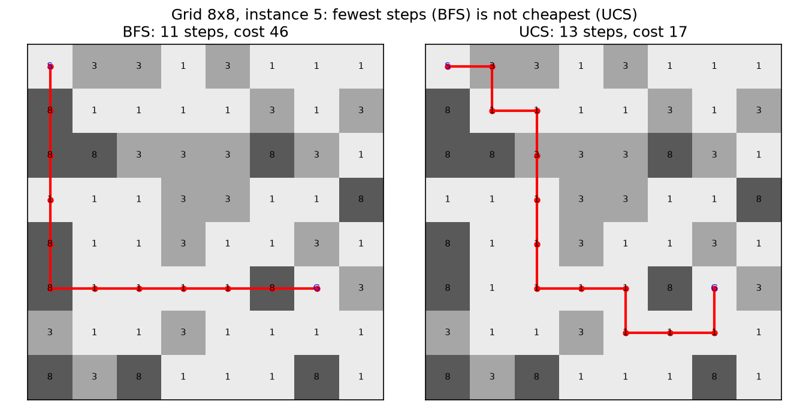
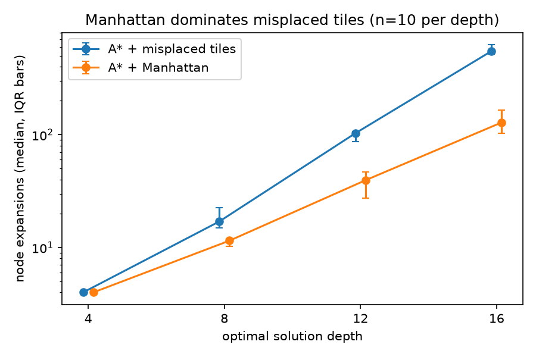
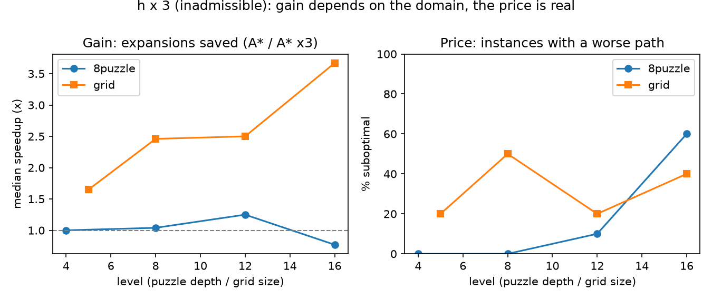
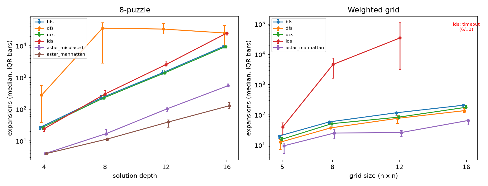
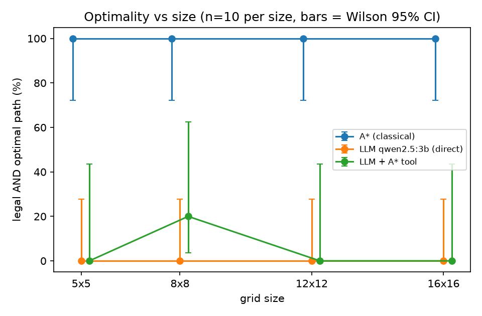

# HW1 — Duel 1: Search

**Author:** Antonio Muñoz. Code, raw data, figures and LLM transcripts are in `code/`, `results/`, `fig/` and `.llm_cache/`. Protocol decisions: `code/PROTOCOL.md`.

## 1. Setup

Two domains: the 8-puzzle (optimal depths 4, 8, 12, 16) and weighted grids (5×5, 8×8, 12×12, 16×16; terrain costs 1/3/8 paid on entering a cell; no walls). Ten instances per level, 80 in total, taken from the course banks (seed 20260807). Algorithms: BFS, DFS, UCS, IDS and A* (misplaced tiles, Manhattan, Manhattan×3). Each run has a hard 10 s timeout, reported as a timeout and never as a failure. We report medians and IQRs.

The LLM is qwen2.5:3b, run locally with Ollama on a 2-core CPU, on the 40 grids only. Our own validator checks every answer: legal path (valid letters, in bounds, no walls, ends at G), recomputed cost, and comparison with the optimum from our A*. The model is never asked whether it is right.

## 2. Classical comparison

**Equal-cost solutions.** UCS and A* with an admissible h returned the same cost in 120/120 comparisons. BFS matched on the 8-puzzle (unit costs) but was suboptimal on 33/40 grids (Fig. 1).

**Dominance.** Manhattan ≥ misplaced tiles on all 181,440 reachable states, and Manhattan expanded no more nodes on 40/40 instances (median 128.5 vs 551 at depth 16; both 4 at depth 4). Tie-breaking was identical.

**Breaking admissibility (h×3).** On grids the gain was 1.65×, 2.46×, 2.50× and 3.67× fewer expansions (sizes 5→16), at the price of 2, 5, 2 and 4 of 10 suboptimal paths, up to 1.5× the optimal cost. On the 8-puzzle there was no gain (1.00, 1.04, 1.25, 0.77×): at depth 16 h×3 expanded more than A* on 7/10 instances and 6/10 were suboptimal. We did not test why; our hypothesis is that Manhattan is already tight there (Fig. 3).

**Effective branching factor b\*** (N = expansions, d = solution length), depths 4/8/12/16: misplaced 1.00/1.17/1.31/1.37; Manhattan 1.00/1.08/1.17/1.22; grid Manhattan 1.20/1.18/1.17/1.15. Manhattan is lower but still grows with depth. Because N counts expansions, values are comparable only within this study.

**Other measurements.** At depth 16, A* with Manhattan needed about 73× fewer expansions than BFS/UCS (128.5 vs 9,441.5). IDS keeps the frontier tiny (5–17 nodes) but timed out on 6/10 grids of 16×16. DFS returns solutions of median cost 24,835 at depth 16 (optimum 16).

*Fig. 1. Grid 8×8 #5. BFS finds the fewest steps (11) but costs 46; UCS takes 13 steps and costs 17. BFS is optimal only under uniform costs.*

*Fig. 2. A* expansions (median, IQR bars, log scale). Manhattan stays below misplaced tiles at every depth where they differ.*

*Fig. 3. h×3 helps on grids but not reliably on the 8-puzzle, and it costs optimality in both. Reporting only the speedup would be misleading.*

*Fig. 4. Expansions per algorithm (median, IQR). A* grows slowest; IDS on 16×16 grids is missing because 6/10 runs timed out.*

## 3. The duel

**Direct arm.** The prompt gives the same task text as the course prompt plus one sentence stating the cost convention (cost of every cell entered, S not counted), so the model has the information our A* has. The model is told not to explain. Temperature 0, seed 0, 200-token cap.

**Tool arm.** The model receives a tool `astar_solve(grid)` and must copy the grid into a JSON call. We run our A* on the grid it sent and return the result; the model relays the final answer. Our validator judges that answer against the *original* grid, so a mis-copied grid shows up as a failure. This arm was run on 5 instances per size (20 in total) because of time.

| Category | LLM direct (n=40) | Tool arm (n=20) |
|---|---|---|
| Illegal path | 40 | 6 |
| Legal but suboptimal | 0 | 0 |
| Optimal, wrong reported cost | 0 | 0 |
| Malformed (no PATH line) | 0 | 12 |
| Tool call failed (server error) | – | 1 |
| Correct | 0 | 1 |

**Direct arm.** All 40 answers were illegal: 19 contained invalid characters (always the letters S or G copied from the map), 13 left the grid, 8 did not reach G. 16/40 were cut by the token cap, several of them in repeating loops. An audit that kept only the letters U/D/L/R also gave 0/40, so the strict parser does not explain the result.

**Tool arm.** The tool was called in 16/20 cases, but no grid was copied exactly (0/20) and our tool rejected 14/20 inputs (rows of unequal length, extra S or G). One more request ended in a server error (HTTP 500; in the pilot the server reported a repetition limit). The single success (8×8) therefore does not show faithful formalization. The bottleneck moved from solving to formalizing.

**Reproducibility** (one instance, 8×8 #0, five identical calls): A* gave 1 distinct answer; the LLM gave 2 distinct answers at temperature 0 and 5 at temperature 0.8 without a seed. Even greedy decoding was not repeatable on this server (we did not test why). The cache stores each transcript, so reported numbers are re-derivable, but a live rerun may differ.

*Fig. 5. Legal and optimal paths vs size, 95% Wilson intervals. A* is flat at 100%. The LLM is at 0% from the first size: there is no cliff, only a floor. The tool arm is 0/5, 1/5, 0/5, 0/5.*

## 4. Duel Scorecard

| Axis | Classical (A*) | LLM (qwen2.5:3b, direct) | Tool-augmented (LLM + A*) | Evidence |
|---|---|---|---|---|
| Correctness | 40/40 optimal | 0/40 (95% CI 0–8.8%) | 1/20 (CI 0.9–23.6%) | `classical_grid.csv`, `llm_grid.csv`, `tool_grid.csv` |
| Guarantee | Optimal provided h never overestimates (Manhattan is admissible here since the minimum step cost is 1). No claim about runtime. | None: legality, optimality and the reported cost are all unverified. | A* is optimal for the grid it receives; nothing guarantees the model's copy is faithful (0/20 were). | — |
| Cost | 26 expansions (median) | 259.5 tokens in / 23 out (median) | 871.5 in / 123.5 out (median, all calls) + one A* run | `scorecard_data.csv` |
| Latency | 0.15 ms median / 0.43 ms p95 | 25.6 s / 55.1 s | 38.3 s / 148.1 s | `scorecard_data.csv` |
| Reproducibility | 1 distinct answer in 5 | 2 distinct (temp 0), 5 distinct (temp 0.8) | not measured | `repro.csv` |
| Scaling | Flat 100% | 0% at all four sizes (floor) | 0, 1, 0, 0 of 5 | `fig/scaling.png` |
| Interpretability | Path plus cost is a checkable certificate | Letters only, no certificate | A* path is a certificate for the grid sent; the relayed answer is not | — |
| Failure mode | No A* failures; IDS timed out on 6/10 at 16×16 | Illegal 40/40, often invalid characters or token-cap loops | Malformed 12, illegal 6, tool call failed 1; grid never copied exactly | `scorecard_data.csv` |

## 5. Where we may have been unfair

**Tuned classical side, untuned prompt.** The classical side uses textbook heuristics with proofs behind them, and the course-supplied search code. The LLM got one direct-answer prompt after a single pilot (free reasoning, 512-token cap: 2 of 3 replies were cut off). We never tried few-shot examples, step-by-step prompting, or a longer cap. The comparison is a well-engineered classical solver against a lightly engineered prompt.

**Development time.** We did not record it. Most of the work went into the harness and validator, and the LLM prompt received two iterations. Time spent on classical versus LLM is therefore not comparable.

**Instance distribution.** The banks come from the course. The grids have no walls, costs 1/3/8 and random start and goal, which suits A* (median 26 expansions). For the LLM the smallest size is already too hard, so our size range sits entirely above its competence and we cannot see where it starts failing (3×3 or 4×4 untested). The LLM never saw the 8-puzzle.

**Different information across arms.** The direct and tool arms received the cost convention, which the original course prompt omits. The tool arm shows the grid without spaces (the format the tool needs) while the direct arm uses the course's spaced format. The information is identical, but the format is not.

**Small model, one setting.** qwen2.5:3b on CPU is far from a frontier model. The direct arm forbids explanation, so we did not measure what this model does when allowed to reason. One temperature was used for the main runs.

**Operational choices.** The 10 s timeout penalises IDS; with more time it would finish. The tool arm has 5 instances per size and one round (no retry after a tool error). Server errors (HTTP 500) were retried up to three times in the direct arm; their cause was not diagnosed beyond one case of repeating output. BFS, DFS, UCS, IDS and the grid heuristics come from the instructor's reference solutions (used with his permission); the engine, the 8-puzzle heuristics, the validator and the harness are ours, written with AI assistance (see `AI_LOG.md`).

## 6. What the evidence does not support

- **Nothing about instance 41 or larger grids for A*.** Its optimality comes from the admissibility proof, not from our 40/40.
- **No claim that LLMs cannot solve path planning.** One 3B model, one prompt, one domain, 0/40. Pooled, the 95% upper bound for the true rate is still about 9%.
- **No scaling claim for the LLM.** A floor at 0% shows no trend with size. A 1/5 at 8×8 in the tool arm is noise.
- **No conclusion that tool use helps.** 1/20 versus 0/40 is not a statistically meaningful difference, and the 20 grids were never copied faithfully. We cannot say whether a larger model would copy them.
- **No claim about the cause** of h×3 expanding more nodes on the 8-puzzle, nor of the non-repeatable output at temperature 0.
- **Nothing about the 8-puzzle for the LLM**, or about real-time cost (timings come from one machine and one run).