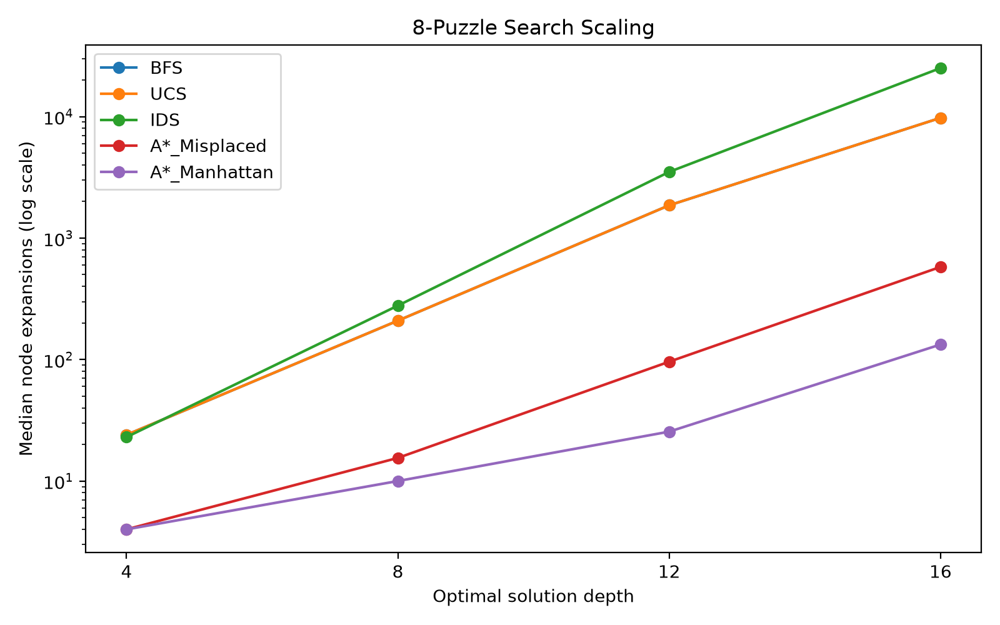
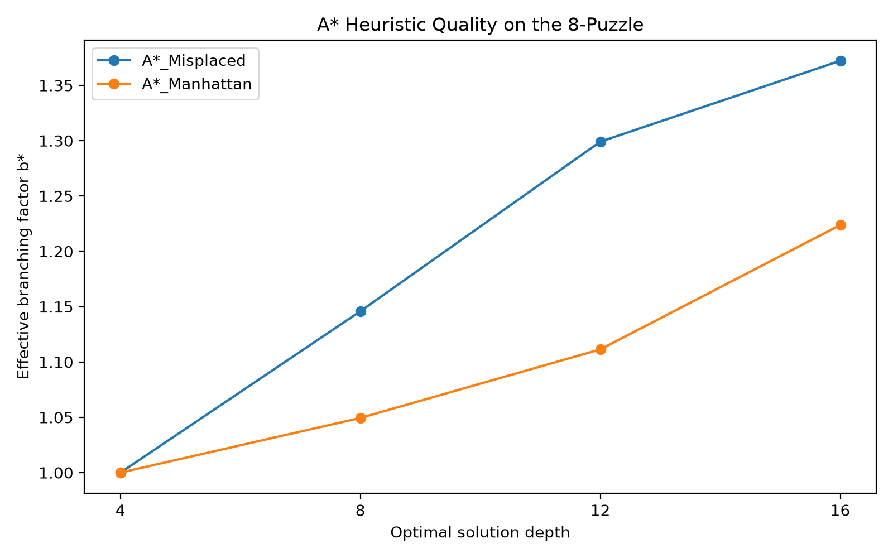
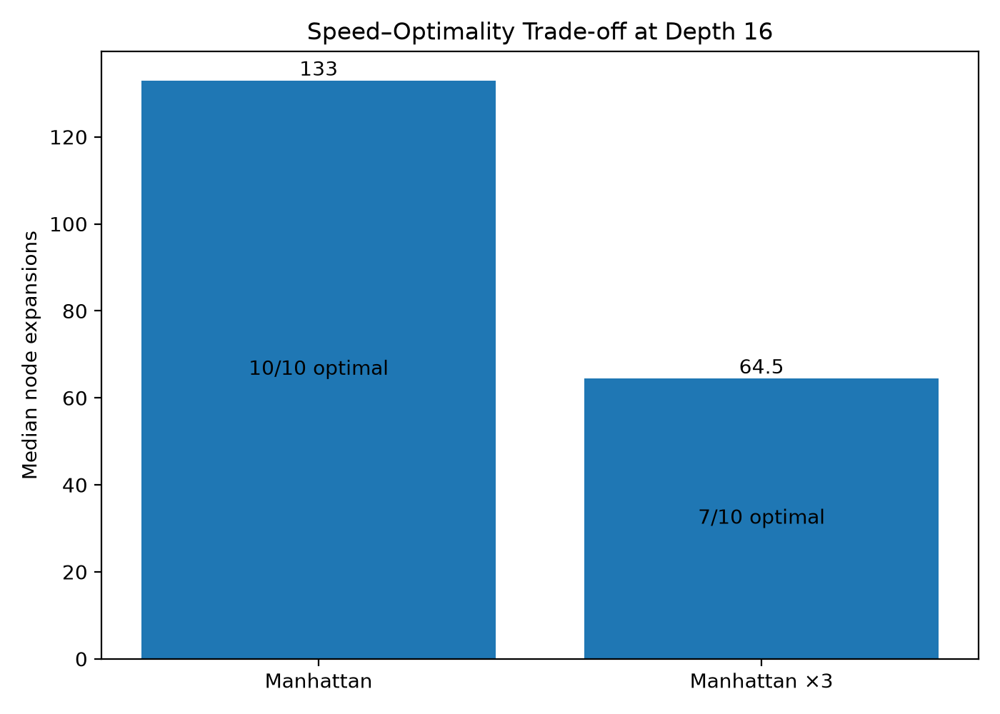
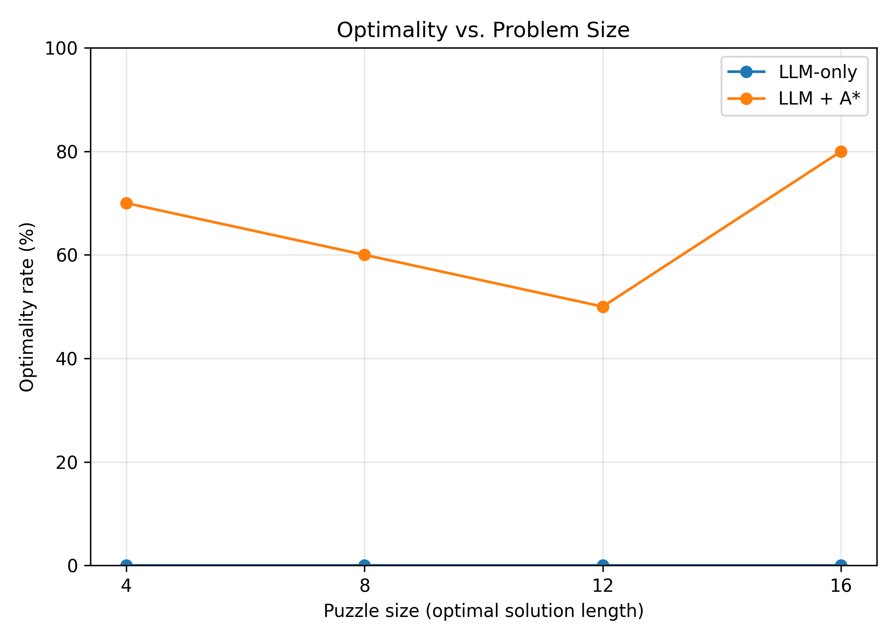

# Homework 1: Duel 1 - Search

**Names:** Karen Villavicencio (00335621) y Martín Cevallos (00335290) - **Fecha:** 5 de octubre de 2026

## Part 1 - Classical Comparison

## Metodología

Para esta tarea se implementaron BFS, DFS, UCS, IDS y A*. Se trabajó sobre dos dominios, un 8-puzzle y un gridworld con costos de terreno. Para el 8-puzzle se usaron profundidades 4, 8, 12 y 16. Asi mismo para grids, tamaños 5x5, 8x8, 12x12 y 16x16. Se evaluaron 10 instancias en cada nivel. Para cada instancia se registró costo y longitud de la solución, expansiones de nodos y tamaño máximo del frontier. Además se agregó un hard timeout de 10 segundos, los casos que lo excedieron se registraron como "timeout".

### Optimalidad y escalamiento

Se encontró que UCS y A* con heurística admisible tuvieron el mismo costo en las 40 instancias de grid. En cambio, BFS fue subóptimo en 33 de 40 grids con costos no uniformes.

Al analizar el funcionamiento de BFS y UCS en un terreno con costos no uniformes, encontramos que BFS no siempre encuentra la solución de menor costo. Por ejemplo, en la segunda instancia del grid 5×5, tanto BFS como UCS encontraron una solución de 3 pasos, pero BFS obtuvo un costo de 5, mientras que UCS obtuvo un costo de 3. BFS garantiza una solución de profundidad mínima, pero cuando los costos son variables, esto no garantiza un costo mínimo.

IDS tuvo el mayor problema al hablar de escalamiento. Resolvió todas las primeras instancias bien, pero al llegar a 16x16 se alcanzó el timeout en 5 de las 10 instancias.

*Figura 1. Expansiones medianas en el 8-puzzle. Los algoritmos no informados crecen más rápido con la profundidad, mientras que A-star requiere menos expansiones. Manhattan muestra una pequeña ventaja sobre misplaced tiles al aumentar la profundidad.*

### Dominancia de heurísticas

En las 40 instancias del 8-puzzle, Manhattan nunca expandió más nodos que misplaced tiles. A profundidad 16, la mediana fue de 133 expansiones para Manhattan frente a 579 para misplaced tiles.

Se podría decir que la heurística más informativa reduce el árbol efectivo de búsqueda.

*Figura 2. Effective branching factor de A-star. Manhattan mantiene un b * menor que misplaced tiles.*

### Rompiendo la admisibilidad

También se trabajó con 3x Manhattan. Por ejemplo, analizando en profundidad 16, la mediana de expansiones disminuyó de 133 con Manhattan a 64.5 con 3x Manhattan. Sin embargo, Manhattan llegó a soluciones óptimas en todas las instancias, mientras que 3x Manhattan fue óptimo solamente en 7/10. Los tres casos subóptimos tuvieron costos 18, 22 y 22 frente al óptimo de 16.

*Figura 3. Romper la admisibilidad reduce el esfuerzo de búsqueda pero puede sacrificar la calidad. 3x Manhattan redujo considerablemente la mediana de expansiones de nodos, pero tuvo un 30% de soluciones subóptimas.*

## Part 2 — The Duel

### Metodología

Para el duelo usamos el dominio de 8-puzzle con cuatro tamaños de problema: soluciones óptimas de longitud 4, 8, 12 y 16. Para cada tamaño se evaluaron 10 instancias, dando un total de 40 instancias por sistema. Usamos Qwen2.5:3b mediante Ollama, con temperatura 1.0.

Se compararon dos sistemas. El primero fue **LLM-only**, donde el modelo recibió la descripción del problema y tuvo que producir directamente una solución. El segundo fue **tool-augmented**, donde el modelo podía llamar a una herramienta que ejecutaba nuestra implementación de A*. Después de recibir el resultado de A*, el modelo debía entregar la respuesta final.

### Validador

La evaluación no dependió de que el propio modelo decidiera si su respuesta era correcta. Implementamos un validador externo que comprobó tres condiciones: que los movimientos fueran legales y contiguos, que el costo reportado coincidiera aritméticamente con la solución y que la solución fuera óptima comparándola con A*.

Las respuestas se clasificaron en cuatro categorías: `optimal_correct`, `illegal`, `suboptimal` y `wrong_cost`. Esto permitió separar los diferentes tipos de errores.

### Resultados

El sistema **LLM-only** obtuvo 0 de 40 soluciones óptimas. Las 40 respuestas fueron clasificadas como caminos ilegales. No se observaron casos legales subóptimos ni casos con costo incorrecto.

El sistema **LLM + A*** obtuvo 26 de 40 soluciones óptimas y correctas, equivalente a **65%**. Las tasas por tamaño fueron 70% para L4, 60% para L8, 50% para L12 y 80% para L16. Los otros 14 casos fueron ilegales. Nuevamente, no hubo soluciones legales subóptimas ni costos incorrectos.

Esto muestra una diferencia clara entre los dos sistemas en este experimento: proporcionar acceso a A* mejoró considerablemente la capacidad de obtener soluciones óptimas. Sin embargo, el modelo todavía cometió errores al proporcionar los argumentos de entrada a la herramienta.

### Modos de fallo

En el sistema tool-augmented, los 26 casos con argumentos correctos para la herramienta terminaron en soluciones óptimas. Los 14 casos con argumentos incorrectos terminaron como respuestas ilegales. Por lo tanto, en nuestros datos el principal problema no parece ser A*, sino la interfaz entre el modelo y la herramienta.

El sistema LLM-only tuvo un comportamiento diferente: las 40 respuestas fueron ilegales. Esto significa que no encontramos evidencia de que el modelo estuviera produciendo caminos legales pero simplemente eligiendo caminos no óptimos; el problema ocurrió antes, al generar una secuencia de movimientos válida.

### Escalamiento

*Figura 4. Tasa de optimalidad del LLM-only y del sistema tool-augmented en los cuatro tamaños de puzzle. La incorporación de A-star mejora sustancialmente la optimalidad, pero los cuatro tamaños evaluados no muestran una relación monotónica entre tamaño y tasa de éxito.*

La curva del LLM-only permaneció en 0% para los cuatro tamaños. Para el sistema tool-augmented, las tasas fueron 70%, 60%, 50% y 80%. Por lo tanto, nuestros resultados no muestran el comportamiento monotónico esperado de una caída progresiva con el tamaño. Esto puede deberse al número limitado de instancias y a la distribución específica de dificultad.

### Reproducibilidad

Realizamos cinco llamadas idénticas para una misma instancia. Tanto el sistema LLM-only como el sistema tool-augmented produjeron **5 respuestas distintas en 5 llamadas**. Esto indica que ninguno de los dos sistemas fue completamente reproducible con la temperatura seleccionada de 1.0.

### Costo y latencia

El LLM-only produjo en promedio 1257.5 tokens de salida por instancia, mientras que el sistema tool-augmented produjo 75.5 tokens de salida. La latencia promedio fue de **128.89 ± 116.00 s** para LLM-only y **15.08 ± 2.52 s** para LLM + A*. Las medianas fueron 90.68 s y 15.07 s, respectivamente.

La gran desviación estándar del LLM-only muestra una variabilidad considerable en el tiempo de ejecución. El sistema tool-augmented fue mucho más estable. Estas mediciones corresponden únicamente al tiempo de ejecución de los experimentos; no incluyen el tiempo utilizado para desarrollar A*, el validador, la herramienta ni los prompts.

### Where we may have been unfair

Hay varias limitaciones que podrían haber favorecido a uno de los sistemas. Primero, A* utiliza una heurística diseñada específicamente para resolver el 8-puzzle, mientras que no realizamos una búsqueda sistemática de prompts para optimizar el comportamiento del LLM-only. Aunque sí tuvimos que reforzar el prompt del sistema tool-augmented para que utilizara la herramienta correctamente, esto no equivale a un proceso completo de optimización de prompts.

Segundo, usamos 10 instancias por tamaño. Aunque esto cumple con el mínimo solicitado, una muestra relativamente pequeña puede no representar toda la variedad de configuraciones posibles del 8-puzzle. La distribución concreta de instancias puede haber favorecido accidentalmente a uno de los sistemas.

Finalmente, no contamos el tiempo de desarrollo. El tiempo necesario para implementar A*, el validador y la interfaz de herramientas no forma parte de las mediciones de latencia. Por esta razón, no interpretamos la diferencia de tiempo de ejecución como una comparación del esfuerzo total necesario para construir cada sistema.

También debe considerarse que el sistema híbrido recibió acceso directo a un algoritmo de búsqueda diseñado específicamente para este problema. Por tanto, el experimento mide principalmente cuánto puede mejorar un LLM cuando se le proporciona una herramienta de búsqueda verificable, no una comparación de recursos computacionales idénticos.

### Lo que la evidencia no permite afirmar

Estos resultados no permiten concluir que los LLM sean incapaces de resolver problemas de búsqueda en general, ni que A* sea siempre superior a un LLM. Tampoco permiten predecir qué ocurriría con un modelo más grande, otra temperatura, otro prompt o un conjunto diferente de instancias.

En particular, haber evaluado los tamaños 4, 8, 12 y 16 **no permite hacer afirmaciones sobre tamaño 20 o mayores**. Tampoco podemos concluir que el rendimiento del sistema tool-augmented necesariamente seguirá aumentando o disminuyendo con el tamaño, ya que nuestros cuatro puntos no muestran una tendencia monotónica.

En este experimento concreto, la evidencia sí muestra que el acceso a A* mejoró considerablemente la tasa de soluciones óptimas y redujo la latencia, pero la corrección del sistema completo todavía dependió de que el modelo proporcionara correctamente los argumentos de la herramienta.

## The Duel Scorecard

| Eje | Classical | LLM | Hybrid / Tool-augmented | Evidencia |
|---|---|---|---|---|
| **1. Correctness** | A* admisible: 40/40 óptimas; UCS y A* coincidieron en costo en 40/40 grids | **0/40 óptimas** | **26/40 óptimas (65%)** | Resultados Part 1 + `results/duel_raw.csv` |
| **2. Guarantee** | UCS garantiza costo óptimo; A* también con heurística admisible | **Sin garantía formal de optimalidad** | A* es óptimo con argumentos correctos, pero el LLM puede proporcionarlos incorrectamente | Implementación + validador |
| **3. Cost** | Sin tokens; costo computacional medido mediante expansiones y frontier | **1257.5 tokens de salida, media** | **75.5 tokens de salida, media**, más ejecución de A* | `results/duel_raw.csv` |
| **4. Latency** | Ejecución algorítmica; A* requirió muchas menos expansiones que búsqueda no informada al crecer la profundidad | **128.89 ± 116.00 s**, mediana 90.68 s | **15.08 ± 2.52 s**, mediana 15.07 s | Resultados Part 1 + `results/duel_raw.csv` |
| **5. Reproducibility** | Determinista para una instancia e implementación fijas | **5 respuestas distintas / 5 llamadas** | **5 respuestas distintas / 5 llamadas** | `results/duel_repro.csv` |
| **6. Scaling** | A* mantuvo optimalidad en los tamaños probados; las expansiones aumentaron con profundidad | **0% en L4, L8, L12 y L16** | **70%, 60%, 50% y 80%** | Figuras 1 y 4 |
| **7. Interpretability** | Camino, costo, expansiones y frontier son directamente inspeccionables | La respuesta requiere validación externa | A* produce camino y costo verificables, pero LLM→tool agrega un punto de fallo | Implementación + validador |
| **8. Failure mode** | IDS: 5/10 timeouts en 16×16; 3x Manhattan perdió optimalidad en 3/10 casos de profundidad 16 | **40/40 ilegales** | **14/40 ilegales; 0 subóptimas; 0 wrong-cost** | Resultados Part 1 + `results/duel_raw.csv` |
