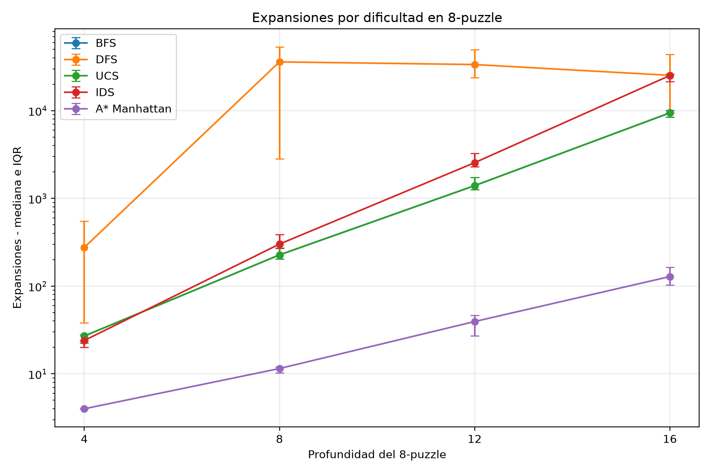

# AI Log - HW1

## Parte 1

### Organización del experimento clásico

**Tool:** ChatGPT

**What I asked:** Tenía dudas sobre cómo organizar la Parte 1 y qué archivos de Week 3 y Week 4 podía reutilizar sin volver a hacer todo desde cero.

**What I got:** Una propuesta de estructura para separar el código, el benchmark, los resultados y las figuras. También se revisó qué archivos venían directamente del repositorio del curso.

**What I did with it:** Organicé el proyecto en `code/`, `results/` y `fig/`. Dejé `search.py`, `gridworld.py` y los bancos de instancias como material reutilizado del curso y lo indiqué en el reporte.

**Did I understand it?** Si, sé qué archivos son del repositorio, cuáles fueron adaptados para el deber y para qué sirve cada parte del proyecto.

### algorithms.py

**Tool:** ChatGPT

**What I asked:** Lo usé para repasar BFS, DFS, UCS, IDS y A*, y para entender cómo conectar lo visto en Week 3 y Week 4 con los experimentos del deber. También pedí ejemplos de código cuando tenía dudas con IDS, A* y las heurísticas.

**What I got:** Explicaciones y ejemplos de código con los algoritmos y las heurísticas `h=0`, misplaced tiles, Manhattan y Manhattan x3.

**What I did with it:** Me guie de la explicación y de los ejemplos, al igual que del `starter.py` de Week 3 y con el código dado en Week 4 para hacer el archivo. También mantengo las funciones que uso en los experimentos y entiendo qué hace cada una.

**Did I understand it?** Si, puedo explicar la diferencia entre las fronteras de BFS, DFS y UCS, cómo IDS aumenta el límite de profundidad y cómo A* combina `g(n)` con una heurística.

### benchmark y CSV

**Tool:** ChatGPT

**What I asked:** Necesitaba medir las variables que pide el deber y no tenía claro cómo guardar también el máximo de la frontera y cómo aplicar un hard timeout por ejecución.

**What I got:** Una propuesta para el benchmark y ejemplos para medir costo, longitud, expansiones, frontera máxima, tiempo y estado de la ejecución. También recibí una forma de usar `multiprocessing` para cortar una prueba cuando supera el timeout.

**What I did with it:** Adapté el benchmark a mis dos dominios y lo ejecuté con un timeout de 5 segundos. La corrida final generó 640 filas en `classical_results.csv`: 631 terminaron y 9 quedaron como `timeout`.

**Did I understand it?** Si, sé de dónde sale cada columna del CSV. También entiendo que un `timeout` no significa que el problema no tenga solución, sino que el algoritmo no terminó dentro del límite que fijamos.

### Revisión de la optimalidad

**Tool:** ChatGPT

**What I asked:** Después de correr el benchmark, usé ChatGPT para revisar qué comparaciones debía hacer para comprobar la parte de optimalidad de UCS, A* y BFS.

**What I got:** Me indicó qué columnas del CSV comparar y por qué BFS puede dar un camino con pocos pasos pero con mayor costo cuando el terreno no es uniforme.

**What I did with it:** Revisé los resultados del CSV. UCS y A* con heurística admisible dieron el mismo costo en las instancias probadas. También revisé el grid 5x5, instancia 3, donde BFS obtuvo costo 5 y UCS costo 3 con la misma longitud de 3 movimientos.

**Did I understand it?** Si, el BFS prioriza la profundidad de pasos, mientras que el UCS compara el costo acumulado. Por eso BFS no tiene la misma garantía cuando cada movimiento puede costar diferente.

### Heurísticas, Manhattan x3 y effective branching factor

**Tool:** ChatGPT

**What I asked:** Quería entender mejor la dominancia entre misplaced tiles y Manhattan, qué pasa al multiplicar Manhattan por 3 y cómo interpretar el effective branching factor `b*`.

**What I got:** Una explicación de la dominancia de Manhattan, del efecto de usar una heurística inadmisible y del cálculo de `b*` usando bisección.

**What I did with it:** Revisé las 40 instancias del 8-puzzle. Manhattan nunca expandió más nodos que misplaced tiles. Con Manhattan x3 encontré 7 soluciones subóptimas. También calculé `b*` para las cuatro heurísticas y comparé los resultados por profundidad.

**Did I understand it?** Si, Manhattan da una estimación más informativa que misplaced tiles. Un `b*` menor indica que A* necesita explorar menos alternativas. Al usar Manhattan x3 se puede reducir el trabajo en algunos casos, pero ya no se conserva la garantía de optimalidad.

### Figuras

**Tool:** ChatGPT

**What I asked:** Pregunté cómo resumir las 10 ejecuciones de cada nivel sin usar una sola corrida y cómo mostrar mediana e IQR en las gráficas.

**What I got:** Un ejemplo de script con pandas y matplotlib para agrupar el CSV por dificultad y generar las barras de IQR.

**What I did with it:** Adapté y ejecuté `generate_figures.py`. Generé cuatro figuras: expansiones del 8-puzzle, tiempo del weighted grid, comparación de heurísticas y effective branching factor. Revisé que todas usaran los datos de la corrida final.

**Did I understand it?** Si, la mediana representa el valor central de las 10 instancias y el IQR permite ver cuánto varían los resultados sin depender de un solo caso.

### Revisión del REPORT.md

**Tool:** ChatGPT

**What I asked:** Primero hice el `REPORT.md` usando los resultados del benchmark y las figuras. Después pedí ayuda para revisar la redacción porque tenía algunas faltas ortográficas, partes que podían explicarse mejor y quería saber si faltaba algún punto importante del deber.

**What I got:** Sugerencias para mejorar la redacción, corregir errores ortográficos, hacer algunas frases más claras y revisar si el análisis cubría los puntos pedidos en la Parte 1.

**What I did with it:** Mantuve mis resultados y el contenido principal del reporte, pero mejoré algunas frases, corregí errores de ortografía y agregué algunas sugerencias que ayudaban a explicar mejor los datos.

**Did I understand it?** Si, el reporte se basa en los resultados que obtuve en mi benchmark.

## Parte 2
### Planificación y elección del backend

**Tool:** Claude

**What I asked:** Le pasé el enunciado del deber y `resources/setup.md`. Pregunté qué era el backend del LLM y si podía avanzar mi parte sin tener todavía la Parte 1

**What I got:** Una explicación de las tres opciones (Ollama local, transcripts manuales o API propia) y la recomendación de usar Ollama con `qwen2.5:3b`. También qué partes del duelo dependían de la Parte 1: los costos óptimos, el A* como herramienta y las mismas instancias.

**What I did with it:** Esperé por la parte 1 mientras comprobé que Ollama funciona

**Did I understand it?** Si, se usó un modelo pequeño local que teníamos instalado y es necesario usar las mismas instancias y el mismo A* para que la comparación sea justa

### Ayuda en el código del duelo

**Tool:** Claude

**What I asked:** Pedí ayuda para guiarme en base a la parte 1 para crear los archivos y en la estructura de los códigos. Cuando algo tuvo error también busqué la forma de resolverlo con ayuda de Claude, entendiendo la causa del error.

**What I got:** Bases para los archivos py, verificación de errores en los archivos y correcciones de código: `duel_problems.py`, `validator.py`, `prompts.py`, `llm.py`, `run_duel.py`, `repro.py`, `analyze.py`, `show_responses.py` y `test_duel.py`. El código usa el A* y las instancias de la parte 1.

**What I did with it:** Verifiqué las partes del código en las que pedí ayuda y ejecuté. Apliqué las sugerencias que dio Claude para corregir cuando el modelo casi nunca llamaba a la herramienta, o cuando algunos errores de Ollama se contaban como timeouts, cuando en realidad el modelo se quedaba repitiendo texto.

**Did I understand it?** Sí. El validador revisa primero si el camino es legal. Si lo es, compara su costo con el óptimo de A* y si es óptimo revisa si el costo que reportó el modelo está bien sumado. Esa fue la parte donde utilicé más ayuda y entendí lo que hice mal al llamar al modelo y que este no utilizara la herramienta.

### Redacción de la Parte 2 del reporte

**Tool:** Claude

**What I asked:** Que me ayudara a redactar la interpretación de los resultados obtenidos para la sección Part 2 de `REPORT.md` y .

**What I got:** Un borrador de la sección Part 2 con los números verificados contra los resultados, que luego edité según fuera necesario

**What I did with it:** En base al borrador fui añadiendo y quitando elementos. También ubicando correctamente las imágenes y títulos del reporte y ampliando la explicación de los resultados obtenidos en la parte 2.

**Did I understand it?** Sí entendí, Claude me ayudó a mejorar la redacción y darme un borrador inicial para reportar los resultados obtenidos. 

## Parte 3

**Tool:** ChatGPT

**What i asked:** Solicité que me ayudara con la explicación de cómo insertar imágenes en un archivo Markdown. Por ejemplo, se utilizó ayuda para escribir referencias como:

Además recomendaciones generales para ciertas redacciones del texto.

**What I got:** Sugerencias para organizar la Parte 3 del REPORT.md, explicaciones sobre cómo insertar imágenes utilizando rutas relativas en Markdown y recomendaciones para redactar de forma más clara las conclusiones y limitaciones del experimento.

**What I did with it:** Utilicé estas sugerencias como apoyo para completar y organizar el reporte final. Usé la explicación de Markdown para insertar correctamente las figuras dentro del REPORT.md. 

**Did I understand it?** Sí. Aprendí a insertar imágenes correctamente en Markdown y a presentar de forma más clara las conclusiones y limitaciones obtenidas a partir de nuestros resultados.