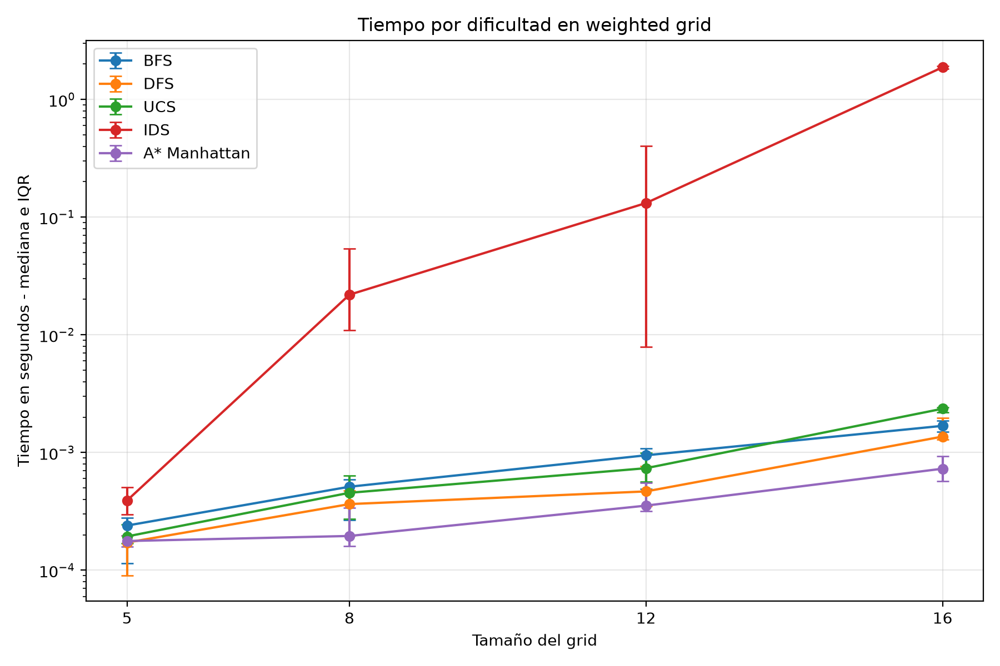
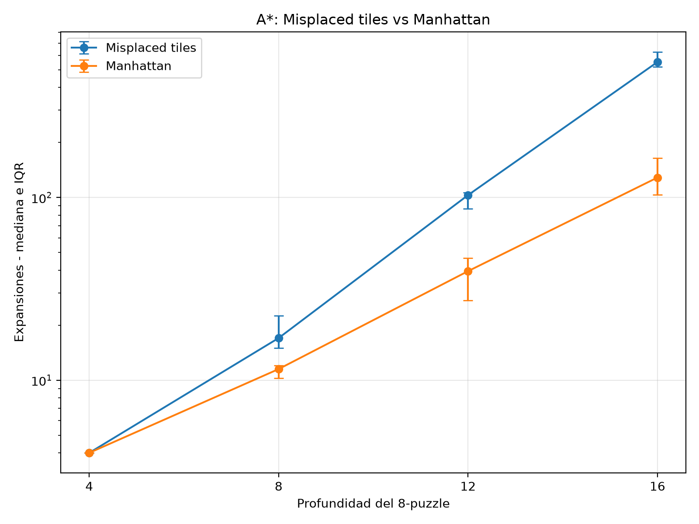
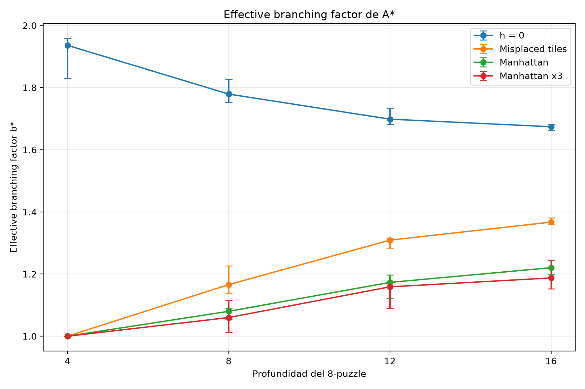
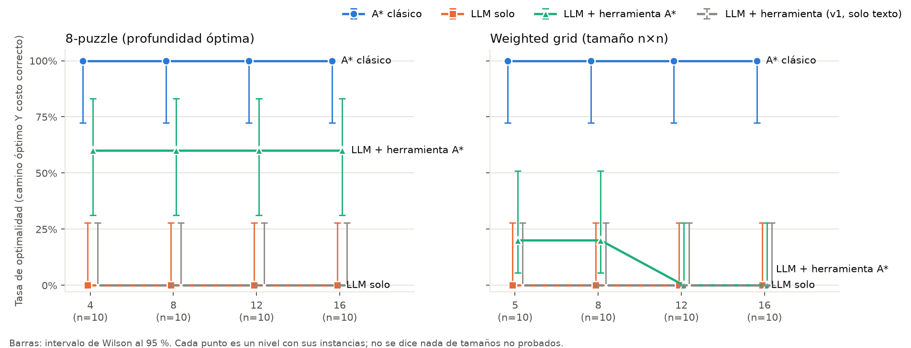
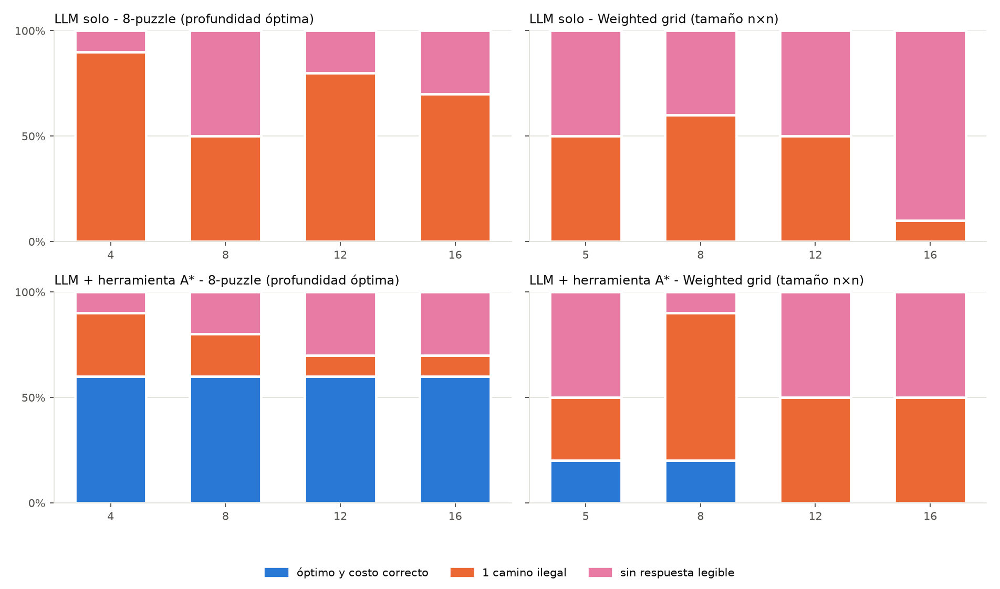
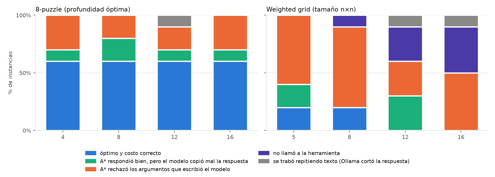

# HW1 - Search

Integrantes: Estefania Solorzano, Daniela Urbina, Sol Segovia.

## Part 1 - Classical comparison

### 1. Configuracion del experimento

Se probaron BFS, DFS, UCS, IDS y A* en dos dominios: 8-puzzle y weighted grid. Para 8-puzzle se usaron profundidades 4, 8, 12 y 16, con 10 instancias por profundidad. Para weighted grid se usaron tamaños 5x5, 8x8, 12x12 y 16x16, tambien con 10 instancias por tamaño.

En cada ejecucion se guardo costo de solucion, longitud, expansiones, tamanio maximo de frontera y tiempo. El hard timeout fue de 5 segundos. Los casos que pasaron ese limite se guardaron como `timeout`. El benchmark genero 640 ejecuciones: 631 terminaron y 9 llegaron al timeout. Todos los timeouts fueron de IDS: uno en 12x12 y ocho en 16x16.

Los resultados completos estan en `results/classical_results.csv`. Las medianas y los IQR de todas las metricas se resumen en `results/classical_summary.csv`.

### 2. Codigo y datos reutilizados

Se reutilizaron sin cambiar su logica:

- `studios/week-03/search.py`
- `studios/week-04/gridworld.py`
- `studios/week-03/instances.json`, renombrado como `instances_8puzzle.json`
- `studios/week-04/instances.json`, renombrado como `instances_grid.json`

### 3. Comparacion general

En 8-puzzle, BFS y UCS tuvieron las mismas medianas de expansiones porque todos los movimientos cuestan 1. A profundidad 16 ambos llegaron a una mediana de 9441.5 expansiones. A* con Manhattan quedo en 128.5. DFS tuvo mucha variacion entre instancias. IDS tambien crecio rapido porque vuelve a recorrer niveles anteriores al aumentar el limite de profundidad.


*Figura 1. Mediana e IQR de expansiones. A* con Manhattan crece mucho menos que BFS, UCS e IDS al aumentar la profundidad.*

En weighted grid, IDS fue el que mas sufrio con tamanios grandes. La mediana de tiempo entre los casos que si terminaron paso de aproximadamente 0.00039 s en 5x5 a 1.88 s en 16x16. Ocho de las diez instancias 16x16 llegaron al timeout.



*Figura 2. Mediana e IQR del tiempo de las ejecuciones resueltas. IDS aumenta mucho mas rapido que los otros algoritmos cuando crece el grid.*

### 4. Optimalidad de UCS y A*

UCS y A* con una heuristica admisible dieron el mismo costo en todas las instancias probadas: 40/40 en 8-puzzle usando Manhattan y 40/40 en weighted grid usando Manhattan escalada por el costo minimo. BFS no tuvo la misma propiedad en el grid porque busca por cantidad de pasos y no por costo del terreno. En 33 de las 40 instancias del weighted grid, BFS devolvio un costo mayor que UCS.

Un caso claro fue el grid 5x5, instancia 3:

```text
.S...
~....
.,G.,
,.,~.
.~~..
```

| Algoritmo | Costo | Longitud |
|---|---:|---:|
| BFS | 5 | 3 |
| UCS | 3 | 3 |

Los dos caminos tienen tres movimientos, pero UCS encuentra el de menor costo. Esto muestra por que BFS deja de ser optimo cuando los costos no son uniformes.

### 5. Dominancia: misplaced tiles vs Manhattan

Se compararon las 40 instancias del 8-puzzle. No hubo ningun caso donde Manhattan expandiera mas nodos que misplaced tiles.

| Profundidad | Misplaced, mediana | Manhattan, mediana |
|---:|---:|---:|
| 4 | 4 | 4 |
| 8 | 17 | 11.5 |
| 12 | 103 | 39.5 |
| 16 | 551 | 128.5 |

La diferencia se hace mas clara al aumentar la profundidad. En profundidad 16, Manhattan redujo la mediana de expansiones de 551 a 128.5, aproximadamente 76.7%.



*Figura 3. Manhattan expande igual o menos nodos que misplaced tiles en las 40 instancias. La diferencia aumenta en los puzzles mas profundos.*

### 6. Manhattan x3

Tambien se probo `h = 3 x Manhattan` para romper la admisibilidad.

En las 40 instancias del 8-puzzle, 7 soluciones fueron suboptimas. La perdida promedio de costo sobre las 40 instancias fue 4.17%. Si se toman solo los 7 casos suboptimos, el aumento promedio del costo fue 23.81%.

Para medir el speedup se calculo, por instancia, `tiempo Manhattan / tiempo Manhattan_x3`. La mediana fue 0.99x, asi que en esta corrida no hubo una mejora de tiempo consistente. Los tiempos son muy pequenos y cambian un poco entre ejecuciones, por eso no conviene interpretar diferencias pequenas como una ventaja real.

En profundidad 16, instancia 3, Manhattan encontro costo 16 con 192 expansiones. Manhattan x3 encontro costo 18 con 64 expansiones. En ese caso hubo 3 veces menos expansiones, pero el costo final empeoro 12.5%.

### 7. Effective branching factor

Se calculo `b*` para A* con las cuatro heuristicas del 8-puzzle: `h=0`, misplaced tiles, Manhattan y Manhattan x3.

| Profundidad | h = 0 | Misplaced b* | Manhattan b* | Manhattan x3 b* |
|---:|---:|---:|---:|---:|
| 4 | 1.936 | 1.000 | 1.000 | 1.000 |
| 8 | 1.779 | 1.166 | 1.080 | 1.060 |
| 12 | 1.698 | 1.309 | 1.173 | 1.159 |
| 16 | 1.674 | 1.367 | 1.220 | 1.187 |

`h=0` tuvo los valores mas altos de `b*`, lo cual tiene sentido porque A* con `h=0` se comporta como UCS y explora muchas mas alternativas. Misplaced tiles mejora frente a `h=0`, pero Manhattan lo mejora en todas las profundidades desde 8 hasta 16.

Manhattan x3 tuvo el `b*` mas bajo de los cuatro casos a partir de profundidad 8. Eso indica que corta todavia mas ramas, pero no conserva optimalidad. Por eso, un `b*` mas bajo no significa automaticamente una mejor solucion: tambien hay que revisar el costo final.



*Figura 4. Comparacion de `b*` para A* con `h=0`, misplaced tiles, Manhattan y Manhattan x3. Manhattan y Manhattan x3 reducen mas la busqueda que misplaced tiles, pero Manhattan x3 pierde admisibilidad.*

## Part 2 - The duel

### 1. Configuracion
Las 80 instancias de la Parte 1 se dieron como texto a `qwen2.5:3b` (Ollama, local; temperatura 0, semilla 0, maximo 1024 tokens), pidiendo terminar con `{"path":..., "cost":...}`. Sistemas: **A\*** de la Parte 1; **LLM solo**; y **LLM + herramienta**, donde el modelo puede llamar a `astar` con el problema como argumento y nosotros corremos nuestro A\* con lo que escribio. Transcripts en `.llm_cache/`.

### 2. Validador
`code/validator.py` nunca consulta al modelo: revisa que el camino sea legal (sale del inicio, llega a la meta, no sale del tablero, pasos entre vecinos; los grids no tienen paredes), recalcula el costo y lo compara con el reportado y con el optimo de A\*. Categorias: **1. ilegal**, **2. legal suboptimo**, **3. optimo con costo mal reportado**, mas "sin respuesta legible". Como prueba, A\* sale 80/80 correcto y BFS "legal suboptimo" en 33/40 grids, igual que en la Parte 1.

### 3. Resultados

| Sistema | Dominio | Optimo | 1. Ilegal | 2. Suboptimo | 3. Costo mal | Sin respuesta |
|---|---|---:|---:|---:|---:|---:|
| A* | 8-puzzle / grid | 40 / 40 | 0 | 0 | 0 | 0 |
| LLM solo | 8-puzzle | 0 | 29 | 0 | 0 | 11 |
| LLM solo | grid | 0 | 17 | 0 | 0 | 23 |
| LLM + herramienta | 8-puzzle | 24 | 7 | 0 | 0 | 9 |
| LLM + herramienta | grid | 4 | 20 | 0 | 0 | 16 |



*Figura 5. Optimalidad por nivel (IC de Wilson 95 %, n = 10). A\* 10/10 y LLM solo 0/10 en todos los niveles; con herramienta, el 8-puzzle se mantiene en 6/10 sin importar la profundidad y el grid cae de 2/10 a 0/10.*

El LLM solo no produjo ningun camino legal, por eso las categorias 2 y 3 estan en cero. En el 8-puzzle saca el espacio vacio del tablero; en el grid, 13 de 17 caminos no empiezan en S. Leer los movimientos como de la ficha o las coordenadas como 1-indexadas no vuelve legal ninguna respuesta. Las respuestas sin JSON que revisamos (33 de 34) llegan al limite de 1024 tokens: el modelo entra en bucles (`U, L, U, L...`, celdas fuera del grid como (2, 36)) y en dos grids escribe codigo Python e inventa su salida (`results/llm_responses.txt`).



*Figura 6. Categorias por nivel. El LLM solo falla por camino ilegal o por quedarse sin tokens; en el grid 16x16 domina lo segundo (9/10).*

### 4. Reproducibilidad

8-puzzle de profundidad 8 n.°1, cinco llamadas identicas salvo la semilla (`results/repro*.csv`):

| Temperatura | Resultados distintos | Detalle |
|---:|---:|---|
| 0.7 | 5 de 5 | 4 caminos distintos, todos ilegales, y 1 sin JSON |
| 0 | 1 de 5 | `RUDLUDULD` las cinco veces, ilegal |

Con temperatura 0 la respuesta es estable, pero sigue siendo incorrecta. En la corrida principal (temperatura 0, semilla 0) esta instancia dio otra salida, sin JSON, asi que tampoco con temperatura 0 hay garantia de obtener lo mismo entre corridas.

### 5. LLM con herramienta

Hubo dos versiones. En la v1 la herramienta se describia en texto: el modelo la llamo 1 vez en 80 y respondio casi siempre `RDRDRUULLD` (0/80 optimos). La v2 usa la API de herramientas de Ollama; la hicimos despues de ver la v1, lo que favorece a este brazo. Los resultados de arriba son de la v2.

| Dominio | Optimo | No llamo | A* rechazo los argumentos | Copio mal la respuesta de A* | Bucle |
|---|---:|---:|---:|---:|---:|
| 8-puzzle | 24 | 0 | 10 | 5 | 1 |
| grid | 4 | 8 | 21 | 5 | 2 |



*Figura 7. Paso en el que falla el brazo con herramienta. Falla al transcribir, no al buscar: en el grid, A\* rechazo lo que escribio el modelo en 21 de 40 casos.*

Con argumentos validos, la respuesta fue optima en 28 de 38 casos y nunca hubo un camino legal suboptimo. Este brazo no hereda la garantia de A\*: depende de que el modelo llame a la herramienta y copie bien el problema y la respuesta.

## Part 3 - Report

### The Duel Scorecard

| Axis | Classical (A*) | LLM | Tool-augmented | Evidence |
|---|---|---|---|---|
| Correctness | 80/80 optimal | 0/80 | 28/80 | `duel_*.csv` |
| Guarantee | Optimal if *h* admissible | None | No end-to-end guarantee | validator + Part 1 |
| Cost | Median 16 expansions (8-puzzle), 26 (grid) | 1 call/instance | Median 2 LLM calls; 74 tool calls/80 | CSVs |
| Latency | 0.00027 s median; 0.00180 p95 | 15.44 s; 45.08 p95 | 6.18 s; 17.21 p95 | `latency_s` |
| Reproducibility | Deterministic | 5/5 distinct at T=0.7; 1/5 at T=0 | Not separately measured | `repro*.csv` |
| Scaling | 100% at all levels | 0% at all levels | 8-puzzle: 60% each; grid: 20%, 20%, 0%, 0% | Fig. 5 |
| Interpretability | Checkable path/cost | Needs external validation | Checkable when tool use is correct | validator |
| Failure mode | None in duel set | Illegal/unreadable output | Bad arguments, missed calls, copying errors, loops | Figs. 6–7 |

### Where we may have been unfair
Manhattan ya había sido ajustada y probada, mientras que el prompt no. Utilizamos `qwen2.5:3b`, un límite de 1024 tokens, un formato JSON estricto y grids sin paredes. No se contabilizó el tiempo de desarrollo de A*. El sistema con herramientas también fue mejorado después de observar la versión 1, lo que pudo favorecer a este enfoque. La distribución también puede favorecer al LLM porque los grids no tienen paredes y los 8-puzzles llegan como máximo a profundidad 16.

### What our evidence does not support
Los resultados no pueden generalizarse a profundidades mayores de 16, cuadrículas superiores a 16x16, ni a otros modelos, prompts o temperaturas. Con diez instancias por nivel, pequeñas diferencias entre niveles no son suficientes para establecer una tendencia general de escalabilidad.
