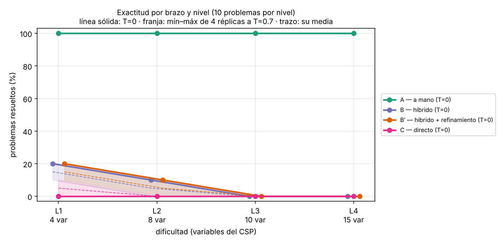
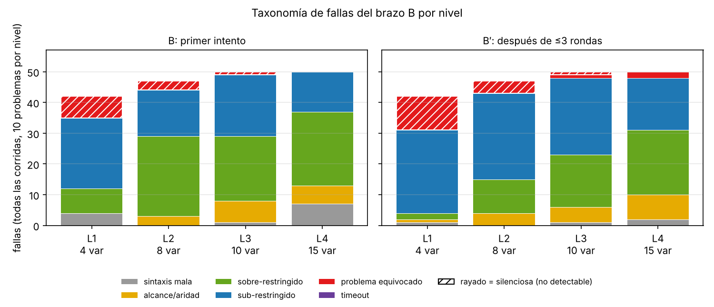
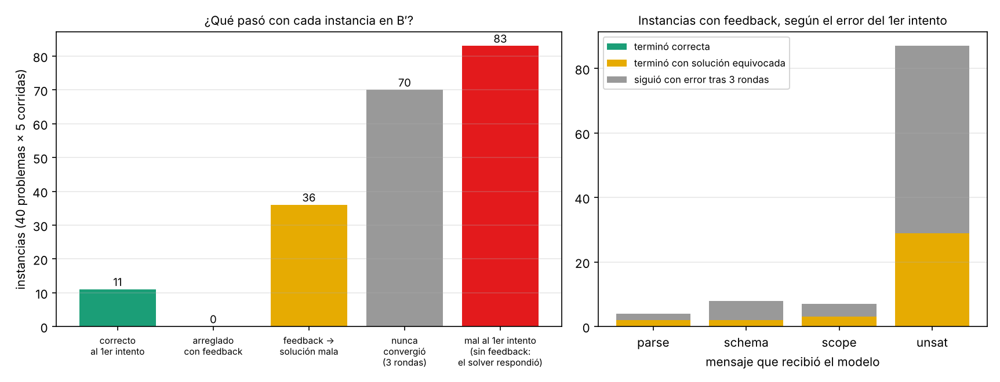
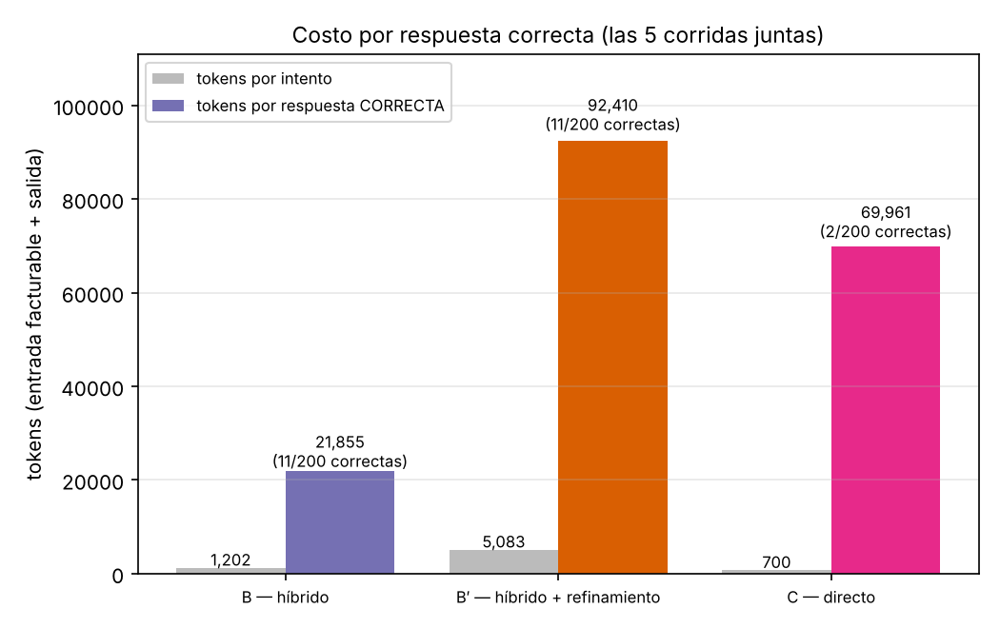
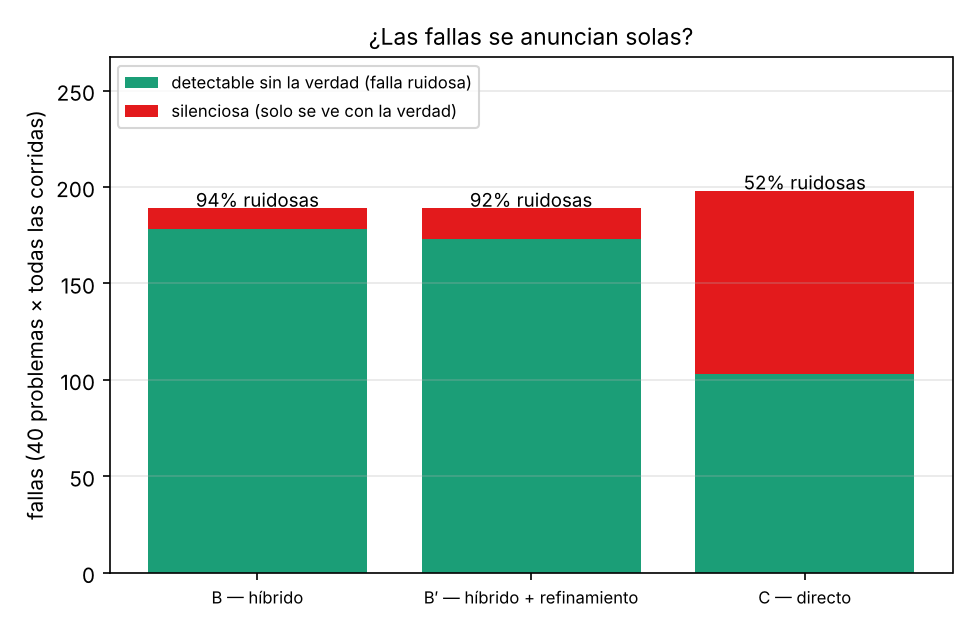

# Duelo 2 — The Formalizer (CSP)

**Kevin Barrera (00333576), Juan Pablo Bastidas (00334808), Ayelén Jaramillo (00335334)** · CMP 4004 Inteligencia Artificial · USFQ, Otoño 2026


**Qué se hizo.** 
Formalismo: CSP, con el solver de la semana 6 generalizado a restricciones binarias (MRV + forward checking; `code/csp_solver.py`). Banco propio de 40 acertijos de casas en fila con respuesta única, en 4 niveles de 4, 8, 10 y 15 variables (10 por nivel; `problems/`). Brazos:

- **A**: el modelo CSP a mano, que también es la verdad.
- **B**: el LLM escribe el CSP en JSON y el solver lo resuelve.
- **B′**: como B, pero cuando el parser o el solver fallan se le devuelve al modelo solo el mensaje de error, hasta 3 rondas.
- **C**: el LLM responde directo.

B y C reciben el mismo ejemplo resuelto. Se hicieron 5 corridas por instancia, una a T=0 (principal) y cuatro a T=0,7 con semillas 1–4 (varianza); 200 intentos por brazo, en `.llm_cache/`.

**Cómo se construyó y verificó la verdad.**
 `code/generate_problems.py` sortea una solución (semilla fija), agrega pistas verdaderas hasta que la solución es única y quita las redundantes. El texto sale de plantillas nuestras y lo revisamos en `problems/PROBLEMS.md`. `code/verify_problems.py` comprueba la verdad, sin el solver ni el parser; enumera todas las asignaciones y encuentra exactamente una, la guardada, en los 40 (`problems/verification.txt`).

## 1. Duel Scorecard

Formato: corrida T=0 · las 5 corridas juntas.

| Eje | A — a mano | B — híbrido | B′ — híbrido + refinamiento | C — directo |
|---|---|---|---|---|
| **Corrección** | 40/40 · 200/200 | 3/40 · 11/200 (réplicas: 2,5–7,5 %) | 3/40 · 11/200 (2,5–7,5 %) | 0/40 · 2/200 (0–2,5 %) |
| **Garantía** | Correcta y única si el modelo es fiel; el solver es completo. | Como A **solo si** el modelo del LLM es fiel (no garantizado). "Sin solución" sí es una prueba. | La de B; el bucle no agrega. | Ninguna. |
| **Costo** (tokens por intento / por correcta) | 0 tokens; 0,13 ms de solver | 1 202 / 21 855 | 5 083 / 92 410 | 700 / 69 961 |
| **Latencia** (mediana / p95, T=0) | 0,13 ms / máx. 1,4 ms | 4,1 s / 23,1 s | 18,6 s / 114,7 s | 3,2 s / 19,9 s |
| **Reproducibilidad** (4 corridas a T=0,7) | determinista | misma respuesta en 15/40 problemas; mediana 2 respuestas distintas | 5/40; mediana 3 | 0/40; mediana 4 (una distinta cada vez) |
| **Escalamiento** (Fig. 1) | plano en 100 % | 20 → 10 → 0 → 0 % | igual a B | 0 % en los 4 niveles |
| **Interpretabilidad** | JSON revisable pista por pista | igual: el error se señala en el JSON | igual + historial de rondas | prosa sin certificado |
| **Modo de falla** | — (no falló) | **ruidosa**: 94 % de las fallas se detecta sola | 92 % detectable | **silenciosa**: 95 de sus 97 respuestas completas están mal y nada lo avisa |

Tiempo del solver en B: 34 ms en total contra 1073 s de LLM; todo el costo es traducción.

## 2. Exactitud vs. dificultad



**Figura 1.** A: 100 % en todo nivel. B y B′: 8/50 en L1, 3/50 en L2, 0/100 en L3–L4 (5 corridas). C: 2/200, ambos en L1. **Conclusión:** no hay "precipicio" porque el modelo de 3B ya está en el piso desde L2; solo baja la curva de B.

## 3. Taxonomía de errores del brazo B

Las 189 fallas de B (primer intento, 5 corridas), clasificadas por `code/taxonomy.py`; la lista completa con la salida del modelo está en `taxonomy.md`. "Detectable" está medido; falla el parser, el solver dice que no hay solución, el modelo admite más de una (el enunciado promete una) o falta un nombre.

| Categoría | Fallas | Detectables sin verdad | El enunciado decía |
|---|---|---|---|
| Sintaxis mala (no parsea) | 12 | **12 (100 %)** | Sí |
| Válido pero sobre-restringido (sin solución) | 79 | **79 (100 %)** | Sí |
| Válido pero sub-restringido (varias soluciones; devolvió otra) | 71 | **71 (100 %)** | A veces |
| Modelo válido del problema equivocado | 11 | **0 (0 %)** | No |
| Alcance / aridad | 16 | **16 (100 %)** | A veces |
| Timeout del solver | 0 | — | Sí |
| **Total** | **189** | **178 (94 %)** | |

Dos "A veces" salieron "siempre"; sub-restringido, porque pedir una segunda solución al solver basta (monitor barato, sin verdad), y alcance/aridad, porque los 16 casos los rechazó el validador o terminaron sin solución. Lo silencioso son solo las 11 de "problema equivocado". Además, de las 11 correctas de B, 9 fueron suerte; el modelo estaba sub-restringido y el solver devolvió justo la buena.



**Figura 2.** Rayado = silencioso. **Conclusión:** en L1 domina lo sub-restringido (olvida pistas o el alldiff); desde L2, lo sobre-restringido (inventa igualdades). Lo silencioso se concentra en L1.

**Causas** (al comparar con el modelo a mano; una falla puede tener varias):

- `offset` con la dirección invertida: 103/189.
- `eq` inventado, típicamente "next to" o "immediately left" traducido como igualdad: 91/189.
- Al menos una pista perdida: 83/189.
- alldiff de un grupo omitido: 14/189.

**Ejemplos tal cual** (recortados):

**(1) L1-02, T=0, sub-restringido, detectable.** "Raul's house is immediately to the left of Elena's house."
```
{"type": "eq", "a": "Nora", "b": 3},
{"type": "offset", "a": "Raul", "b": "Elena", "k": 1}
```
Falta el `alldiff` (la salida pone a Elena y Hugo en la casa 1) y el `offset` está invertido (Raul = Elena + 1). Hay ≥2 soluciones, lo detecta el monitor de unicidad.

**(2) L1-05, T=0, sobre-restringido, detectable.** "Sara's house and Nora's house are next to each other."
```
{"type": "alldiff", "vars": ["Paula", "Mateo", "Sara", "Nora"]},
{"type": "eq", "a": "Sara", "b": "Nora"},
```
"Vecinas" se tradujo como "en la misma casa", lo que contradice el alldiff. El solver **prueba** que no hay solución.

**(3) L1-04, rep 1, problema equivocado, SILENCIOSO.** "Nora … left of Dev", "Raul … immediately left of Nora", "Sara … left of Raul".
```
{"type": "offset", "a": "Nora", "b": "Dev", "k": 1},
{"type": "offset", "a": "Raul", "b": "Nora", "k": 1},
{"type": "offset", "a": "Sara", "b": "Raul", "k": 1}
```
Las tres relaciones están invertidas: el modelo describe el espejo del acertijo, con una única solución (Dev=1, Nora=2, Raul=3, Sara=4), la verdad al revés. Ningún monitor sin verdad lo nota.

**(4) L1-08, T=0, sintaxis, detectable.**
```
{"type": "offset", "a": "Carla", "b": "Raul"}
```
Falta `k`, y el validador responde "constraint #2 (offset) is missing field 'k'". Fue el error de esquema más común (8 de 12).

**(5) L3-07, T=0, alcance, detectable.** El modelo declaró 8 de las 10 variables (faltan Raul y Paula) y luego escribió `{"type": "lt", "a": "green", "b": "Paula"}`. El validador rechaza la restricción porque `b='Paula'` no es una variable declarada.

**(6) L2-02, T=0, sobre-restringido que el refinamiento vuelve sub-restringido.** El primer intento tenía `eq(Kai, white)` y `offset(Kai, white, 1)`: "immediately left" traducido dos veces, ambas mal. Tras "no solution", el modelo **resuelve en prosa** ("Kai's house must be house 2"), escribe `{"type": "eq", "a": "Kai", "b": 2}` y borra los alldiff: devuelve a Ana, Kai y Dev en la misma casa 2.

## 4. Análisis del refinamiento (B vs. B′)

**El delta B → B′ es cero: 3/40 → 3/40 a T=0 y 11/200 → 11/200 en total.**



**Figura 3.** **Conclusión:** de las 106 instancias que recibieron feedback (87 por "no solution", 19 por parse, esquema o alcance), ninguna terminó correcta. El 66 % (70) nunca convergió en 3 rondas y el 34 % (36) salió del error hacia una solución equivocada.

- **Distribución de rondas hasta el éxito.** 0 en 1 ronda, 0 en 2, 0 en 3. Las 11 correctas de B′ son las mismas 11 de B, correctas al primer intento.
- **Qué nunca convergió.** 70 instancias (31 de L4, 4 de L1). En 15 el modelo devolvió el mismo conjunto de restricciones tras 3 rondas. Las respuestas se alargan (mediana de 857 a 2 311 caracteres, razonando en prosa) y 39 se cortaron en el tope de 1 500 tokens.
- **Lo que "se arregló" en 1 ronda es otra clase de falla.** De las 36 que salieron del error, 31 terminaron con un modelo de varias soluciones y 16 borraron un alldiff entero, el modelo no encuentra la restricción mala, quita restricciones hasta que el solver encuentra algo. Lo que sobrevive 3 rondas son errores de comprensión (dirección del `offset`, "vecino" como igualdad) que repite; lo que "se resuelve" en una es borrar.
- **Consecuencia.** Con 3B, "no solution" sirve de alarma, no de señal de aprendizaje. El bucle convierte fallas unsat en modelos con varias soluciones; 31 siguen detectables por unicidad, 5 se volvieron silenciosas (B′ 92 % detectable vs. B 94 %).

## 5. Costo por respuesta correcta

Entrada facturable = máx(conteo de Ollama, caracteres/4), porque Ollama no recuenta el prefijo en caché y un proveedor sí lo cobra. Precios (nov. 2026): Together Qwen2.5-7B-Instruct-Turbo, $0,30/$0,30 por millón y Groq Llama-3.1-8B-Instant, $0,05/$0,08. Las 5 corridas juntas:

| Brazo | Correctas | Tokens / intento | Tokens / correcta | USD / 1 000 correctas (Together · Groq) | Segundos de LLM / correcta |
|---|---|---|---|---|---|
| A | 200/200 | 0 | 0 | $0 · $0 (0,13 ms de CPU) | 0 |
| B | 11/200 | 1 202 | 21 855 | $6,56 · $1,31 | 98 |
| B′ | 11/200 | 5 083 | 92 410 | $27,72 · $5,46 | 384 |
| C | 2/200 | **700** | 69 961 | $20,99 · $4,51 | 441 |



**Figura 5.** **Conclusión:** C es el más barato por intento (700 tokens) pero por correcta cuesta 3,2× lo que B; con T=0 sola, su costo por correcta es infinito. B′ cuadruplica el costo por intento sin comprar ni una correcta más. El costo humano de A no está en la tabla (§7).

## 6. La comparación que importa: ¿cuántas fallas se anuncian?



**Figura 4.** De las 198 fallas de C, 103 (52 %) "se detectan" solo porque la respuesta está incompleta o es imposible (dos personas en una casa), un chequeo de formato. De sus 97 respuestas completas y bien formadas, 95 están mal sin ninguna señal. En B, 178/189 (94 %) se anuncian (parse, unsat, scope, no única); las 11 silenciosas son modelos coherentes de otro problema, como el espejo del ejemplo 3.

**Consecuencia de ingeniería.** Con monitores (parse, unsat, unicidad, cobertura), B se abstiene en vez de mentir, a T=0 ninguna respuesta pasó los monitores (0 errores silenciosos); en las 5 corridas pasaron 13, 2 correctas. C, con el único monitor que admite (formato), entregaría 97 respuestas, 95 equivocadas. Un sistema que se abstiene se puede poner detrás de un humano; uno que se equivoca con seguridad, no.

## 7. Dónde pudimos haber sido injustos

- **El prompt favorece errores de dirección.** `offset` es "A = B + k", pero el texto dice "X is immediately to the left of Y" y el modelo copia el orden (a=X, b=Y), invirtiendo la relación: 103 de 189 fallas. Un tipo `left_next(A, B)` en el orden del texto probablemente bajaría este error; no lo probamos. A no sufre la trampa porque lo escribimos nosotros.
- **El prompt no se iteró, y el de C tiene un defecto conocido.** Pide mapear "every person, colour and pet" también en L1, donde no hay colores ni mascotas: en 13 de 50 respuestas de L1 el modelo agregó nombres que no están en el enunciado (a veces los colores del ejemplo). Los nombres de más no cuentan como error, pero la instrucción confunde. Escribimos una corrección tras la prueba, pero la corrida final usó la versión original (lo comprobamos en `.llm_cache/`), así que el código entregado es el que se corrió.
- **A es un techo por construcción**: su modelo sale de la misma estructura que generó el texto. Su costo real es humano (generador, plantillas, verificación).
- **Un solo dominio con texto de plantilla**, más regular que el lenguaje real; eso debería *ayudar* al LLM.
- **Un modelo de 3B** no representa a "los LLM"; con 0–20 % de acierto la señal está en *cómo* falla.
- **Tope de 1 500 tokens**: cortó 2/200 respuestas de C y 39 de B′.
- **Emparejamiento de nombres tolerante** a favor del modelo (`red_house` = `red`). La reproducibilidad a T=0 no se midió dos veces (la caché repite la respuesta).

**Lo que la evidencia no respalda:** que B′ nunca ayude (con un modelo mayor o con feedback de unicidad podría funcionar); que el 94 % de detectabilidad valga para otros dominios; ni ningún resultado sobre problemas de más de 15 variables.

## 8. Recomendación

**Para este acertijo con un modelo de 3B, no despliego ningún brazo como respondedor automático.** De las arquitecturas, la que entregaría es B con monitores y abstención, y nunca C.

- **Por qué B.** Es el único brazo con LLM que *sabe cuándo no sabe* (94 % de fallas ruidosas contra 0 de las 95 respuestas completas y erróneas de C) y el más barato por correcta ($1,31–6,56 por 1 000).
- **Monitores que adjuntaría:**
  1. Fallo de parse o esquema.
  2. Unsat o timeout del solver.
  3. **Unicidad**: pedir 2 soluciones. Solo este monitor atrapó 71 fallas y los 9 aciertos por suerte.
  4. Cobertura: cada nombre del enunciado tiene variable.
  5. Una alarma por tasa de abstención, con este modelo fue del 94 % (187 de 200), lo que indica que hay que cambiar de modelo, no de prompt.
- **Qué no agregaría.** El bucle B′ tal como está: cuadruplica el costo, no aporta aciertos y silencia 5 fallas ruidosas. Si se usa, hay que re-verificar unicidad en cada ronda.
- **Lo que queda sin monitor.** Las fallas "espejo" (11/189) solo se atrapan leyendo el JSON contra el texto: revisión humana por muestreo de lo que pasa los monitores, que serían pocas respuestas.
