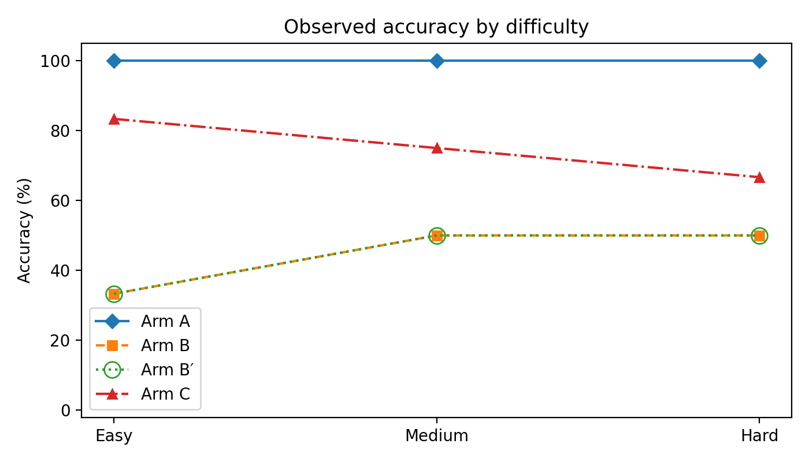
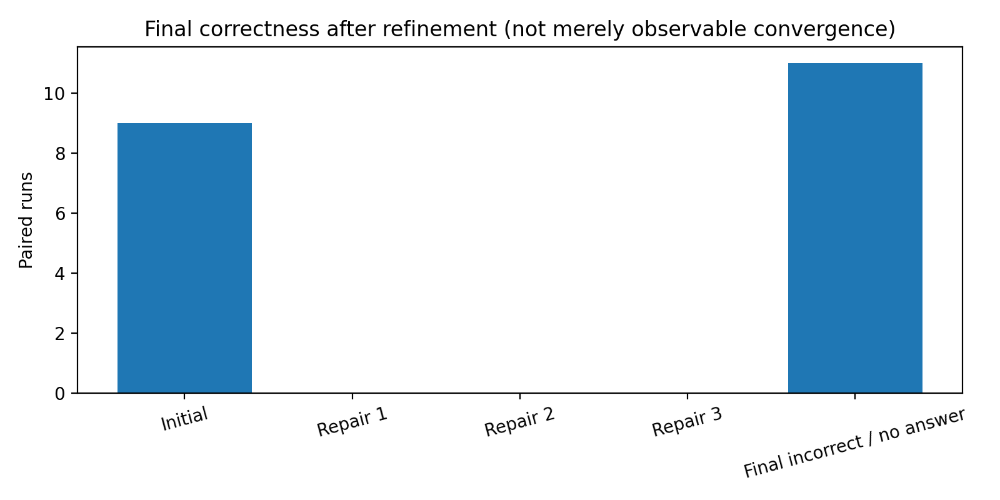
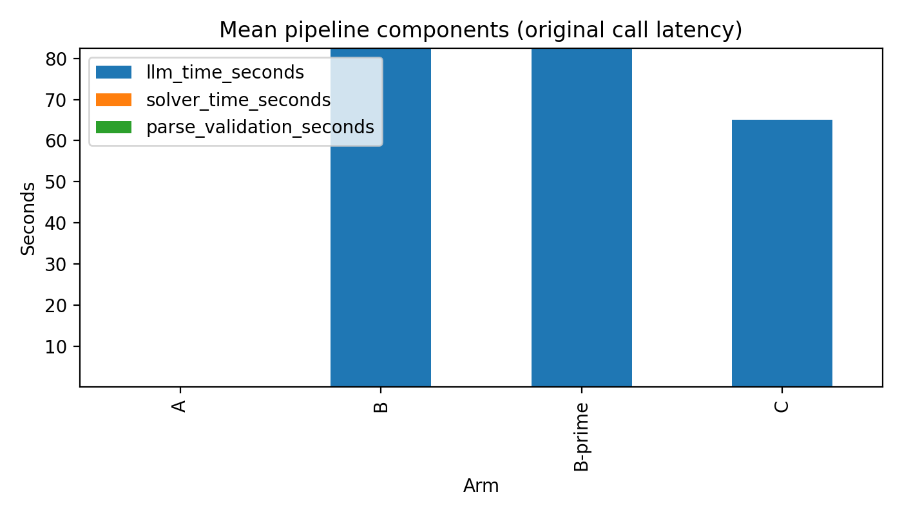

# Homework 2 — The Formalizer (SAT)

Team members: [complete with existing studio-group names]

## 1. Duel Scorecard

| Metric | A | B | B′ | C |
| --- | --- | --- | --- | --- |
| Accuracy | 1 | 0.45 | 0.45 | 0.75 |
| Correct answers | 60 | 9 | 9 | 15 |
| Incorrect answers | 0 | 11 | 11 | 5 |
| No answers | 0 | 0 | 0 | 0 |
| Mean wall-clock (s) | 8.49468e-05 | 82.5135 | 0.00055377 | 65.0719 |
| Mean solver time (s) | 6.31793e-05 | 0.000570817 | 0.000570817 | 0 |
| Mean LLM time (s) | 0 | 82.5052 | 82.5052 | 65.0651 |
| Total tokens | 0 | 7518 | 7518 | 4877 |
| Total cost (USD) | 0 | N/A | N/A | N/A |
| Cost per correct (USD) | 0 | N/A | N/A | N/A |

Accuracy is correct / all attempts; no-answer counts against accuracy and is also reported separately. N/A denotes undefined or unpriced quantities. Pending arms: none. These are not zero-accuracy arms.

## 2. Experimental Methodology

The 20 supplied Spanish problems and their CNF references were copied byte-for-byte. There are six easy, eight medium and six hard instances, balanced overall between SAT and UNSAT. Every documented SAT witness was checked independently. Exhaustive truth tables verified every status and agreed with the unmodified Week 7 DPLL engine. No reference was corrected. Validation concerns CNF and witnesses; it does not independently prove that every Spanish premise was encoded faithfully.

| Difficulty | Variables (range) | Clauses (range) | Mean literals | Mean clause length | Unit fraction |
| --- | --- | --- | --- | --- | --- |
| easy | 4–4 | 4–5 | 7.83333 | 1.74167 | 0.258333 |
| medium | 6–6 | 6–8 | 14 | 1.93527 | 0.0982143 |
| hard | 8–8 | 9–12 | 20.1667 | 1.98796 | 0.0472222 |

DPLL performs unit propagation, pure literal elimination, conflict detection and backtracking. A POSIX deadline adapter reports SAT, UNSAT, TIMEOUT or ERROR and checks returned witnesses. The vendored source is unchanged; its hash and dataset hashes appear in experiment metadata. The default deadline is 10 seconds. Tests also compare randomized formulas against an exhaustive oracle.

Actual execution: A: 60 runs, 20 instances, 3 repeats; B: 20 runs, 20 instances, 1 repeats; B-prime: 20 runs, 20 instances, 1 repeats; C: 20 runs, 20 instances, 1 repeats. Repetitions are repeated measurements of the same 20 problems, not additional independent problems. The solver is deterministic; repeated solver runs quantify timing variation only. Model configuration: [{"provider": "ollama", "model": "llama3.1:latest", "model_size": "8.0B; Q4_K_M", "temperature": 0.0}] Measured LLM settings: {"timeout": 300.0, "max_tokens": 2048, "solver_timeout": 10.0, "seed": 20261118, "temperature": 0.0}

A separate real preflight call timed out after 120 seconds and is preserved in results/pilot_timeout120; the subsequent protocol uses a 300-second LLM deadline. This failed preflight is not pooled into main-protocol accuracy.

A uses the reference CNF. B receives only the Spanish prompt and variable map and generates strict JSON CNF. B′ reuses exactly B's first response and performs at most three repairs. C receives the Spanish prompt and a JSON answer format. Default temperature is zero, output budget 2048 tokens, request timeout 120 seconds and prompt version sat-v1. Optional seeds vary by repetition; provider determinism is not guaranteed. Exact configuration, environment and timestamps are recorded per campaign.

Raw responses, prompts, usage and provenance are persisted. Tokens come from provider usage when available, otherwise a labeled characters/4 estimate. Cache keys include model, endpoint, prompt, parameters, seed and repetition. Original model latency is kept separate from file access and observed invocation wall time. Pipeline time includes the shared initial B attempt for B′; measured B′ invocation wall time may exclude work already completed by B. Arm costs are standalone-policy estimates, while the physical call ledger avoids double-counting shared generations.

## 3. Accuracy vs Difficulty

A/easy: 100.0% (18 runs); A/hard: 100.0% (18 runs); A/medium: 100.0% (24 runs); B/easy: 33.3% (6 runs); B/hard: 50.0% (6 runs); B/medium: 50.0% (8 runs); B-prime/easy: 33.3% (6 runs); B-prime/hard: 50.0% (6 runs); B-prime/medium: 50.0% (8 runs); C/easy: 83.3% (6 runs); C/hard: 66.7% (6 runs); C/medium: 75.0% (8 runs). Missing series are explicitly marked pending. More variables and clauses support structural difficulty labels but do not prove computational hardness. This small dataset cannot establish causal effects of difficulty.

## 4. Error Taxonomy

See [taxonomy.md](taxonomy.md) for all categories, available verbatim examples and the production/analysis distinction. Every flagged attempt is saved in results/errors.csv. Exhaustive solution-set inclusion distinguishes over-constraint, under-constraint and incomparable models. Identical SAT/UNSAT status is weaker than semantic equivalence. Quantifier scope/arity is not applicable here.

| Arm | Failed attempts | Observable failures | Detection rate |
| --- | --- | --- | --- |
| B | 11 | 0 | 0 |
| C | 5 | 0 | 0 |

20 flagged B cases are currently recorded. B: 20 silent semantic mismatches; B-prime: 20 silent semantic mismatches. If B has not run, this is an absence of evidence. UNSAT is a legitimate observation and never itself proves mistranslation. C's free-text explanations are retained but no unverifiable contradiction detector is claimed.

## 5. Refinement Analysis

Paired accuracy difference B′ − B: 0 percentage points across 20 pairs. Outcomes: {'initial_success': 9, 'silent_incorrect': 11}. Improvements: 0; regressions: 0. Observable non-convergence: 0.0%; exhausted three-repair budgets: 0.0%. Status-incorrect cases that stopped without a detectable error: 11. Repaired initial categories: {}; persistent status-failure categories: {'Valid syntax, under-constrained': 10, 'Valid syntax, over-constrained': 1}.

Only observable parser/schema errors, solver errors and solver deadlines trigger correction. Infrastructure failures stop and remain separately labeled. Valid SAT and UNSAT both terminate the loop. Consequently, silent semantic failures are not repaired by this policy. The refinement CSV distinguishes observable convergence, real correctness, iteration count and exhausted budgets. Repair-specific effects require real B/B′ observations.

## 6. Cost Accounting

Token cost is input tokens × input price / 1,000,000 plus output tokens × output price / 1,000,000. Local compute may instead use measured model seconds × configured hourly price / 3600. Prices, source and date are external configuration; no current tariff is assumed. Missing tariffs remain N/A. Cost per correct answer includes all attempts and repairs and is undefined when there are no correct answers. A has zero LLM token cost; hardware/energy costs are not claimed to be zero and are outside this accounting.

Physical provider requests: 46. Physical estimated monetary cost: N/A USD. B and B′ standalone costs must not be added to estimate actual experiment spending because their initial generations are shared.

## 7. Where We May Have Been Unfair

The dataset is small, synthetic, balanced and Spanish-only. Related SAT/UNSAT pairs may reduce effective diversity. Hand-written references have a strong information advantage. Labels reflect structure rather than proven hardness. Low temperature reduces diversity but cannot guarantee reproducibility. Translation and direct-answer prompts impose different cognitive and output burdens, despite equal generation budgets. Repeated outputs are clustered by instance; no significance claim treats 60 runs as 60 problems. SAT/UNSAT accuracy can hide semantically wrong translations. Our conservative repair policy leaves valid but wrong models untouched and does not test alternative UNSAT-review policies. Deadline behavior and timing depend on hardware and provider load. Arms run in a fixed sequential order, so warm-up and provider prompt-cache effects may influence latency; no random-order latency claim is made. API errors are infrastructure failures, not evidence of poor SAT reasoning. Real model results and five examples remain unavailable until a provider is configured if those arms are pending.

## 8. Deployment Recommendation

The validated hand-model pipeline is the only empirically supported choice when trusted CNF specifications are already available. This does not establish the best architecture for unseen natural-language inputs. Among observed LLM runs, C has the highest accuracy (75.0%; ties resolved by listing order). This is descriptive, not a significance result. Compare coverage and silent failures before deployment. Selection among B, B′ and C requires completed accuracy, silent-error, latency and cost measurements. A deployed translator should retain raw outputs, validate schemas and witnesses, monitor timeouts and provider failures, and use independent semantic review or clarification for high-impact specifications. Refinement can address observable failures, but valid-looking translations still require monitoring; superiority of B′ is not assumed.

## 9. Conclusion

The supplied references and reused DPLL are independently validated. The LLM campaign is incomplete; observed metrics describe only the reported coverage and do not establish a full-dataset comparison.
