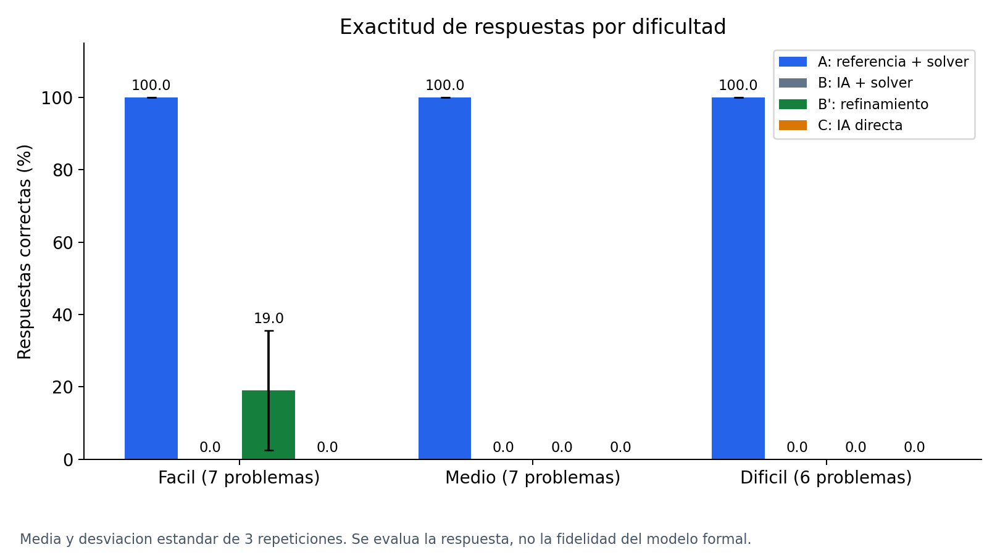
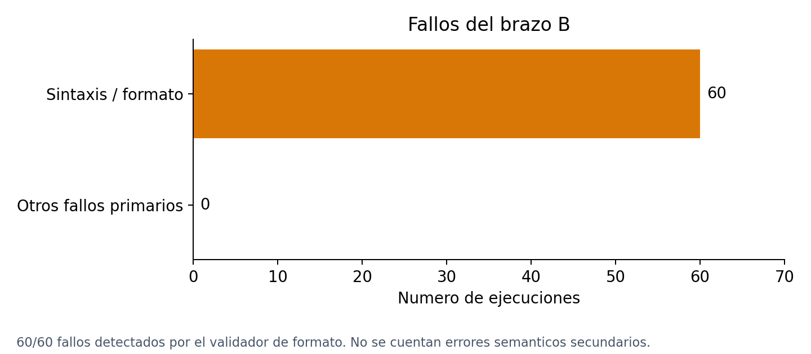
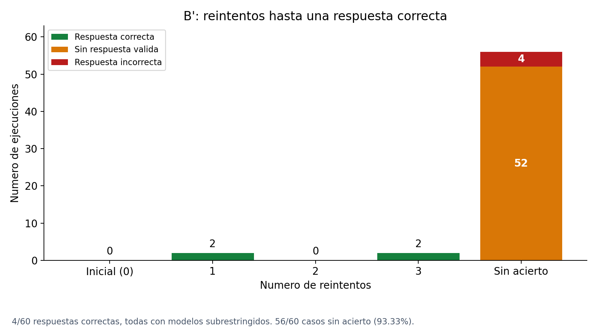

# HW2 - The Formalizer

**Integrante:** Antonio Munoz.
**Formalismo:** SAT en CNF. **Solver:** DPLL de la semana 7.
**Modelo:** `llama3.2:3b`, aproximadamente 3 mil millones de parametros, ejecutado localmente mediante Ollama.

## 1. Dataset y protocolo

Se construyeron 20 problemas SAT de seleccion de actividades, todos satisfacibles. Cada variable indica si se incluye una actividad. Las condiciones abarcan obligaciones, prohibiciones, implicaciones, incompatibilidades, equivalencias y cardinalidad. Se acepta cualquier asignacion completa valida.

Dificultad por numero de variables: 7 casos faciles (3-4), 7 medios (5-6) y 6 dificiles (7-8), con espacios de 8 a 256 asignaciones. Mide tamano, no esfuerzo de DPLL. El dataset incluye cantidades de premisas y clausulas.

La IA elaboro enunciados, CNF y justificaciones. Se comprobaron las 1552 asignaciones del conjunto y los testigos con DPLL; el estudiante confirmo la revision manual. A utiliza una referencia asistida por IA y revisada. Detalles en `AI_LOG.md`.

Se compararon A (referencia + solver), B (IA + solver), B' (refinamiento) y C (IA directa): 3 repeticiones por problema, 240 resultados. Configuracion fija: temperatura 0, semilla 42 y 2048 tokens. El prompt solicita JSON; el parser lo valida estrictamente, sin generacion restringida ni reparacion automatica.

Orden: A, B, B', C. B' reutiliza el intento de B y permite 3 reparaciones adicionales. Recibe errores de formato o UNSAT e historial, nunca el ground truth. Termina ante SAT, aunque la respuesta sea incorrecta; no reintenta errores de conexion.

`results/results.csv` contiene 240 resultados; `results/attempts.csv`, 409 registros, incluidos los iniciales compartidos. Se miden tiempo total, tiempo de IA, tiempo de solver y tokens. `.llm_cache/` conserva las respuestas originales y pruebas previas de SAT-01 excluidas de los CSV.

## 2. Duel Scorecard

| Medida | A | B | B' | C |
|---|---:|---:|---:|---:|
| Ejecuciones | 60 | 60 | 60 | 60 |
| Correctas | 60 | 0 | 4 | 0 |
| Incorrectas | 0 | 0 | 4 | 0 |
| Sin respuesta valida | 0 | 60 | 52 | 60 |
| Exactitud | 100% | 0% | 6.67% | 0% |
| Tiempo total acumulado (s) | 0.004377 | 606.330498 | 1754.417582 | 219.016132 |
| Tiempo de IA acumulado (s) | 0 | 606.259529 | 1754.148913 | 218.946686 |
| Tiempo de solver acumulado (s) | 0.003410 | 0 | 0.000182 | 0 |
| Tokens de entrada | No aplica | 21570 | 346488 | 20010 |
| Tokens de salida | No aplica | 81857 | 205282 | 13122 |

La exactitud evalua la respuesta final; el formato invalido cuenta como sin respuesta. B'-B = **6.67 puntos porcentuales**.



B' acierta 4/21 ejecuciones faciles (19.05%) y ninguna media o dificil. Por repeticion: 0%, 10% y 10%; media 6.67%, desviacion estandar muestral 5.77 puntos. Las otras series no variaron. Repetir los mismos problemas no equivale a 60 instancias independientes.

## 3. Taxonomia y detectabilidad

Los 60 fallos de B son de formato y ocurren antes de DPLL; su tiempo de solver es cero. `taxonomy.md` documenta cada fallo, repeticion, error y salida completa.

| Categoria primaria en B | Cantidad | Detectable sin ground truth |
|---|---:|---|
| Sintaxis/formato invalido | 60 | Si, por el validador |
| Modelo valido sobre-restringido, UNSAT | 0 | Si para UNSAT; su causa requiere revision |
| Modelo valido subrestringido, respuesta incorrecta | 0 | No garantizado; varias soluciones pueden ser legitimas |
| Modelo valido de otro problema | 0 | No, en general |
| Alcance de cuantificadores / aridad | 0 | No aplica como categoria independiente al SAT proposicional utilizado |
| Timeout del solver | 0 | Detectable con un limite temporal; no se implemento uno para DPLL |

Los ceros no descartan errores semanticos: ninguna salida de B supero el parser. Las observaciones semanticas se registran como secundarias, sin doble conteo.



### Cinco ejemplos textuales anotados

Fragmentos literales de B, repeticion 1:

**SAT-01:**

```text
[[1], [2]],  // Incluye concierto y taller
```

Markdown, comentarios no validos en JSON y un nivel extra de listas.

**SAT-02:**

```text
Para resolver este problema, necesitamos traducir las condiciones del evento a CNF (Conjunto Normal). Las condiciones son:
```

Prosa en lugar de JSON; el desarrollo tambien altera la eleccion exclusiva y la prohibicion.

**SAT-03:**

```text
2. (taller AND concurso)
```

Convierte taller implica concurso en una conjuncion que obliga a ambos. La salida es prosa repetitiva.

**SAT-04:**

```text
1. Se incluye cine si y solo si se incluye debate.
```

No devuelve JSON. Desarrolla dos implicaciones con el mismo antecedente y consecuentes opuestos, en lugar de las dos direcciones de la equivalencia.

**SAT-05:**

```text
- Taller: incluido (1)
- Conferencia: incluido (2)
```

Incluye ambas pese a exigir exactamente una; mezcla prosa y negacion simbolica no admitida como entero JSON.

### Comparacion con C

C tiene 60/60 fallos de formato detectables sin ground truth. No hubo asignaciones bien serializadas incorrectas para evaluar la deteccion de errores de razonamiento. El protocolo no extrae respuestas de la prosa.

B no supera a C en detectabilidad: ambos fallan de forma observable. Validar el formato permite rechazar salidas inutilizables, pero no verifica su significado.

## 4. Analisis del refinamiento



| Resultado de B' | Ejecuciones |
|---|---:|
| Acierto inicial, sin reparaciones | 0 |
| Acierto tras 1 reparacion | 2 |
| Acierto tras 2 reparaciones | 0 |
| Acierto tras 3 reparaciones | 2 |
| Sin respuesta valida tras 3 reparaciones | 52 |
| Respuesta incorrecta sin error del solver | 4 |

B' no acierta en 56/60 casos (93.33%): 52 agotan tres reparaciones con errores de formato y 4 terminan con respuestas incorrectas pese a SAT. Tres fallos silenciosos aparecen tras una reparacion y uno tras dos.

Los aciertos son SAT-02 tras una reparacion y SAT-01 tras tres, en las repeticiones 2 y 3. Sus formulas respectivas, `[[-1, 2, 3]]` y `[[1, 2, -3]]`, permiten siete asignaciones; cada problema admite solo una. DPLL devuelve esa asignacion por coincidencia: son aciertos de respuesta, no formalizaciones fieles.

Las reparaciones tempranas logran modelos ejecutables demasiado permisivos; los casos persistentes siguen fallando principalmente en formato. Convergencia sintactica no implica correccion semantica.

## 5. Costo por respuesta correcta

Costo local estimado = tiempo acumulado de IA + solver de todos los intentos / respuestas correctas. Es tiempo de ejecucion, no dinero ni energia.

| Brazo | Tiempo IA + solver acumulado (s) | Segundos por acierto |
|---|---:|---:|
| A | 0.003410 | 0.000057 |
| B | 606.259529 | Sin costo finito: cero aciertos |
| B' | 1754.149095 | 438.537274 |
| C | 218.946686 | Sin costo finito: cero aciertos |

B' consume 7.31 minutos por acierto. Su costo incluye el intento compartido con B: debe descontarse al sumar el consumo conjunto. A excluye el trabajo humano de formalizacion y revision.

## 6. Where we may have been unfair

- A usa CNF asistidas por IA y revisadas, no formalizaciones humanas independientes.
- Solo se probo un modelo de 3B, con 20 problemas pequenos, similares y satisfacibles.
- El parser estricto penaliza prosa y Markdown; no se probaron esquemas ni extraccion tolerante.
- El orden fijo, la carga de Ollama y las pausas afectan tiempos; igual semilla no garantiza determinismo.
- Un acierto no demuestra equivalencia del modelo, como muestran los cuatro aciertos de B'.
- Ollama tiene timeout de 120 s; DPLL no tiene limite propio. No se evaluo la deteccion de timeouts del solver.
- La detectabilidad observada corresponde al formato; los errores semanticos requieren contrastar el enunciado.

## 7. Recomendacion

Desplegaria A con modelos revisados: 60/60 aciertos. Monitorearia UNSAT y tiempos, validaria entradas y revisaria los modelos al cambiar las condiciones. Su costo medido excluye la formalizacion humana.

B y C no produjeron respuestas utilizables. B' obtuvo 4/60 aciertos con modelos incorrectos: solo lo usaria como asistente con revision semantica, registrando salidas, errores, reintentos, tokens y tiempos. DPLL verifica las clausulas recibidas, no su fidelidad al enunciado.