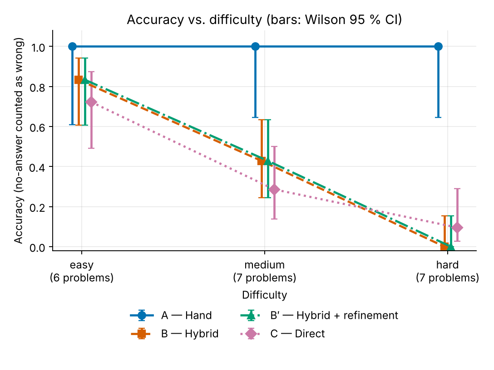
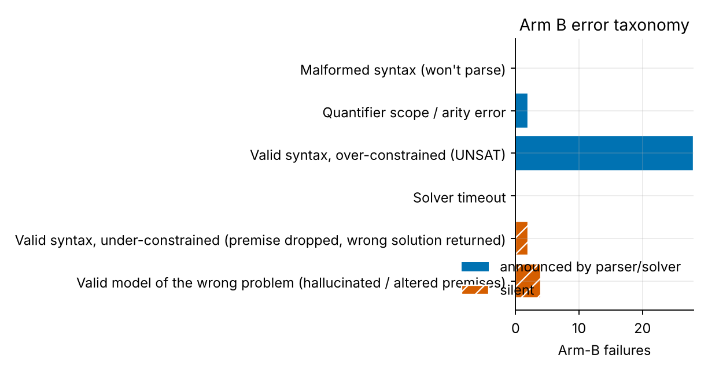
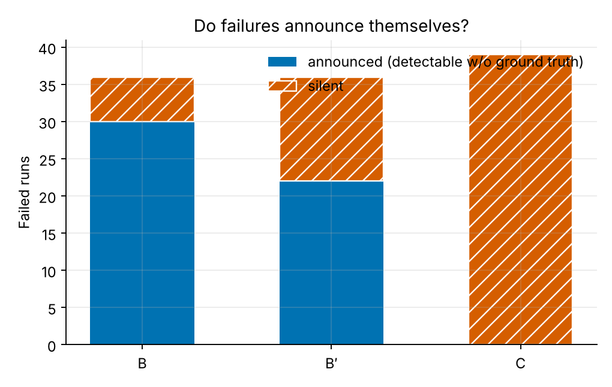
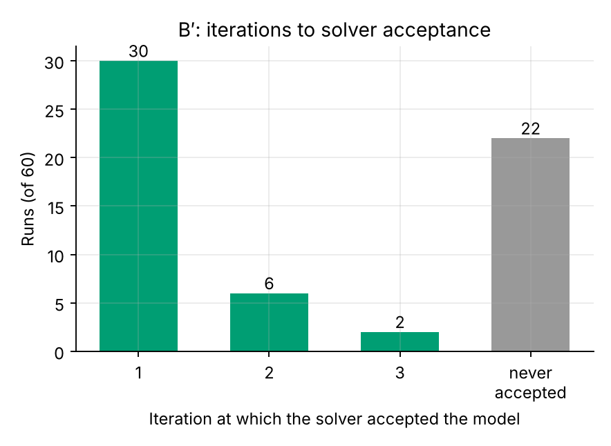

# Homework 2 — The Formalizer

**Integrantes:** Giuliana Auqui y Felipe Campuzano  
**Formalismo:** CSP (coloreo de grafos) · **Solver:** backtracking con MRV y desempate por grado (`code/csp.py`)  
**Modelo LLM:** `allam-2-7b` — proveedor: Groq; tamaño/versión: 7B; temperatura 0.7; 3 repeticiones por instancia; fecha 2026-11-17.

## 1. Diseño experimental

Dataset propio de 20 problemas de coloreo de grafos con 3 colores (`problems/`): 6 fáciles (4–5 regiones, 5–6 adyacencias), 7 medios (6–7 regiones, 11–12 adyacencias) y 7 difíciles (8–9 regiones, 19–20 adyacencias y 2 pistas de color fijas). La dificultad se mide con #variables, #restricciones y #pistas. El ground truth es el modelo CSP escrito a mano; un script independiente (`code/validate_dataset.py`) lo re-deriva del texto del enunciado y comprueba que coincide, además de que cada instancia es satisfacible. Una respuesta es correcta si asigna todas las regiones, respeta dominios/pistas y ninguna arista une dos regiones del mismo color (se evalúa satisfacción, no igualdad con un coloreo único). Cada instancia se ejecuta 3 veces por brazo para estimar varianza; se reportan intervalos de Wilson al 95 %. B y B′ comparten su primer intento (misma caché), de modo que B′ ≥ B por construcción y la diferencia es una medición pareada del valor de la retroalimentación del solver. En B′ el único feedback es el mensaje del parser/solver (JSON inválido, esquema rechazado, UNSAT, timeout) junto con la salida previa del propio modelo; nunca se envía el ground truth.

## 2. Duel Scorecard

| Métrica | A — Hand | B — Hybrid | B′ — Refinement | C — Direct |
|---|---:|---:|---:|---:|
| Ejecuciones | 20 | 60 | 60 | 60 |
| Correctas | 20 | 24 | 24 | 21 |
| Incorrectas (respondió mal) | 0 | 6 | 14 | 39 |
| Sin respuesta | 0 | 30 | 22 | 0 |
| **Accuracy** | **100 %** | **40 %** | **40 %** | **35 %** |
| IC 95 % (Wilson) | [84 %, 100 %] | [29 %, 53 %] | [29 %, 53 %] | [24 %, 48 %] |
| σ de accuracy entre repeticiones | 0.000 | 0.108 | 0.108 | 0.082 |
| Tiempo total medio (s) | 0.0002 | 1.0790 | 2.0188 | 0.8645 |
| Tiempo solver medio (s) | 0.00023 | 0.00006 | 0.00014 | 0.00000 |
| Tiempo LLM medio (s) | 0.000 | 1.079 | 2.019 | 0.864 |
| Tokens medios (entrada+salida) | 0 | 759 | 2147 | 505 |
| Fallos anunciados / silenciosos | 0 / 0 | 30 / 6 | 22 / 14 | 0 / 39 |
| Costo por respuesta correcta (USD) | 0.00000 | 0.00012 | 0.00032 | 0.00009 |

(Brazo A: tiempos de solver sobre el modelo escrito a mano; sin tokens.) Delta B→B′: 40 % → 40 % 

## 3. Accuracy vs. dificultad



| Brazo | Fácil | Medio | Difícil |
|---|---:|---:|---:|
| A | 100 % (6/6) | 100 % (7/7) | 100 % (7/7) |
| B | 83 % (15/18) | 43 % (9/21) | 0 % (0/21) |
| B′ | 83 % (15/18) | 43 % (9/21) | 0 % (0/21) |
| C | 72 % (13/18) | 29 % (6/21) | 10 % (2/21) |

Los no-answer cuentan como incorrectos. Cada nivel tiene solo 6–7 problemas (×3 repeticiones, que no son independientes entre sí), por lo que los intervalos son anchos; diferencias de pocos puntos no son concluyentes.

## 4. Taxonomía de errores del brazo B

Hubo **36** fallos en B de 60 ejecuciones; todos están en `taxonomy.md` con la salida íntegra del modelo.



| Categoría | ¿Detectable sin ground truth? (a priori) | Cuenta | Anunciados | Silenciosos |
|---|---|---:|---:|---:|
| Malformed syntax (won't parse) | yes | 0 | 0 | 0 |
| Valid syntax, over-constrained (UNSAT) | yes | 28 | 28 | 0 |
| Valid syntax, under-constrained (premise dropped, wrong solution returned) | no | 2 | 0 | 2 |
| Valid model of the wrong problem (hallucinated / altered premises) | no | 4 | 0 | 4 |
| Quantifier scope / arity error | yes | 2 | 2 | 0 |
| Solver timeout | yes | 0 | 0 | 0 |

**Detectabilidad:** 30 de 36 fallos de B fueron anunciados por el parser/solver sin necesitar el ground truth; 6 fueron silenciosos (el solver devolvió una solución de un modelo equivocado).

**Ejemplo 1 — P02 (rep 0), Valid syntax, over-constrained (UNSAT).** hallucinated adjacencies: R1-R4. Anunciado por el solver/parser.

```text
{
  "variables": ["R1", "R2", "R3", "R4"],
  "domains": {
    "R1": ["red", "green", "blue"],
    "R2": ["red", "green", "blue"],
    "R3": ["red", "green", "blue"],
    "R4": ["red", "green", "blue"]
  },
  "constraints": [
    ["R1", "R2"],
    ["R1", "R3"],
    ["R1", "R4"],
    ["R2", "R3"],
    ["R2", "R4"],
    ["R3", "R4"]
  ]
}
```

**Ejemplo 2 — P12 (rep 1), Valid model of the wrong problem (hallucinated / altered premises).** dropped adjacencies: R2-R3, R4-R6, R5-R6; hallucinated adjacencies: R3-R5. Silencioso: el solver aceptó el modelo.

```text
{
  "variables": ["R1", "R2", "R3", "R4", "R5", "R6"],
  "domains": {
    "R1": ["red", "green", "blue"],
    "R2": ["red", "green", "blue"],
    "R3": ["red", "green", "blue"],
    "R4": ["red", "green", "blue"],
    "R5": ["red", "green", "blue"],
    "R6": ["red", "green", "blue"]
  },
  "constraints": [
    ["R1", "R2"],
    ["R1", "R3"],
    ["R1", "R5"],
    ["R1", "R6"],
    ["R2", "R4"],
    ["R2", "R6"],
    ["R3", "R4"],
    ["R3", "R5"],
    ["R4", "R5"]
  ]
}
```

**Ejemplo 3 — P07 (rep 0), Valid syntax, under-constrained (premise dropped, wrong solution returned).** dropped adjacencies: R3-R7, R4-R5, R6-R7. Silencioso: el solver aceptó el modelo.

```text
{
  "variables": ["R1", "R2", "R3", "R4", "R5", "R6", "R7"],
  "domains": {
    "R1": ["red", "green", "blue"],
    "R2": ["red", "green", "blue"],
    "R3": ["red", "green", "blue"],
    "R4": ["red", "green", "blue"],
    "R5": ["red", "green", "blue"],
    "R6": ["red", "green", "blue"],
    "R7": ["red", "green", "blue"]
  },
  "constraints": [
    ["R1", "R2"],
    ["R1", "R5"],
    ["R1", "R6"],
    ["R2", "R3"],
    ["R2", "R7"],
    ["R3", "R4"],
    ["R3", "R5"],
    ["R4", "R6"],
    ["R5", "R6"]
  ]
}
```

**Ejemplo 4 — P14 (rep 1), Quantifier scope / arity error.** The CSP was rejected by the validator: constraint ['R8', 'green'] uses undeclared variable "green". Fix it and reply with ONLY the corrected JSON object. Anunciado por el solver/parser.

```text
{
  "variables": ["R1", "R2", "R3", "R4", "R5", "R6", "R7", "R8"],
  "domains": {
    "R1": ["red"],
    "R2": ["red", "green"],
    "R3": ["red", "blue"],
    "R4": ["red", "green"],
    "R5": ["red", "blue"],
    "R6": ["green"],
    "R7": ["blue", "green"],
    "R8": ["green"]
  },
  "constraints": [
    ["R1", "R2"],
    ["R1", "R3"],
    ["R1", "R4"],
    ["R1", "R5"],
    ["R2", "R3"],
    ["R2", "R4"],
    ["R2", "R6"],
    ["R2", "R7"],
    ["R2", "R8"],
    ["R3", "R4"],
    ["R3", "R5"],
    ["R4", "R6"],
    ["R4", "R7"],
    ["R4", "R8"],
    ["R5", "R6"],
    ["R5", "R7"],
    ["R6", "R7"],
    ["R8", "green"]
  ]
}
```

**Ejemplo 5 — P08 (rep 0), Valid model of the wrong problem (hallucinated / altered premises).** dropped adjacencies: R5-R6; hallucinated adjacencies: R3-R6. Silencioso: el solver aceptó el modelo.

```text
{
  "variables": ["R1", "R2", "R3", "R4", "R5", "R6"],
  "domains": {
    "R1": ["red", "green", "blue"],
    "R2": ["red", "green", "blue"],
    "R3": ["red", "green", "blue"],
    "R4": ["red", "green", "blue"],
    "R5": ["red", "green", "blue"],
    "R6": ["red", "green", "blue"]
  },
  "constraints": [
    ["R1", "R2"],
    ["R1", "R3"],
    ["R1", "R5"],
    ["R1", "R6"],
    ["R2", "R3"],
    ["R2", "R4"],
    ["R3", "R4"],
    ["R3", "R5"],
    ["R3", "R6"],
    ["R4", "R5"],
    ["R4", "R6"]
  ]
}
```

### Brazo C (respuesta directa)

C falló 39 veces. Detectables sin ground truth (no parseable / incompleta / color fuera de {rojo, verde, azul}): **0**. Silenciosas (respuesta bien formada que viola adyacencias o pistas): **39**. Desglose: silent_wrong: 39.

**Consecuencia de ingeniería:** en B los fallos que importan casi siempre se anuncian (se puede reintentar o escalar automáticamente); en C un error bien formado es indistinguible de un acierto, así que cada respuesta necesitaría verificación externa.



## 5. Análisis de refinamiento (B′)



Iteración en que el solver aceptó el modelo: 1 → 30, 2 → 6, 3 → 2, nunca → 22 de 60 ejecuciones (37 % no convergió). De 38 modelos aceptados, 24 eran fieles al problema: aceptar no equivale a acertar. Respecto a B, B′ rescató 0 ejecuciones y perjudicó 0. Además, 8 fallos que en B eran anunciados (el solver rechazó el modelo) pasaron a ser silenciosos en B′: tras reintentar, el modelo produjo algo satisfacible pero infiel, que el solver acepta.

**¿Cualitativamente distintos?** Las 8 ejecuciones aceptadas por el solver tras ≥1 reintento (ninguna era fiel al problema salvo que se indique: ver rescates arriba) fallaron al inicio por: Valid syntax, over-constrained (UNSAT): 8. Fallos de las 22 que no convergieron — primer intento: Valid syntax, over-constrained (UNSAT): 20, Quantifier scope / arity error: 2; último intento: Valid syntax, over-constrained (UNSAT): 20, Quantifier scope / arity error: 1, Malformed syntax (won't parse): 1. En 17 de 22 el modelo repitió la misma categoría de error en los tres intentos.

Limitación estructural: B′ solo reintenta cuando el solver rechaza el modelo (sintaxis, UNSAT, timeout). Un modelo satisfacible pero infiel termina el bucle con éxito aparente, por lo que el feedback del solver no puede corregir errores silenciosos.

## 6. Costo por respuesta correcta

Tarifa usada: Groq / allam-2-7b (tarifa proxy de llama-3.1-8b-instant (8B) en Groq: allam-2-7b no tiene precio publicado): 0.05 USD / M tokens de entrada y 0.08 USD / M de salida. Se suman todos los intentos de todas las repeticiones y se divide por las respuestas correctas.

| Brazo | Tokens totales | Costo total (USD) | Correctas | USD por correcta |
|---|---:|---:|---:|---:|
| B | 45546 | 0.00288 | 24 | 0.000120 |
| B′ | 128825 | 0.00765 | 24 | 0.000319 |
| C | 30317 | 0.00180 | 21 | 0.000086 |

Brazo A cuesta cero tokens, pero su costo real es el tiempo humano de escribir cada modelo a mano (no medido).

## 7. Dónde podemos haber sido injustos

- **Dataset de un solo formalismo y muy regular:** todos los enunciados listan las adyacencias explícitamente en plantilla; traducir es casi transcribir, lo que favorece a B/B′ y probablemente subestima los errores de modelado reales.
- **Tamaño:** instancias de hasta 9 regiones; las diferencias entre brazos de pocos puntos caen dentro del intervalo de confianza.
- **Brazo A** parte de modelos escritos por nosotros, que son también el ground truth: no es un brazo independiente (un error de especificación nuestro sería invisible para A).
- **Normalización:** aceptamos «rojo/verde/azul» además de red/green/blue, cercas de código markdown y nombres de región en minúsculas («r1» = «R1») en C. Sin esa última tolerancia C puntuaba 17 % en vez de 35 %: un detalle de formato, no de razonamiento, decidía la comparación. Corregimos el evaluador tras detectarlo (B no tenía ese problema: ninguna salida de B usó minúsculas); aun así, otras reglas de formato podrían sesgar a un brazo.
- **Modelo:** allam-2-7b es un modelo de 7B orientado al árabe/inglés con ventana de 4 k tokens; los enunciados están en español. Los resultados describen a este modelo, no a la arquitectura en general. Groq no publica tarifa para él: el costo usa la de llama-3.1-8b-instant como proxy de un modelo de tamaño equivalente.
- **Prompt único por brazo**, sin ajuste ni ejemplos few-shot; un prompt distinto podría cambiar el orden de los brazos. C recibe un formato JSON estricto que penaliza respuestas correctas pero mal formateadas.
- **Temperatura y repeticiones:** con muestreo > 0 hay variación; reportamos σ entre repeticiones, pero no hicimos barrido de temperatura.
- **Cómputo:** tiempos LLM dependen de la carga del proveedor en ese momento.

## 8. Recomendación

Con nuestros números (accuracy 40 % en B, 40 % en B′, 35 % en C; fallos silenciosos 6/14/39; USD por respuesta correcta 0.00012/0.00032/0.00009), el brazo que enviaríamos es **B — Hybrid**.
La ventaja de accuracy de B sobre C (40 % frente a 35 %) cae dentro de los intervalos de confianza: elegimos B por detectabilidad (30 de 36 fallos anunciados frente a 0 de 39 en C), no por precisión. No enviaríamos B′: no rescató ninguna ejecución adicional (0), costó 2.8× más tokens por petición y convirtió 8 fallos anunciados en fallos silenciosos, que es lo peor que puede hacer un bucle de reintentos.
Monitoreo: (1) tasa de rechazo del parser/solver por petición (hoy 30 de 60); ante rechazo, escalar a un modelo mayor o a revisión humana en lugar de reintentar con el mismo; (2) los 6 fallos silenciosos de B no se anuncian: auditar una muestra comparando el conjunto de restricciones con una segunda traducción independiente o con una retro-traducción a lenguaje natural; (3) latencia y costo por respuesta correcta; (4) accuracy por nivel de dificultad en un conjunto de control con ground truth (aquí cae a 0 % en el nivel difícil).
Aviso honesto: con una accuracy de 40 % ningún brazo es desplegable sin supervisión con allam-2-7b; la recomendación presupone escalado humano o un modelo más grande, y habría que repetir el experimento con ese modelo antes de afirmar nada más.

Antes de afirmar generalidad habría que repetir el experimento con enunciados de lenguaje natural menos explícitos y otros formalismos.

## Reproducibilidad

Código en `code/` (`run_experiment.py`, `analyze.py`, `csp.py`, `taxonomy.py`, `llm.py`), datos en `problems/`, métricas en `results/*.csv`, figuras en `fig/`, respuestas del LLM cacheadas en `.llm_cache/`, uso de IA en `AI_LOG.md`.