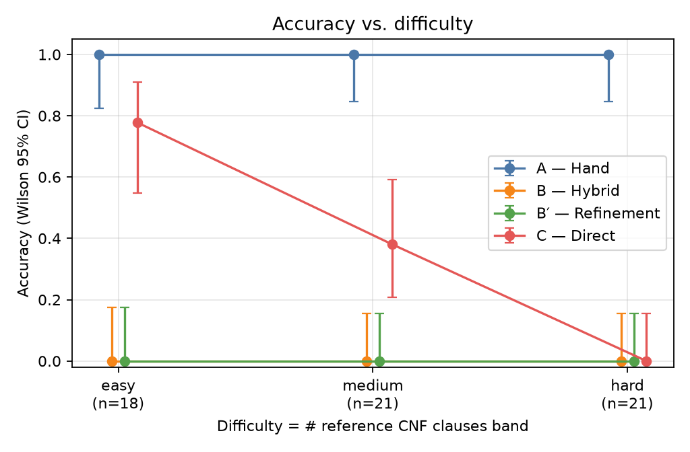
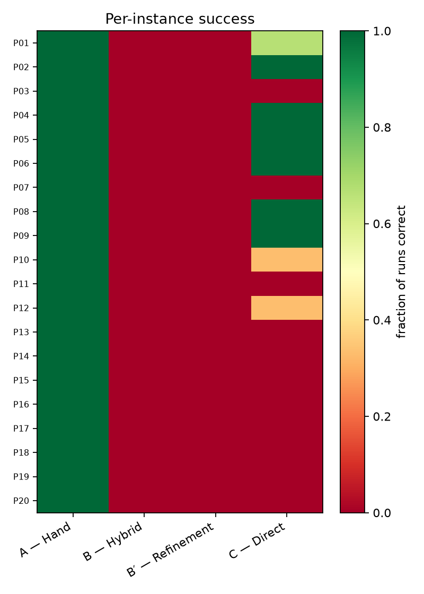
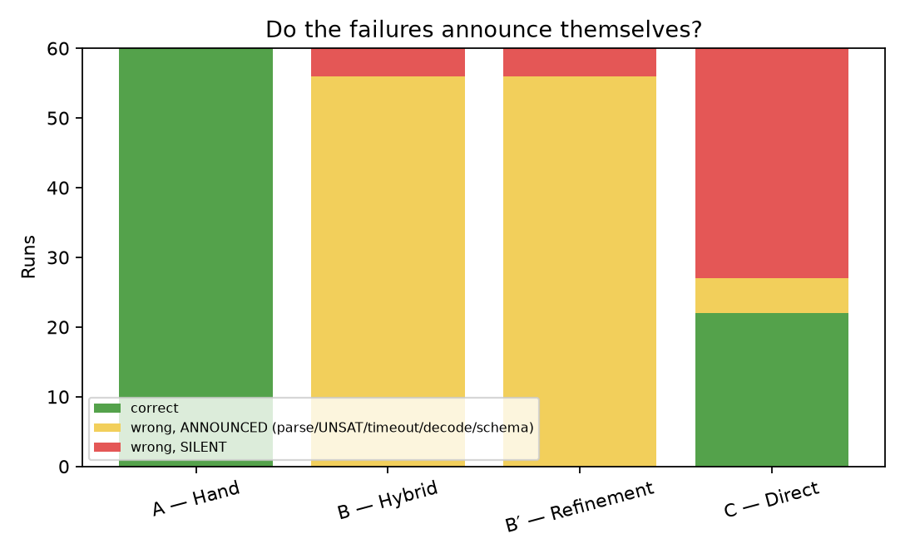
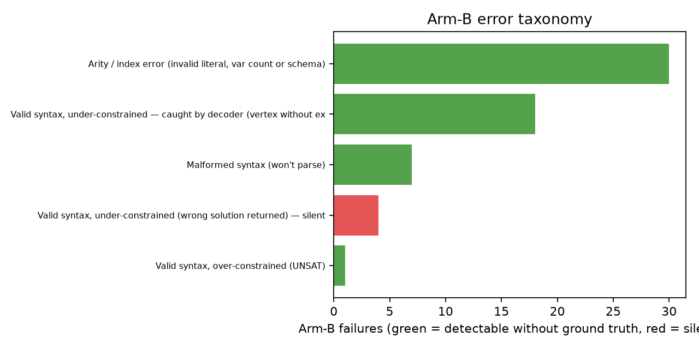
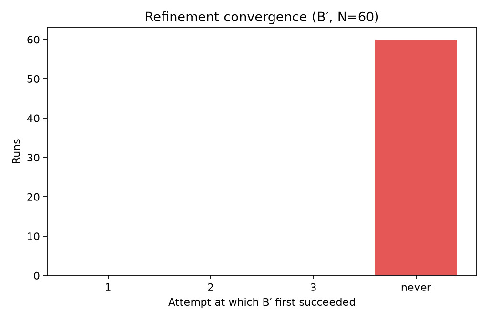
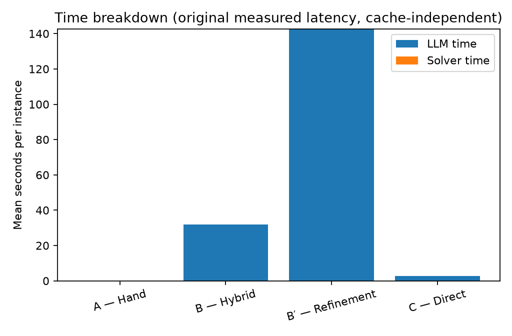

# HW2 — SAT Translation Duel (coloreado de grafos, 3 colores)

> Resultados experimentales obtenidos localmente; 20 problemas × 3 corridas por método.

## 1. Setup
- **Modelo y entorno de ejecución:** Los experimentos se ejecutaron localmente en una MacBook Air con procesador Apple M4 de 10 núcleos y 16 GB de memoria RAM, utilizando macOS 26.6.2, Python 3.14.0 y Ollama 0.40.16. El modelo utilizado fue qwen2.5:3b, con 3.1 mil millones de parámetros, cuantización Q4_K_M, ventana de contexto de 32.768 tokens e identificador 357c53fb659c.
- **Formalismo:** SAT/CNF con DPLL propio (validado contra fuerza bruta en 600 CNF aleatorias).
- **Dataset:** 20 problemas de coloreado de grafos con 3 colores, redactados en español (6 easy, 7 medium, 7 hard). **Dificultad = nº de cláusulas del CNF de referencia (4n+3m)**: easy 25–36, medium 42–65, hard 74–115; bandas fijadas antes de ejecutar y verificadas por test. Los prompts coinciden con los datos estructurados (test de consistencia), el ground truth se verificó con un oráculo de backtracking independiente del SAT, y el validador rechaza un ground truth corrompido.
- **Protocolo:** 3 corridas × 20 problemas = 60 evaluaciones por método, temperatura T = 0.7, semillas 0, 1 y 2; IC de Wilson 95 %; McNemar exacto para B vs B′. Timeout del solver 5 s.
- **Brazos:** A (codificador escrito a mano + DPLL), B (1 intento LLM→CNF→DPLL), B′ (≤ 3 intentos con feedback solo del solver/validador; el intento 1 es la misma llamada que B), C (el LLM devuelve el coloreado directamente).
- **Qué ve B′:** mensaje de parseo/esquema, `UNSAT`, `TIMEOUT` o «vértice X tiene k colores en el modelo del solver». Nunca el ground truth ni el CNF de referencia (el test `test_pipeline_mock.py` comprueba que ningún prompt lo contiene).

## 2. Duel Scorecard

Se evaluaron 20 problemas × 3 corridas por método. Los IC son de Wilson al 95 %; «no-answer» indica fallos anunciados por el sistema.

| Métrica | A — Hand | B — Hybrid | B′ — Refinement | C — Direct |
|---|---:|---:|---:|---:|
| Correctas / incorrectas / sin respuesta | 60 / 0 / 0 | 0 / 4 / 56 | 0 / 4 / 56 | 22 / 33 / 5 |
| Accuracy [IC 95 %] | 100 % [94–100] | 0 % [0–6] | 0 % [0–6] | 36.7 % [25.6–49.3] |
| Accuracy si respondió | 100 % | 0 % | 0 % | 40 % |
| Desv. entre corridas | 0 | 0 | 0 | 0.024 |
| Tiempo medio total / LLM (s) | <0.001 / 0 | 31.899 / 31.897 | 142.593 / 142.589 | 2.742 / 2.741 |
| Tiempo medio solver (s) | <0.001 | <0.001 | <0.001 | <0.001 |
| Tokens medios entrada / salida | 0 / 0 | 471.8 / 826.3 | 3576.0 / 3385.0 | 234.4 / 56.6 |
| Intentos medios | 1 | 1 | 2.867 | 1 |

A obtuvo 60/60 aciertos y la menor latencia, aunque requirió diseñar previamente un codificador específico. B y B′ obtuvieron 0/60: el cuello de botella fue generar CNF fiel al problema, no resolver la fórmula con DPLL. C logró 22/60, pero 33 de sus 38 fallos fueron silenciosos. Las latencias de B′ reflejan también el uso de caché, por lo que no equivalen al coste de repetir todas las llamadas desde cero.

## 3. Accuracy vs. dificultad

Los gráficos siguientes se generaron mediante `analyze.py` y muestran la precisión por dificultad y por instancia.

| Método | Easy (18 evaluaciones) | Medium (21) | Hard (21) |
|---|---:|---:|---:|
| A | 18/18 (100 %) | 21/21 (100 %) | 21/21 (100 %) |
| B | 0/18 (0 %) | 0/21 (0 %) | 0/21 (0 %) |
| B′ | 0/18 (0 %) | 0/21 (0 %) | 0/21 (0 %) |
| C | 14/18 (77.8 %) | 8/21 (38.1 %) | 0/21 (0 %) |

El método C perdió precisión a medida que aumentó la dificultad. En cambio, B y B′ fallaron incluso en los problemas fáciles, por lo que no podemos determinar si el tamaño de las fórmulas afectó sus resultados. Los problemas más difíciles requieren generar más cláusulas, pero no sabemos si los errores se deben a esto o a una falta de comprensión del problema. Los intervalos de confianza de C fueron: easy [54.8–91.0 %], medium [20.8–59.1 %] y hard [0–15.5 %].

## 4. Taxonomía de errores (brazo B)

| Categoría | n | ¿Detectable sin ground truth? |
|---|---:|---|
| Sintaxis malformada | 7 | Sí |
| Aridad / índice | 30 | Sí |
| Sobre-restringido (UNSAT) | 1 | Sí |
| Sub-restringido detectado por decodificador | 18 | Sí |
| Sub-restringido silencioso | 4 | No |
| Problema equivocado (categoría exclusiva) | 0 | No |
| Timeout | 0 | Sí |

**Cinco ejemplos reales del LLM** (fragmentos iniciales copiados literalmente de `results/taxonomy.json`; salidas completas en ese archivo):

1. **P20, corrida 1 — SCHEMA_ERROR.** Fragmento literal de la salida del modelo: `{"num_vars": 30, "clauses": [[1, 2, 3, -4, -5, -6], [4, 5, 6, -7, -8, -9], [10, 11, 12, -13, -14, -15], [16, 17, 18, -19, -20, -21], [22, 23, 24, -25, -26, -27], [28, 29, 30, -31, ` … **Diagnóstico:** literal inválido en la cláusula 5: -31 (debe ser entero no nulo con |lit| <= 30).

2. **P03, corrida 1 — DECODE_ERROR.** Fragmento literal de la salida del modelo: `{"num_vars": 12, "clauses": [[1, 2, 3], [4, 5, 6], [7, 8, 9], [10, 11, 12], [1, -2], [2, -1], [4, -5], [5, -4], [7, -8], [8, -7], [10, -11], [11, -10]]}` … **Diagnóstico:** falta 'a lo sumo un color' (parcial o total) en ['A', 'B', 'C', 'D']; restricción de arista omitida por completo: ['A-B', 'A-D', 'B-C']; 8 cláusulas extra de otro tipo (variables/índices incorrectos u otras).

3. **P05, corrida 2 — UNSAT.** Fragmento literal de la salida del modelo: `{"num_vars": 15, "clauses": [[1, 2, 5], [3, 6, 9], [4, 7, 10], [8, 11, 14], [12, 15, -1], [1, -2], [2, -1], [-1, -3], [3, -4], [4, -1], [-5, -6], [5, -7], [6, -5], [7, -6], [-8, -9` … **Diagnóstico:** falta 'al menos un color' en ['A', 'B', 'C', 'D', 'E']; falta 'a lo sumo un color' (parcial o total) en ['A', 'B', 'C', 'D', 'E']; restricción de arista omitida por completo: ['A-B', 'A-E', 'B-C']; 18 cláusulas extra de otro tipo ….

4. **P14, corrida 0 — SAT.** Fragmento literal de la salida del modelo: `{"num_vars": 24, "clauses": [[1, 2, 3], [-1, -2], [4, 5, 6], [-4, -5], [7, 8, 9], [-7, -8], [10, 11, 12], [-10, -11], [13, 14, 15], [-13, -14], [16, 17, 18], [-16, -17], [19, 20, 2` … **Diagnóstico:** falta 'a lo sumo un color' (parcial o total) en ['A', 'B', 'C', 'D', 'E', 'F', 'G', 'H']; restricción de arista omitida por completo: ['A-B', 'A-C', 'A-F', 'B-C', 'B-D', 'B-E', 'B-F', 'B-G', 'C-D', 'C-G', 'D-E', 'D-F', 'E-G', 'F-G….

5. **P16, corrida 2 — PARSE_ERROR.** Fragmento literal de la salida del modelo: `{"num_vars": 27, "clauses": [[1, 2, 3], [4, 5, 6], [7, 8, 9], [-1, -2, -3], [-4, -5, -6], [-7, -8, -9], [10, 11, 12], [-10, -11, -12], [13, 14, 15], [-13, -14, -15], [16, 17, 18], ` … **Diagnóstico:** JSON inválido: Expecting ',' delimiter (posición 3562) [salida truncada por num_predict].

De los 60 fallos de B, 56 (93.3 %) fueron anunciados y 4 (6.7 %) silenciosos. No hubo aciertos con CNF no equivalente: B nunca acertó. En C, solo 5/38 fallos (13.2 %) fueron anunciados; los otros 33 requerían verificación externa. Un error anunciado permite abstención o reintento, mientras que uno silencioso puede parecer válido. 

## 5. Análisis de refinamiento (B vs B′)

B y B′ acertaron 0/60: Δ = 0 puntos porcentuales; McNemar exacto p = 1.000 (sin pares discordantes). Ninguna evaluación convergió en los intentos 1, 2 o 3; 60/60 nunca convergieron. B′ acumuló 172 intentos (media 2.867), con 56 casos de múltiples intentos. En 14/56 se repitió exactamente la misma salida y en 42/56 hubo variación; 74/172 intentos provinieron de caché y 98 fueron consultas nuevas.

La clasificación final de los 60 casos no convergentes fue: 24 errores de sintaxis, 22 de aridad/índice, 9 de decodificación, 4 silenciosos y 1 UNSAT. En 32/60 se mantuvo la misma categoría de error en todos los intentos. Los 4 errores silenciosos no activaron refinamiento porque el solver devolvió SAT. El feedback consiguió modificar muchas respuestas, pero no generar una formalización correcta; «UNSAT» por sí solo ofrece poca información diagnóstica. 

## 6. Coste por respuesta correcta

Como utilizamos un modelo local mediante Ollama, medimos el costo computacional a través de los tokens utilizados y el tiempo de ejecución, sin considerar costos monetarios.

| Método | Tokens entrada | Tokens salida | Tokens totales | Aciertos | Tokens por acierto |
|---|---:|---:|---:|---:|---:|
| A — Hand | 0 | 0 | 0 | 60 | 0 |
| B — Hybrid | 28,308 | 49,575 | 77,883 | 0 | No calculable |
| B′ — Refinement | 214,557 | 203,099 | 417,656 | 0 | No calculable |
| C — Direct | 14,064 | 3,396 | 17,460 | 22 | 793.6 |

El método A fue el más eficiente: resolvió todos los problemas en menos de 0.001 segundos por evaluación y sin utilizar tokens de un LLM. Sin embargo, requirió trabajo humano para desarrollar el codificador.

Los métodos B y B′ consumieron muchos tokens sin obtener respuestas correctas. B′ fue el más costoso porque realizó varios intentos de corrección. El método C consiguió 22 respuestas correctas, con un promedio de **793.6 tokens y 7.48 segundos por acierto**.

En conclusión, A fue el método más eficiente del experimento. Entre los métodos que utilizaron inteligencia artificial, C obtuvo los mejores resultados con el menor consumo de recursos.

**Limitación:** Las métricas pueden incluir respuestas recuperadas de caché, por lo que no representan necesariamente el procesamiento real realizado por el modelo.

## 7. Where we may have been unfair
Limitaciones metodológicas identificadas:
- **El prompt de B entrega la receta de codificación** (índice de variable, ALO/AMO, aristas): mide más «enumerar cláusulas sin errores» que «traducir del lenguaje natural». Favorece a B; no se probó una variante sin receta.
- **A es un codificador parametrizado**, no un modelo escrito a mano por instancia, y comparte validador con B/C. Es el techo por construcción.
- **Todas las instancias son satisfacibles** y de un solo dominio: `UNSAT` solo puede ser culpa del modelo; no se mide si C alucina un coloreado cuando no existe.
- **B′ gasta hasta 3× más** que B; su primer intento es idéntico a B (comparación pareada, pero el coste no es comparable).
- **C sin cadena de pensamiento** y con un modelo de 3B; un C con razonamiento o un modelo mayor cambiaría la comparación.
- **El feedback `DECODE_ERROR`** usa un chequeo del harness (≠1 color por vértice); es información del solver + convención, no del ground truth, pero ayuda a B′ más que un `UNSAT` pelado.
- Temperatura/semillas, caché, español, 20 instancias (IC anchos), timeout de 5 s.
- **Limitaciones del entorno de ejecución**. Los experimentos se realizaron localmente en una MacBook Air con procesador M4 y 16 GB de RAM. Por lo tanto, los tiempos de respuesta obtenidos dependen tanto de los métodos evaluados como del hardware disponible. Además, el tiempo de inferencia del LLM y el tiempo de ejecución del solver DPLL corresponden a procesos diferentes. Esto significa que los resultados de latencia no deben ser interpretados como una comparación universal de velocidad entre los métodos. 

## 8. Recomendación de despliegue

Para este dominio recomendamos **A (codificador parametrizado + DPLL)**: obtuvo 60/60 aciertos y latencia mínima. Si aparecen enunciados fuera del esquema conocido, C solo debería considerarse con un verificador de coloreado y abstención ante salidas inválidas; esa variante no se probó aquí. B y B′ no son desplegables con el modelo y los prompts evaluados (0/60 aciertos). El monitoreo debe registrar tasas de `PARSE/SCHEMA/UNSAT/TIMEOUT/DECODE`, latencia p95, intentos, tokens por acierto y auditoría de respuestas aparentemente válidas para estimar errores silenciosos. No generalizamos los resultados a otros modelos o dominios.
