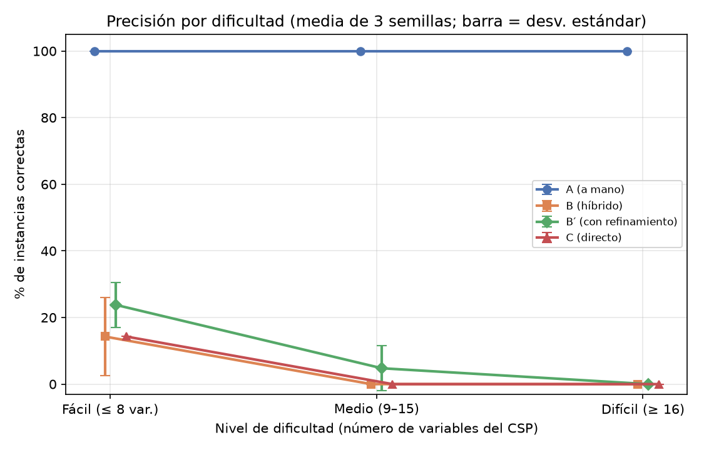
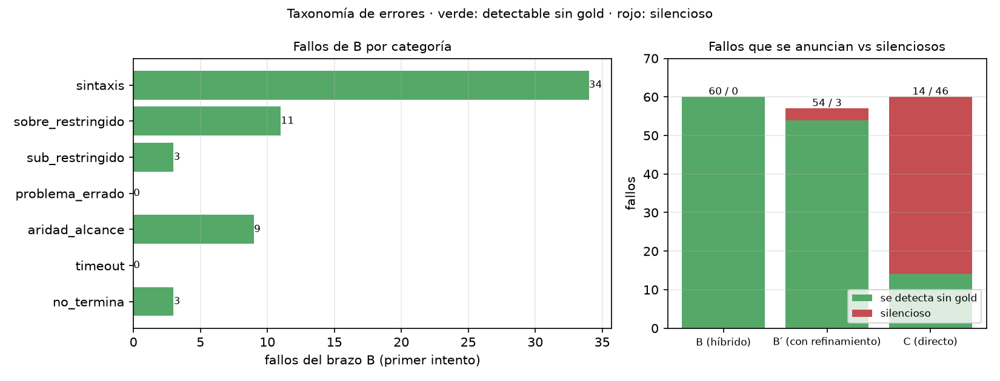
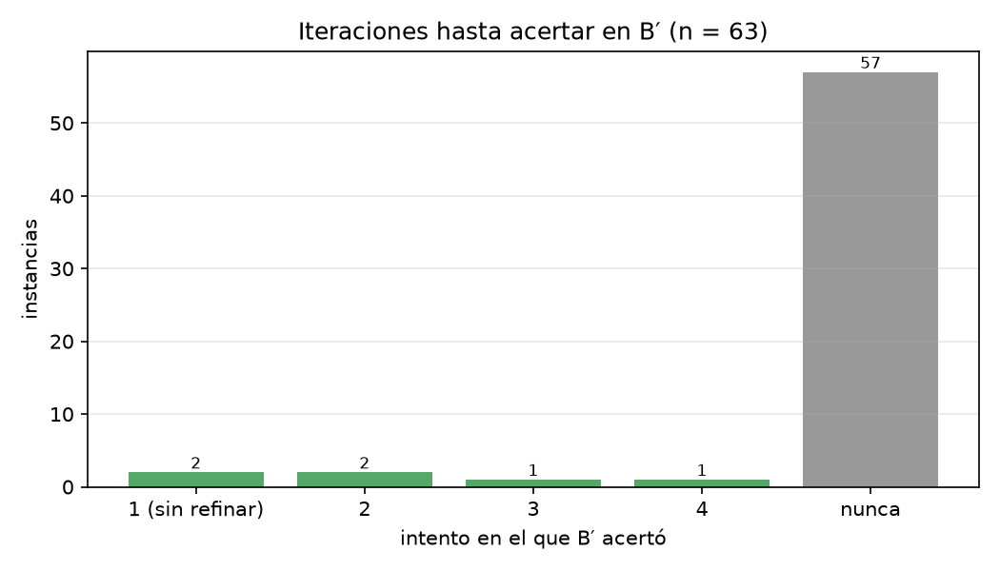
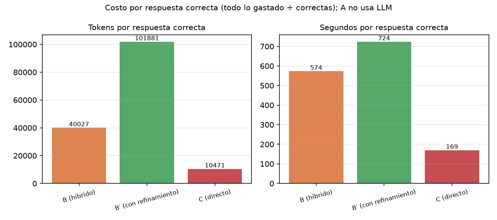
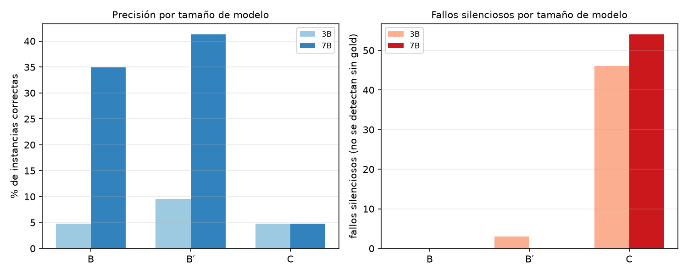

# HW2 · The Formalizer (CSP)

**Equipo:** Daniel Salazar, Andretty Ochoa, Jalil Chano · **Formalismo:** CSP con solver propio (backtracking + forward checking + MRV; cuenta hasta 2 soluciones) · **Modelo: `qwen2.5:3b` (3 mil millones de parámetros)**, y `qwen2.5:7b` en el experimento de tamaño (§8), Ollama local en una GPU de consumo, temperatura 0.7, semillas 0, 1 y 2.

> El tamaño del modelo condiciona todo: con 3B los brazos con LLM aciertan poco, y lo interesante es **cómo** fallan; §8 repite B, B′ y C con 7B.

## 0. Diseño del experimento

- **Dataset (`problems/`).** 21 problemas propios, 7 por nivel, con tres familias en cada nivel: tipo Einstein (posiciones en fila), horarios ("inmediatamente después", "antes de") y coloreo de mapas. La dificultad se mide por el **número de variables del CSP**: fácil ≤ 8, medio 9–15, difícil ≥ 16 (de 6 a 25 variables y de 6 a 56 restricciones). Cada problema trae su gold con la deducción a mano, y `verificar_dataset.py` comprueba que el modelo a mano tiene **solución única** igual al gold.
- **Brazos.** A: modelo a mano → solver. B: el LLM escribe el modelo en JSON → solver. B′: como B, pero si el solver reporta un error le devolvemos **solo ese mensaje** y su modelo anterior, hasta 3 veces. C: el LLM responde directo.
- **Vocabulario.** `alldiff`, `eq`, `neq`, `lt`, `gt`, `adj` (contiguos) y `offset` (a − b = k), una ampliación del studio de la semana 6.
- **Instrumentación (`results/*.csv`).** Por instancia: resultado, reloj de pared, tokens, tiempo del LLM y del solver por separado e iteraciones. Las respuestas del modelo están en `.llm_cache/` y cada intento de B en `results/intentos_b.jsonl`.
- **Protocolo.** 21 problemas × 3 semillas = 63 instancias por brazo. Temperatura 0.7 para que las semillas midan varianza. Una llamada al LLM que pasa de 300 s cuenta como fallo del modelo (`no_termina`) y no se reintenta, el mismo criterio del deber 1.
- **B′ nunca ve el gold.** `evaluar_salida` (`brazo_b.py`) solo recibe la salida del modelo y el formato de respuesta. Los mensajes posibles son: "no parsea (motivo)", "variable inexistente o tipo incorrecto", "no hay solución, y estas restricciones, quitadas una a la vez, lo vuelven satisfacible", "hay más de una solución; difieren en X, Y" y "timeout del solver".
- **Prompts, ajustados solo con 3 problemas de ejemplo que no cuentan.** B v2 (una restricción por pista con su número `"clue"`, números sin comillas) subió de 2/9 a 3/9 en los ejemplos y ahí lo congelamos. Para C elegimos la mejor de tres redacciones.

## 1. Duel Scorecard

| Eje | A · a mano | B · híbrido | B′ · refinamiento | C · directo |
|---|---|---|---|---|
| 1 Correctness | 63/63 (100 %) | 3/63 (5 %) | 6/63 (10 %) | 3/63 (5 %) |
| 2 Guarantee | Correcta y única si el modelo a mano es fiel (solver completo) | Correcta y única si la traducción es fiel; nada sobre la traducción | Igual que B; solo corrige lo que el solver ve | Ninguna; no hay certificado |
| 3 Cost | 0 tokens | 40 027 tokens/correcta | 101 881 tokens/correcta | 10 471 tokens/correcta |
| 4 Latency | < 0.01 s | mediana 12.3 s · p95 77.8 s | mediana 46.5 s · p95 300 s | mediana 7.5 s · p95 13.4 s |
| 5 Reproducibility | 1.00 respuestas distintas por problema; 21/21 estables | 1.95; 3/21 estables | 1.86; 6/21 estables | 2.62; 3/21 estables |
| 6 Scaling | 100 → 100 → 100 % | 14 → 0 → 0 % | 24 → 5 → 0 % | 14 → 0 → 0 % |
| 7 Interpretability | Total: modelo JSON revisable | Alta: el modelo es un certificado; se ve qué pista falló | Alta, más la traza del solver | Baja: solo una asignación |
| 8 Failure mode | sin fallos | sintaxis 34, sobre-restr. 11, alcance 9, sub-restr. 3, LLM no termina 3 · **detectables sin gold: 60/60** | sintaxis 18, sobre-restr. 15, alcance 14, sub-restr. 4, no termina 3, **silenciosos 3** · **54/57** | incorrecta 46, incompleta 14 · **14/60** |

Con 3B, **B y C aciertan lo mismo (3/63)**; la diferencia está en la fila 8: todos los fallos de B se anuncian solos y la mayoría de los de C no. Con 7B la fila 1 también cambia (§8).

## 2. Precisión vs. dificultad



| Nivel | A | B | B′ | C |
|---|---|---|---|---|
| Fácil (6–8 variables) | 100 % | 14 % | 24 % | 14 % |
| Medio (12–15) | 100 % | 0 % | 5 % | 0 % |
| Difícil (20–25) | 100 % | 0 % | 0 % | 0 % |

Media de las 3 semillas; la desviación estándar está en las barras de la figura y en `fig/precision_tabla.csv`. El precipicio aparece ya entre fácil y medio. A se mantiene plano: la dificultad le cuesta llamadas al solver (de 7 a 6 427), no aciertos. Los aciertos con LLM están en `facil-01`, `facil-05` y `medio-02` (este último solo en B′). Parte del precipicio de B es longitud: 413 tokens de salida en fáciles, 829 en medios y 1 208 en difíciles (en `dificil-05` no terminó en 300 s), y cada token más es otra ocasión de romper el JSON.

## 3. Taxonomía de errores

Clasificamos **los 60 fallos** del primer intento de B. La salida cruda de cada uno está en [`taxonomy.md`](taxonomy.md).

| Categoría | Fallos | ¿Detectable sin ground truth? (consigna) | En nuestros datos |
|---|---|---|---|
| Sintaxis rota (no parsea) | 34 (57 %) | Sí | 34/34 detectados |
| Sintaxis válida, sobre-restringido | 11 (18 %) | Sí | 11/11 |
| Sintaxis válida, sub-restringido | 3 (5 %) | A veces | 3/3: el solver cuenta soluciones |
| Modelo válido del problema equivocado | 0 | No | 0 en B; 3 en B′ |
| Alcance / aridad | 9 (15 %) | A veces | 9/9: todos rompían el modelo |
| Timeout del solver | 0 | Sí | – |
| LLM no termina en 300 s | 3 (5 %) | Sí | 3/3 (todos en `dificil-05`) |



- **Los 60 fallos de B se detectan sin ground truth.** El solver rechazó 43, probó que no había solución en 11 y encontró más de una en 3; en otros 3 el LLM no terminó, y eso también se sabe sin el gold. En el primer intento no hubo ningún modelo de solución única equivocado.
- **"Sub-restringido" pasa de "a veces" a "siempre" porque contamos soluciones.** Un solver que devuelve la primera solución sin buscar otra habría vuelto silenciosos esos 3 casos.
- **"Alcance / aridad" se detectó siempre** porque rompía los tipos; una pista aplicada a la persona equivocada sería silenciosa.

**La comparación que importa:**

| Brazo | Fallos | Detectables sin gold | Silenciosos |
|---|---|---|---|
| B | 60 | **60** | **0** |
| C | 60 | 14 | **46** |

De los errores de C, solo 14 se notan (faltan variables o hay valores imposibles); los otros 46 son asignaciones completas y equivocadas, indistinguibles de una correcta. **Consecuencia de ingeniería:** con la misma tasa de acierto, B se puede desplegar con una regla simple ("si el solver no da una solución única, no respondas") que en estos datos nunca entrega una respuesta equivocada; C entrega 46 con la misma confianza que las 3 correctas. Detectar los errores de C exigiría un modelo formal del problema, que es justo lo que construye B.

### Cinco salidas verbatim, anotadas

**1. Sintaxis: cierra con la llave equivocada** (`facil-07`, semilla 0). Las restricciones están bien; el final es:
```
... {"clue": 5, "type": "lt", "a": "Silver", "b": "Copper"}}
```
Falta el `]` de la lista (`}]}`): *"Expecting ',' delimiter at line 1, column 511"*. Es el error más frecuente (34 de 60) y casi siempre aparece al final de una salida larga.

**2. Sobre-restringido: junta dos grupos en un `alldiff`** (`facil-07`, semilla 1):
```
{"clue": 0, "type": "alldiff", "vars": ["Copper", "Indigo", "Lea", "Omar", "Rui", "Silver"]}
```
Las 5 pistas están bien traducidas, pero puso a 3 viajeros y 3 colores de auto en un mismo `alldiff` con dominio {1, 2, 3}: seis valores distintos en tres posiciones. El solver prueba que es imposible.

**3. Alcance/aridad: "enlazado" traducido como "a la derecha de"** (`facil-03`, coloreo, semilla 2). La pista *"Ford–Gorge, Ford–Marsh, Ford–Rim"* (vecinos con colores distintos) quedó como:
```
{"clue": 3, "type": "offset", "a": "Ford", "b": "Gorge", "k": 1}, ...
```
`offset` sobre colores se rechaza por tipos (*"compares numbers but 'Ford' has non-numeric values"*). Es la huella del ejemplo resuelto tipo Einstein.

**4. Sub-restringido: pierde una variable y una pista** (`dificil-01`, semilla 1). El `alldiff` de colores quedó con 4 de 5 (`["Gold", "Jade", "Lilac", "White"]`, falta `Red`) y no tradujo la pista del silbato. El solver avisa que hay dos soluciones que difieren en `Whistle`.

**5. El refinamiento vuelve silencioso un error** (`facil-01`, semilla 2). El primer intento tiene una pista inventada (`{"clue": 5, "type": "offset", "a": "Red", "b": "Yellow", "k": 1}`; el problema tiene 4 pistas) y no tiene solución. En la ronda 2 la cambia por `neq` y quedan dos soluciones. En la ronda 4, para "arreglar" eso, agrega:
```
{"clue": 7, "type": "offset", "a": "Yellow", "b": "Blue", "k": 1}
```
que dice que el amarillo está a la derecha del azul, al revés de la pista 4. El modelo tiene ahora solución única, el solver no objeta nada y la respuesta es incorrecta (`Yellow` 3 en vez de 2). Lo mismo pasó en `facil-02` (semillas 1 y 2): el modelo tradujo *"Jingle is scheduled after slot 3"* al revés (`lt Jingle 4`) y además inventó la pista correcta (`gt Jingle 3`). El solver señaló esas dos como el conflicto, y el modelo **se quedó con la equivocada** y debilitó la buena a `neq Jingle 3`. Esos son los 3 fallos silenciosos de todo el experimento en los brazos con solver, y los tres los creó el refinamiento.

## 4. Análisis del refinamiento (B′)



| Iteraciones hasta acertar | 1 (= B) | 2 | 3 | 4 | nunca |
|---|---|---|---|---|---|
| Instancias | 2 | 2 | 1 | 1 | **57 (90 %)** |

- **Delta B → B′: de 3/63 a 6/63 (+3).** El mensaje del solver sí es una señal de aprendizaje, pero débil con 3B: arregla en 1 o 2 rondas algunos JSON mal cerrados (`facil-05`, `medio-02`) y poco más, a cambio de 5 veces los tokens de B.
- **Lo que se arregla es superficial.** Los casos rescatados empezaron en sintaxis o en un modelo con varias soluciones; ninguno en sobre-restringido ni en alcance.
- **Lo que sobrevive 3 rondas es distinto.** En los 57 que nunca convergieron el error **cambia** de ronda en ronda: el modelo cierra la llave y aparece un `alldiff` imposible, o quita una restricción e inventa otra. Al final B′ queda en sintaxis 18, sobre-restringido 15, alcance 14, sub-restringido 4, no termina 3 y **3 silenciosos**: errores de **comprensión**, no de formato. El solver dice *dónde* está el conflicto, no *qué* dice el enunciado.
- **Riesgo nuevo:** el refinamiento optimiza "que el solver no se queje", no "que el modelo sea fiel". Cuando el solver le señala dos restricciones en conflicto, el modelo puede quitar la correcta: así nacieron los 3 errores silenciosos del experimento (`facil-01` y `facil-02`).

## 5. Costo por respuesta correcta



Equivalente con el precio público de Together AI para Qwen3.5 9B ($0.17 por millón de tokens de entrada y $0.25 de salida, consultado el 18-nov-2026), y tiempo de GPU por respuesta correcta:

| Brazo | Intentos | Correctas | Tokens | USD total | **USD por correcta** | **s por correcta** |
|---|---|---|---|---|---|---|
| A | 63 | 63 | 0 | 0 | 0 (+ tiempo humano de modelar) | 0 |
| B | 63 | 3 | 120 080 | 0.0245 | **0.0082** | 573.7 |
| B′ | 63 | 6 | 611 288 | 0.1199 | **0.0200** | 723.8 |
| C | 63 | 3 | 31 414 | 0.0059 | **0.0020** | 169.4 |

- **B cuesta 4 veces más que C por respuesta correcta**: gasta casi 4 veces más tokens y acierta lo mismo. B′ cuesta 2.4 veces más que B por correcta.
- **El costo por correcta no incluye el costo de un error silencioso.** C entrega 46 respuestas equivocadas sin aviso; B, ninguna. Si un error que llega al usuario cuesta más que unos milésimos de dólar, la cuenta se invierte: con C no sabemos cuáles de sus 63 respuestas son las 3 buenas.

## 6. Dónde pudimos haber sido injustos

- **Sintaxis y tipos estrictos.** Rechazamos un JSON al que le falta la llave final y `"b": "3"` (texto) en un dominio numérico. Lo medimos: con un parser que cierra la llave o convierte números, **ninguno** de los 60 fallos de B se habría vuelto correcto (`taxonomy.md`), porque al arreglar el formato aparecen los errores de fondo.
- **El vocabulario lo diseñamos nosotros.** Los 7 tipos cubren exactamente los problemas que escribimos; las disyunciones no caben. Eso favorece a B. Tres problemas tenían pistas repetitivas ("Sweep is not in slot 1", … hasta 22 veces); las reescribimos como una sola (`gt`) y repetimos sus corridas.
- **Un solo ejemplo resuelto, tipo Einstein.** Horarios y coloreo no tienen uno propio (ejemplo 3). C no lleva ejemplo resuelto: asimetría a favor de B.
- **Retroalimentación generosa:** el mensaje a B′ dice qué restricciones chocan; un solver de caja negra daría menos señal.
- **Temperatura 0.7.** Con 0 los números probablemente suban, pero la varianza sería cero por construcción.
- **Sin modo JSON forzado** en ningún brazo, para que B y C compitieran igual.
- **A es 100 % por construcción:** enunciado, modelo y gold se escribieron juntos. Es un techo y un control del solver, no evidencia de que modelar a mano sea barato.
- **Precio aproximado:** Qwen3.5 9B es más grande que nuestro modelo; el costo está sobreestimado por igual en los tres brazos.

## 7. Recomendación

**Desplegaríamos B con abstención**: el sistema responde solo cuando el solver encuentra una solución única y, si no, dice "no pude" y deriva a una persona. Con 3B nadie debería responder solo (5–10 % de aciertos); con 7B esta regla ya es útil (§8).

- **Con esa regla, B no entrega ninguna respuesta equivocada en estos datos.** Con 3B responde 2 veces de 63 (las 2 bien; un tercer acierto fue por suerte entre varias soluciones y se abstiene); con 7B responde 16 veces, las 16 bien. C responde siempre: 60 mal de 63 con ambos modelos, sin saber cuáles.
- **B′ solo con un modelo de 7B o más.** Con 3B duplica los aciertos pero cuesta 5 veces los tokens y creó los 3 únicos fallos silenciosos del lado del solver. Con 7B sube las respuestas de solución única de 16 a 24 sin ningún silencioso: ahí sí vale su costo.
- **A sigue siendo el techo**: para un tipo de problema que se repite mucho, escribir el modelo una vez gana a cualquier brazo con LLM.

**Monitoreo que adjuntaríamos:**
- Una alarma por cada instancia que el pipeline no resuelva con solución única (o en la que el LLM no termine): nunca llega al usuario como respuesta.
- Revisión humana de una muestra de los modelos con solución única, porque "problema equivocado" es el único fallo silencioso de B.
- Seguimiento semanal de la tasa de cada categoría, para notar si cambió el modelo o el tipo de problemas.

## 8. Experimento de tamaño: el mismo pipeline con `qwen2.5:7b`

Repetimos B, B′ y C con los mismos prompts, problemas, semillas y temperatura (`results/comparacion_modelos.md`).



| Modelo | B | B′ | C | Silenciosos B / B′ / C |
|---|---|---|---|---|
| 3B | 3/63 | 6/63 | 3/63 | 0 / 3 / 46 |
| 7B | **22/63** | **26/63** | 3/63 | **0 / 0 / 54** |

- **El tamaño mejora la traducción, no la respuesta directa.** B pasa de 3 a 22 aciertos (13 fáciles, 6 medios, 3 difíciles); C se queda en 3. Con 7B la arquitectura del curso le gana a la respuesta directa por 7 a 1.
- **Los errores de sintaxis casi desaparecen** (34 → 1). Lo que queda es de comprensión: sobre-restringido (21) y alcance (13).
- **La propiedad central se mantiene:** con 7B, ningún fallo de B ni de B′ es silencioso, y C tiene **más** fallos silenciosos (54 de 60) porque ahora responde siempre con buen formato.
