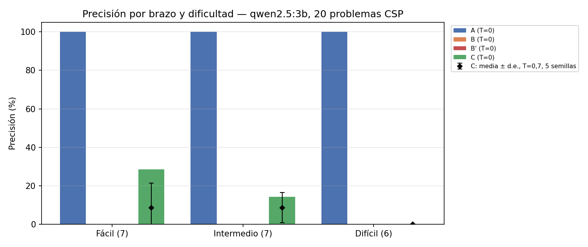
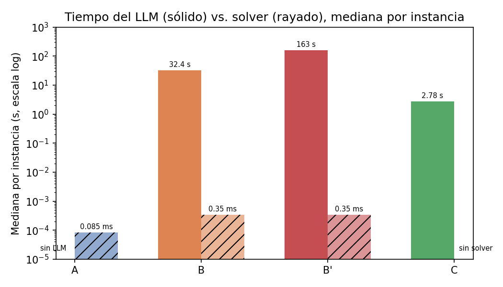
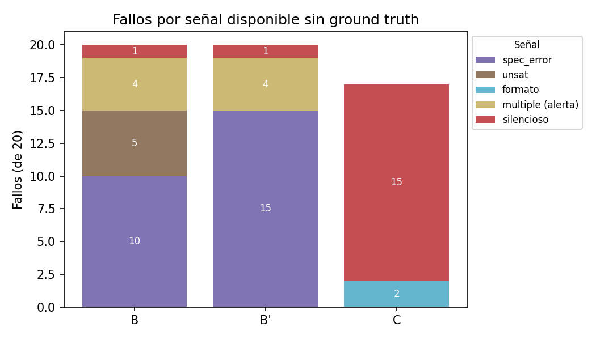

# Homework 2 — The Formalizer

**CMP-4004 · Inteligencia Artificial · USFQ**
**Equipo:** Diego Changotasig (Integrante 1: dataset, ground truth y brazo A), Nicolas Naranjo (Integrante 2: brazos B y B′) y Andrés Vega (Integrante 3: brazo C, evaluación y análisis)
**Formalismo:** Constraint Satisfaction Problems (CSP)
**Modelo de B, B′ y C:** Ollama local **`qwen2.5:3b` (3,1 mil millones de parámetros, Q4_K_M,
digest `357c53fb659c…`)**, temperatura 0, semilla 0 y 4096 tokens de salida. Un modelo tan pequeño
condiciona todos los resultados. B/B′ y C se ejecutaron en equipos distintos (C: Ryzen 9 6900HX,
RTX 3080 Ti Laptop, Ollama 0.30.5).

## 0. Protocolo experimental

Cuatro brazos sobre **los mismos 20 problemas**:

| Brazo | Procedimiento |
|---|---|
| **A — Manual + solver** | Modelo CSP escrito y revisado a mano → solver. |
| **B — LLM → CSP → solver** | El LLM escribe el modelo desde el enunciado → solver. Un intento. |
| **B′ — B + refinamiento** | Si el solver falla, el LLM recibe **solo el mensaje de error** y reintenta, hasta 3 veces. |
| **C — LLM directo** | El LLM responde sin solver. |

A, B y B′ usan el mismo solver (`code/csp_spec.py`). Todos los brazos comparten el formato de
resultados y la regla de calificación (`code/results_schema.py`). Por instancia se registra:
correcto / incorrecto / sin respuesta, tiempo total, tiempo del LLM, tiempo del solver, tokens y
costo. Si hay varias soluciones (`multiple`), se califica la primera. `unsat`, `timeout` y un
modelo inválido cuentan como sin respuesta. Los LLM reciben solo `statement` y `answer_format`
públicos, nunca la dificultad ni el ground truth. B′ reintenta solo tras un error de JSON o de
especificación, o tras `unsat`. C usa el mismo modelo, la misma configuración y la misma caché que B
(`README_B.md`, `README_C.md`).

## 1. Dataset, formalización y ground truth (Integrante 1)

**20 problemas de Ingeniería Industrial**: **7 fáciles (F01–F07), 7 intermedios (M08–M14) y 6
difíciles (D15–D20)**, de producción, logística, inventarios, mantenimiento, asignación y turnos.
Los generó Claude y los revisé a mano uno por uno (`AI_LOG.md`). Las restricciones incluyen
`alldiff`, precedencias, adyacencia, capacidades ponderadas, conteos e implicaciones. La
dificultad crece a la vez en número de variables, número y tipo de restricciones y longitud de la
deducción.

| Dificultad | Variables | Restricciones atómicas | Espacio de búsqueda | Mediana de nodos |
|---|---:|---:|---:|---:|
| Fácil | 3–4 | 4–10 | 27–256 | 5 |
| Intermedia | 5–6 | 7–12 | 243–46 656 | 7 |
| Difícil | 7–9 | 9–23 | 6 561–2 097 152 | 42 |

El solver usa backtracking con **MRV** (desempate por grado), consistencia de nodo y *forward
checking* limitado. **No** aplica AC-3. Las expresiones se validan antes de ejecutarse, lo que
permite correr modelos escritos por el LLM. `verify_ground_truth.py` comprueba que cada solución
cumple todas las restricciones y es **única**, por backtracking y por fuerza bruta: **20/20**.
Como eso solo prueba la corrección respecto de las restricciones *codificadas*, revisé además cada
regla frente a su expresión (por ejemplo, las capacidades de M10 y D16). No encontré errores.

## 2. Duel Scorecard

| Métrica | A: manual + solver | B: LLM + solver | B′: refinamiento | C: LLM directo |
|---|---|---|---|---|
| Correctas / 20 | **20/20** | **0/20** | **0/20** | **3/20** (T=0,7: 6 % ± 2,2 %, 5 semillas) |
| Incorrectas / sin respuesta | 0 / 0 | 5 / 15 | 5 / 15 | 17 / 0 |
| Tiempo por instancia, mediana (Q1–Q3) | 0,47 ms (0,25–0,67) | 32,42 s (22,90–50,04) | 162,58 s (68,02–239,27) | 2,78 s (2,69–2,90)* |
| Tiempo del solver, mediana | 0,08 ms | 0,35 ms | 0,35 ms | — |
| Tokens por instancia, mediana | 0 | 912,5 | 6556,5 | 544,5 |
| Fallos detectables sin ground truth | — | 15 de 20; 4 alertas `multiple` | 15 de 20; 4 alertas `multiple` | **2 de 17**; 15 silenciosos |
| Costo por respuesta correcta | 0 USD (+ tiempo humano) | No definido (0 correctas) | No definido (0 correctas) | 0,0012 USD |

\* Equipo distinto al de B/B′: los segundos son orientativos; los tokens sí son comparables. Tabla
completa en `results/scorecard.csv` (`python code/evaluation.py`).

**A obtiene 20/20 por construcción**, porque su modelo es el mismo que produce el ground truth;
el número vale por la revisión manual de la §1. Con este modelo de 3B, ningún brazo LLM se acerca a
A. C es el único que acierta algo, pero en parte por suerte: con T=0,7 baja a 6 % ± 2,2 %, y uno de
sus tres aciertos (M14) coincide con el orden 1…6 que el modelo suele copiar. La diferencia clave
no es la precisión sino **cómo falla cada brazo**: B no responde en 15 casos y lo avisa; C siempre
entrega una respuesta bien formada, también cuando es incorrecta.

## 3. Precisión vs. dificultad

| Brazo | Fácil (7) | Intermedio (7) | Difícil (6) |
|---|---:|---:|---:|
| A | 7/7 | 7/7 | 6/6 |
| B y B′ | 0/7 | 0/7 | 0/6 |
| C, T=0 | 2/7 (29 %) | 1/7 (14 %) | 0/6 |
| C, T=0,7 (media ± d.e., 5 semillas) | 9 % ± 13 % | 9 % ± 8 % | 0 % ± 0 % |



C baja con la dificultad y llega a 0 en el nivel difícil con todas las semillas. B y B′ están en 0
en todos los niveles. La variación de C entre semillas (8–13 puntos sobre 7 problemas) muestra que
**una sola ejecución con T=0 no basta** para afirmar que C supera a B por margen.



El solver (0,1–0,4 ms) es unas cinco órdenes de magnitud más rápido que el LLM. Todo el costo
temporal de B/B′ es generación, y en B′ crece con cada iteración porque el historial se acumula.



## 4. Taxonomía de errores

Se clasifican **todos** los fallos de B; el detalle, con la salida del modelo, está en
`taxonomy.md`. La columna de detección se llenó con *nuestros* datos.

| Categoría (fallo de B) | Señal | ¿Detectable sin ground truth? | Casos |
|---|---|---|---:|
| Sintaxis o especificación inválida | `SpecError` / JSON ilegible | Sí | 10 |
| Sobre-restringido | `unsat` | Sí | 5 |
| Sub-restringido, respuesta incorrecta | `multiple` | Alerta observable, no prueba por sí sola un fallo | 4 |
| Modelo del problema equivocado | `unique` incorrecto | **No** | 1 |
| Aridad o alcance | Dentro de otras categorías | A veces (solapado, no se suma) | — |
| Timeout del solver | `timeout` | Sí | 0 |

**Ejemplos literales de B (primer intento):**

1. F01 (`unsat`): `"expr": "OP1 + OP2 + OP3 == 3"` suma nombres de máquinas y compara el resultado con un número.
2. F04 (`unique` incorrecto): `"expr": "not (PINTURA == INSPECCION + 1)"` invierte la precedencia prohibida. Es silencioso.
3. F06 (`spec_error`): `"expr": "ELENA != LOTE2"` usa un valor como si fuera una variable.
4. M13 (`unsat`): `"MOTOR != 1"`, `"MOTOR != 2"` y `"MOTOR != 3"` eliminan todo el dominio.
5. D16 (`unsat`): `"expr": "P2 + P5 == 1"` es imposible, porque ambos valores son como mínimo 1.

En F01 y M11, el evaluador convierte errores de tipo en restricciones falsas, así que `unsat` no
siempre indica una sobre-restricción semántica.

**Comparación con C.** C falla 17 veces y **solo 2 de esos fallos (12 %) son detectables sin ground
truth** (D15 y D18, con valores fuera del dominio público). Los otros 15 son JSON válidos con
valores permitidos, indistinguibles de un acierto. En B, **15 de 20 fallos se anuncian solos**, 4
dejan la alerta `multiple` y solo 1 es silencioso. Los fallos silenciosos son **1/20 en B frente a
15/17 en C**. Además, las respuestas incorrectas de C violan una mediana de 2 restricciones, y 4 de
20 solo repiten el orden de los dominios (F01 = CNC, TORNO, FRESADORA; F02 = 1, 2, 3).

**Consecuencia de ingeniería:** con B, un operador sabe *cuándo* no confiar, porque el fallo trae
su aviso y el caso se deriva a una persona. Con C, el 88 % de los errores llega con la apariencia de
un acierto, así que la única defensa es revisar todo a mano, lo que equivale a no automatizar.

## 5. Análisis del refinamiento (B′)

B′ recibe solo el error del solver, nunca el ground truth.

| Iteraciones hasta acertar | Casos |
|---|---:|
| Correcto en el primer intento (igual que B) | 0 |
| Corregido tras 1, 2 o 3 refinamientos | 0 |
| No alcanzó respuesta correcta | 20/20 (100 %) |

Quince casos recibieron tres refinamientos y terminaron con `spec_error`. Los otros cinco no se
refinaron por protocolo (cuatro `multiple` y un `unique`). Ninguno se corrigió, así que no hay un
grupo de éxitos rápidos con el cual comparar. El patrón es el mismo en todas las rondas: **43 de 45
respuestas de reparación añadieron prosa y Markdown**, que el parser rechazó, y el CSP de dentro
conservaba el error original (en F01, la suma de cadenas). **B′ − B = 0 puntos porcentuales**: con
este modelo y este mensaje de error, la retroalimentación del solver no fue una señal aprovechable.

## 6. Costo por respuesta correcta

**Costo por correcta = costo total del brazo / respuestas correctas**, contando todos los intentos.
Tarifa equivalente: Together AI, *Qwen2.5 7B Instruct Turbo*, 0,30 USD por millón de tokens de
entrada y 0,30 USD por millón de salida (together.ai/pricing, consultado el 2026-11-17). No hay
tarifa publicada para el modelo de 3B, así que es una **cota superior**.

| Brazo | Tokens entrada / salida | Costo total | Correctas | **Costo por correcta** | Segundos de LLM por correcta |
|---|---|---:|---:|---:|---:|
| A | 0 / 0 | 0 USD (+ 2 h humanas) | 20 | 0 USD (+ 6 min humanos) | 0,0005 s |
| B | 12 114 / 18 067 | 0,0091 USD | 0 | **no definido (∞)** | ∞ (1751 s en total) |
| B′ | 75 634 / 43 766 | 0,0358 USD | 0 | **no definido (∞)** | ∞ (4032 s en total) |
| C | 10 788 / 899 | 0,0035 USD | 3 | **0,0012 USD** | 18,6 s |

B′ incluye el primer intento de B. B gasta 2,6 veces lo que C y B′ 10 veces, sin ningún acierto.
**C es el único brazo LLM con un costo por correcta finito**, aunque inflado por M14: sin ese caso,
0,0018 USD. En dinero todos los brazos son despreciables a esta escala; lo decisivo es el
denominador. A tiene un costo humano fijo de unas 2 horas, que no escala a problemas nuevos.

## 7. Dónde pudimos ser injustos

- **A tiene ventaja estructural:** su modelo ya está hecho y revisado, saca 100 % por construcción
  y no se le carga el tiempo humano.
- **Dataset generado por un LLM** (Claude) y revisado por una sola persona. Además, se añadieron
  reglas hasta lograr una solución única, lo que puede dar reglas artificiales y favorecer a los
  brazos con solver frente a enunciados reales y ambiguos.
- **El formato de expresiones es nuestro:** B debe usar un formato que no vio en su entrenamiento.
  Parte de los `spec_error` mide el formato, no la capacidad de formalizar.
- **`answer_format` se mostró a B, B′ y C por igual.** Eso favorece a los brazos LLM, porque B
  solo tiene que traducir las restricciones.
- **Ventajas de C:** su prompt se ajustó una vez tras un piloto que mostró un error de formato (el
  modelo copiaba `answer_format`), y la v2 le da un esqueleto que B no tiene. Además, C solo elige
  valores mientras B escribe un programa completo, y M14 cuenta como acierto aunque coincide con el
  orden por defecto.
- **Parser estricto en B′ y tolerante en C.** Comprobamos, sin modificar los resultados de B, qué
  pasaría si B′ usara el parser de C: 4 casos pasarían a `multiple`, pero los 4 siguen siendo
  incorrectos. **B′ seguiría en 0/20**; la asimetría solo infla `spec_error`.
- **Retroalimentación pobre:** tras `unsat`, B′ solo recibe `solver returned unsat`, sin saber qué
  restricciones chocan. Nuestro 0 % de mejora mide *este* mensaje, no la idea en general.
- **Varianza y presupuesto:** solo C tiene réplicas, así que el 0/20 de B no tiene barra de error.
  Tres salidas de B se cortaron por `length`, con un contexto de Ollama de 4096 tokens (no se fijó
  `num_ctx`).
- **Un solo modelo, y muy pequeño.** Con un modelo mayor, B podría superar a C; nuestros datos no
  permiten afirmar ni negar eso.

## 8. Recomendación de despliegue y monitoreo

**No desplegaríamos ningún brazo LLM con `qwen2.5:3b` sin supervisión.** Para problemas
recurrentes (asignaciones y turnos con la misma estructura) desplegaríamos **A**: unos 6 minutos de
trabajo humano por problema, solver en milisegundos y 20/20.

Para enunciados nuevos con un LLM elegiríamos la **arquitectura B, como filtro y con un modelo más
capaz**, nunca C. Lo decisivo no es la precisión (0/20 frente a 3/20, diferencia que se reduce a 6 %
± 2,2 % con las réplicas), sino **qué pasa cuando falla**:

| Si se acepta automáticamente… | Incorrectas entregadas en silencio | Derivadas a una persona |
|---|---:|---:|
| B, solo cuando el solver dice `unique` | **1/20** (F04) | 19/20 |
| C, cualquier respuesta con formato válido | **15/20** | 2/20 |

El costo de C (0,0012 USD por correcta) es engañoso: con 15 de cada 17 errores silenciosos, habría
que revisar todo a mano. B concentra la revisión en los casos marcados; con el modelo de 3B serían
casi todos, por eso el modelo debe cambiar antes de desplegar.

**Monitoreo para B:**

1. **Compuerta por estado del solver:** solo `unique` se entrega automáticamente; `spec_error`,
   `unsat`, `multiple` y `timeout` van a una persona. Alerta si la tasa supera la de referencia
   (hoy, 95 %).
2. **Auditoría por muestreo de `unique`**, la única categoría silenciosa (F04).
3. **Conjunto canario:** volver a ejecutar estos 20 problemas en cada cambio de modelo, prompt u
   Ollama, y bloquear el cambio si la precisión baja.
4. **Registro completo** de prompt, salida, estado, tokens y latencia (como `.llm_cache/`).
5. **Revisión del modelo generado:** claves completas y ausencia de reglas triviales (`X != X`,
   sumas imposibles), que en nuestros datos anticipan `unsat`.

## 9. Reproducibilidad

```bash
python code/verify_ground_truth.py    # 20/20 → results/ground_truth_check.csv
python code/arm_a.py                  # → results/arm_a.csv
python code/arm_b.py --timeout 600 --out results/arm_b_new.jsonl && python code/evaluate_b.py results/arm_b_new.jsonl --out-dir results/new
python code/arm_c.py --out results/arm_c_new.jsonl && python code/evaluate_c.py results/arm_c_new.jsonl --out results/new/arm_c.csv
python code/evaluation.py             # scorecard, varianza y fig/*.png
```

Detalle de B/B′ y C en `README_B.md` y `README_C.md`. Las salidas completas de los LLM están en
`.llm_cache/` y `results/*.jsonl`.
