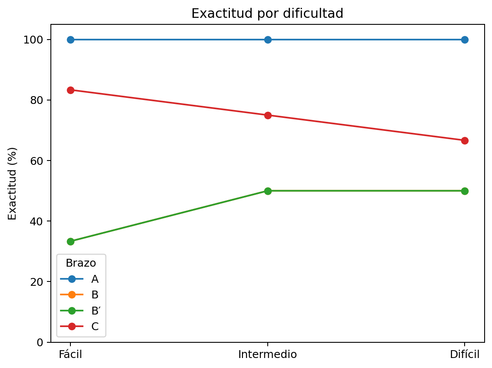
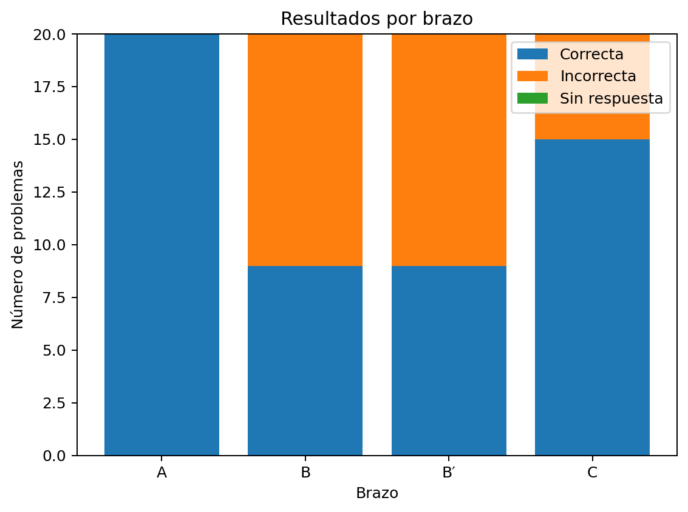
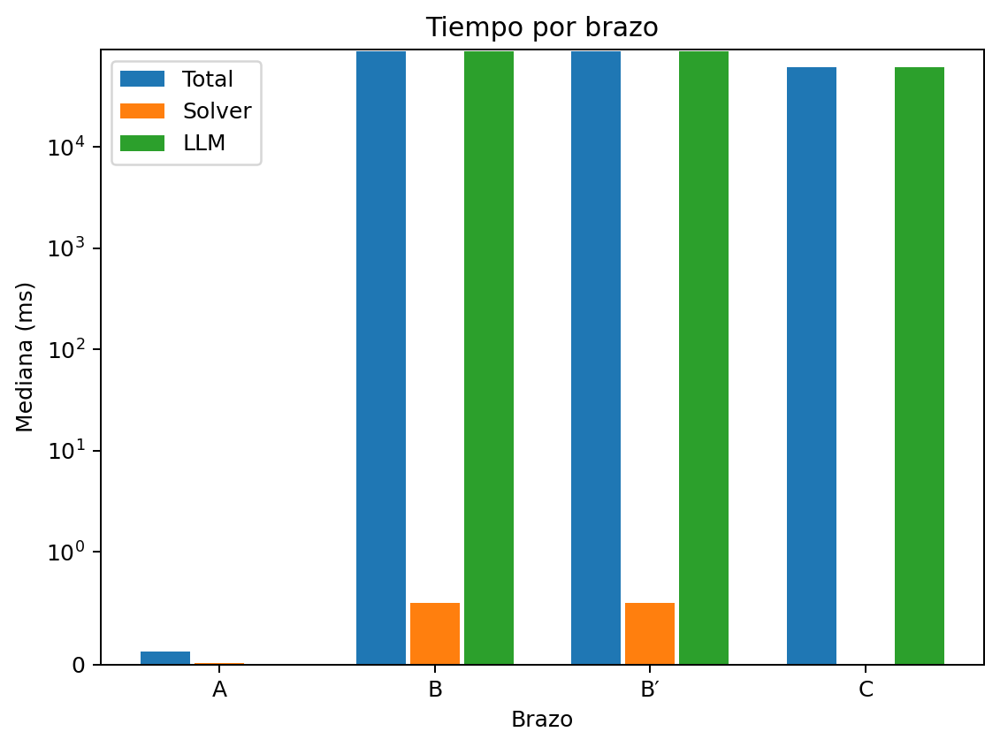

# Homework 2 — The Formalizer

**Integrantes** — Mateo Yépez y Julián Díaz

**Formalismo** — SAT con el solver DPLL de la semana 7

## Diseño del conjunto de problemas

El conjunto contiene 20 problemas de selección escritos en español. Cada problema pregunta si existe una selección que cumpla todas las reglas. Las opciones se representan como variables booleanas y las reglas incluyen requisitos, prohibiciones, implicaciones y exclusiones. Cada JSON en `problems/` guarda el enunciado, las variables, las cláusulas en forma normal conjuntiva y la respuesta de referencia con su justificación.

La dificultad se definió por el número de variables booleanas. Hay seis problemas fáciles con cuatro variables, ocho intermedios con seis variables y seis difíciles con ocho variables. Dentro de cada nivel, la mitad de los problemas son SAT y la mitad UNSAT.

En los casos SAT, la respuesta de referencia incluye una selección que satisface todas las reglas. En los casos UNSAT, la justificación muestra cómo las reglas llevan a una contradicción.

## Método y resultados del brazo A

El script `code/run_arm_a.py` carga las cláusulas de referencia de cada problema y las resuelve con el DPLL de la semana 7. Compara el resultado con la respuesta esperada y verifica que cada selección de referencia de los casos SAT satisfaga todas sus cláusulas.

DPLL coincidió con las 20 respuestas esperadas. El tiempo del solver mide la llamada a DPLL. El tiempo total incluye también la lectura del JSON y la preparación de las cláusulas. Los resultados de la corrida están en `results/arm_a.csv`.

## Duel Scorecard

La comparación usa los mismos 20 problemas para cada brazo. Para A se usó mi corrida local de DPLL. Para B, B′ y C se usó la primera ronda completa de los experimentos de Julián Díaz.

| Métrica | A | B | B′ | C |
|---|---:|---:|---:|---:|
| Correctas | 20 | 9 | 9 | 15 |
| Incorrectas | 0 | 11 | 11 | 5 |
| Sin respuesta | 0 | 0 | 0 | 0 |
| Exactitud | 100 % | 45 % | 45 % | 75 % |

## Gráficas comparativas

### Exactitud por dificultad

A acertó 6/6 problemas fáciles, 8/8 intermedios y 6/6 difíciles. B y B′ acertaron 2/6, 4/8 y 3/6. C acertó 5/6, 6/8 y 4/6, respectivamente.

### Resultados por brazo

C superó a B y B′ por seis aciertos en esta ronda. El refinamiento de B′ dejó la exactitud en el mismo 45 % de B.

### Tiempo mediano por brazo

En A, el tiempo total incluye la lectura del JSON, la preparación de las cláusulas y la ejecución del solver. En B, B′ y C se usó el tiempo del proceso completo registrado en sus experimentos. En B′, esa medición incluye el tiempo de la consulta inicial reutilizada de B. La gráfica también muestra por separado los tiempos de DPLL y del modelo cuando corresponden.

## Where we may have been unfair

Nueve pares de problemas comparten contexto y reglas base. En cada par, la variante UNSAT añade una regla que prohíbe una opción que las demás reglas obligan a elegir. Esto permite observar el efecto de una sola regla, aunque limita la diversidad del conjunto. Además, el número de variables mide el tamaño de cada instancia. La estructura de sus cláusulas también puede afectar la dificultad para formalizarla o resolverla.