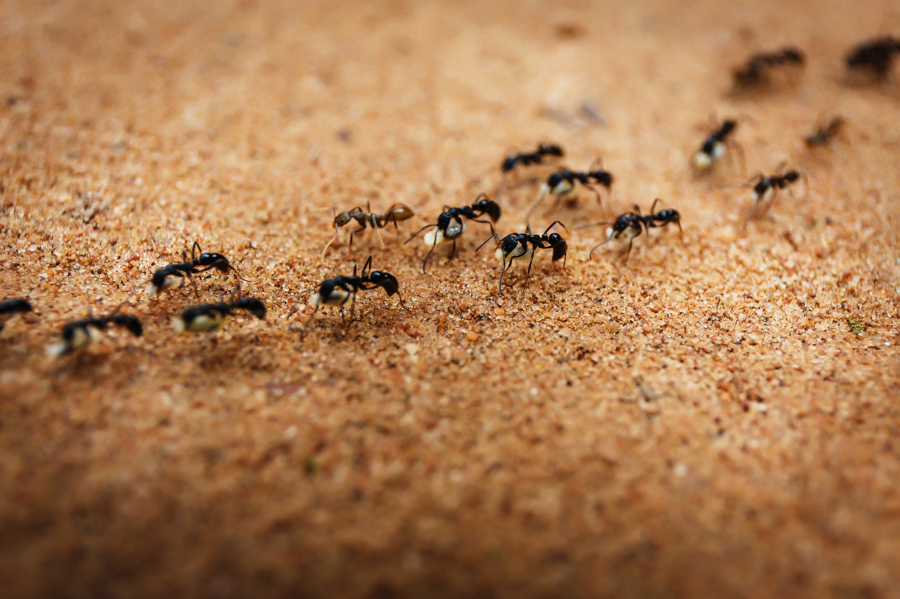
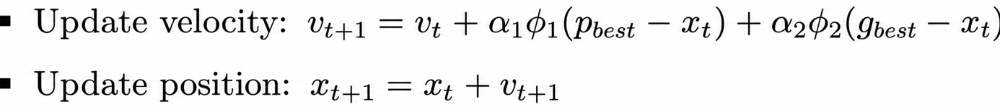
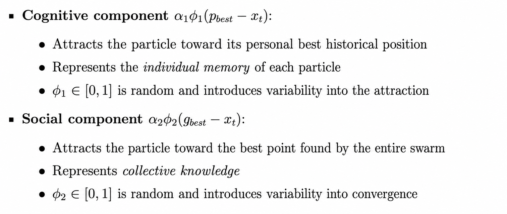
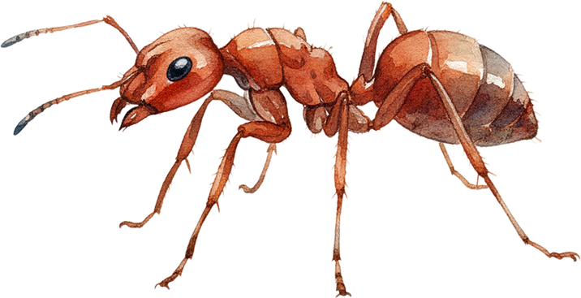
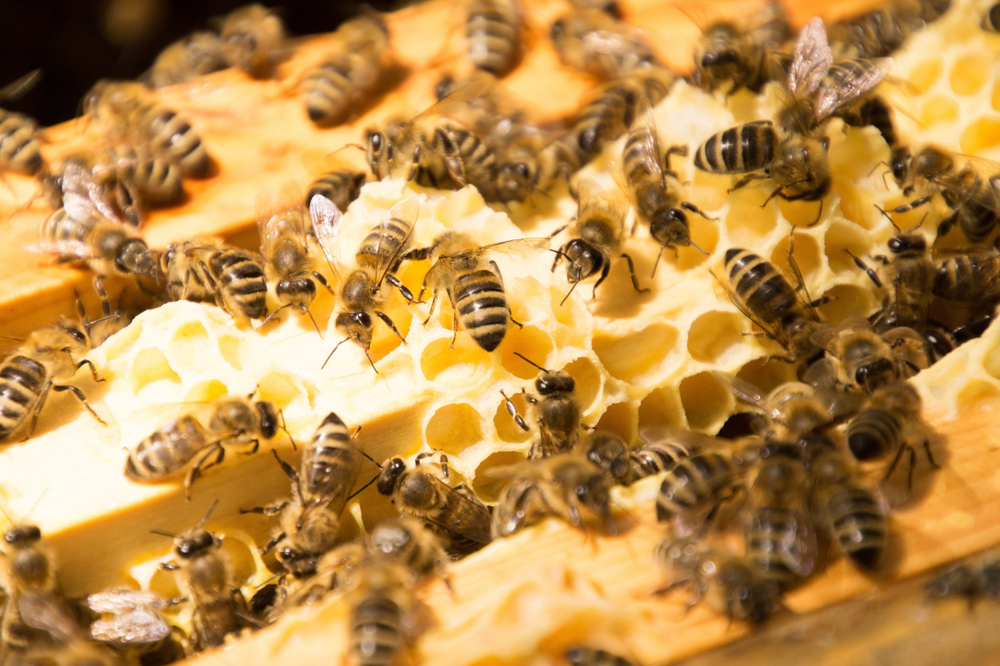
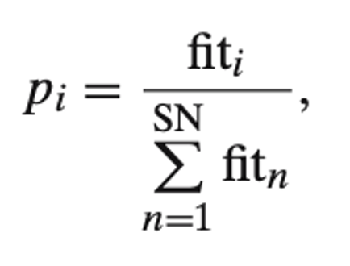

<!--
Week 11 Session A. Mini-lecture budget: 25 minutes.
Source: 04_Optimization.pptx slides 8-19. Beats per lesson plan:
the shared skeleton FIRST (5) → PSO (7) → ACO (7) → ABC (6).
Presenting the skeleton first is the key restructuring: the source deck is a
bestiary, and the skeleton turns it into variations on one theme.
DUEL 3 IS DUE THIS WEEK. Lesson plan: ../../weeks/week-11.md
-->

# Swarm Intelligence

## Four algorithms, one skeleton

**CMP-4004** · Week 11


---

# First, some warranted skepticism

Metaheuristics named after: **ants, bees, wolves, whales, bats, fireflies,
cuckoos, krill, salps.**

Are these fundamentally different algorithms?

There is a real, well-documented critique that many are **the same algorithm with
a new metaphor** and no rigorous comparison against a tuned baseline.

We will teach the algorithms **and** the critique. By the end of the studio you
will have run the fair comparison yourself, which is more than much of the
published literature does.

<!--
Set this tone deliberately. It makes the warm-up poll's skepticism productive
rather than cynical, and it makes the budget-normalization lesson land as
methodology rather than pedantry.
-->

---

# The shared skeleton

```
initialize a population of candidates
repeat:
    evaluate each candidate
    update some shared or individual memory
    generate new candidates from memory + randomness
until budget exhausted
```

| Algorithm | What it **remembers** | How it **generates** |
|---|---|---|
| **GA** (wk 10) | the population itself | crossover + mutation |
| **PSO** | `p_best` per particle, one global `g_best` | velocity update |
| **ACO** | a **pheromone matrix** on edges | probabilistic construction |
| **ABC** | food-source positions + **trial counters** | neighbor perturbation + scouts |

> ## These differ in what they remember and how they use it.

Everything else is biology.

<!--
5 min, and present this BEFORE any individual algorithm. The source deck orders
these as four separate topics; leading with the skeleton is what converts a
bestiary into a design space.
-->

---

# Particle Swarm Optimization



**James Kennedy and Russell Eberhart, 1995.** A stochastic optimization algorithm
inspired by simulations of social behavior in birds and fish.

Maintains a swarm of particles moving **continuously** through the search space,
sharing information about the best positions found.

Each particle has three properties:

- current position `x_t`
- velocity `v_t`
- **personal best** historical position `p_best`

The swarm maintains `g_best` — the best position found by **any** particle in
**any** iteration.

---

# The PSO update



```
v ← w·v  +  c₁·φ₁·(p_best − x)  +  c₂·φ₂·(g_best − x)
x ← x + v
```

| Term | Name | Meaning |
|---|---|---|
| `w·v` | **inertia** | keep going the way you were |
| `c₁·φ₁·(p_best − x)` | **cognitive** | return toward *my* best |
| `c₂·φ₂·(g_best − x)` | **social** | move toward the *swarm's* best |

`φ₁, φ₂ ~ U[0,1]` — uniformly distributed random variables.

### Two things you need

- **Velocity clamping** — without it, particles fly off to infinity
- **`w` schedule** — high `w` explores, low `w` exploits, so linearly decreasing
  `w` is standard. *Structurally the same role as SA's cooling schedule.*

**Why choose PSO:** it is natively **continuous**, unlike a GA's bit strings.

---

# Exploration and exploitation, again



Every algorithm this week has a knob for it. In PSO it is `w` and the `c₁/c₂`
balance.

## A clean demonstration

Set `c₂ = 0` — remove the social term.

You now have **30 independent hill climbers.** The social term *is* the swarm.

<!--
7 min for PSO. Do the c2 = 0 demo in live coding; it is the cheapest possible
proof that the population is doing something a population is required for.
Also remove velocity clamping and watch divergence.
-->

---

# Ant Colony Optimization


**Marco Dorigo, 1996.** Metaheuristic optimization, originally for combinatorial
problems. Focuses on how ant swarms optimize the paths they follow while
foraging.



In the real world:

1. Ants initially wander **at random**
2. On finding food they return to the colony, **leaving a pheromone trail**
3. Other ants encountering the trail are likely to **follow rather than wander**,
   reinforcing it if they too find food

**No ant plans.** The solution emerges from many agents modifying a **shared
environment** — this is called **stigmergy**, and in week 2's vocabulary it is a
cooperative multi-agent system communicating *through the environment* rather than
by messages.

---

# The ACO equations

For TSP — build tours probabilistically, biased by pheromone **τ** and visibility
**η = 1/d**:

```
P(i→j) = [τ_ij]^α · [η_ij]^β  /  Σ_k [τ_ik]^α · [η_ik]^β

τ_ij  ←  (1−ρ)·τ_ij  +  Σ_ants Δτ_ij
```

| Parameter | Weights |
|---|---|
| **α** | learned experience (pheromone) |
| **β** | the greedy heuristic (visibility) |
| **ρ** | **evaporation** |

### The special cases tell you what the parameters mean

- **α = 0** → pure greedy nearest-neighbor. No learning.
- **β = 0** → pure pheromone-following. No problem knowledge.

**The parameters interpolate between a heuristic and a learned policy** — a direct
echo of `g` and `h` in week 4.

---

# Evaporation is not a detail. It is the algorithm.

The goal is to **increase** pheromone on good solutions and **reduce** it on poor
ones. **Pheromone evaporation on weak paths is what makes this possible.**

Without decay, early random paths get locked in **permanently**.

> **Decay is what allows forgetting, and forgetting is what allows exploration.**

### What does evaporation correspond to in simulated annealing?

**Temperature.** Both are the knob controlling how much history constrains the
present.

<!--
7 min for ACO. In live coding, show the pheromone matrix as a HEATMAP evolving
across iterations — structure emerging from a uniform matrix is the best visual
in this unit and it makes stigmergy concrete. Then set rho = 0 and show
premature lock-in.
-->

---

# Artificial Bee Colony



**Karaboga, 2007.** A swarm-intelligence approach imitating the foraging behavior
of honeybee colonies.

## Three components

| Bee type | Role |
|---|---|
| **Employed bees** | exploit known food sources |
| **Onlooker bees** | choose sources probabilistically, by quality |
| **Scout bees** | **abandon** a source and restart randomly |

> Like the survival of a real colony, the algorithm's success depends on quickly
> **discovering** and efficiently **using** the best resources.

Onlookers and employed bees perform **exploitation**; scouts control
**exploration**.

---

# ABC's distinctive idea



Control parameters: number of food sources (= number of employed bees, **BN**, =
onlookers **SN**), the **`limit`** value, and the maximum number of cycles
(**MCN**).

## The `limit` counter

A source abandoned after **`limit` failed improvements** → a scout replaces it
with a random position.

**This is an explicit, per-candidate restart trigger** — a cleaner answer to local
optima than either GA or PSO has. Give the algorithm credit for that specific
mechanism; it is the reason to reach for ABC on highly multimodal landscapes.

**Recruitment rate** — how quickly the colony finds and exploits a new source;
i.e. how fast good solutions to a hard problem can be discovered.

<!--
6 min for ABC. The limit counter is the one genuinely novel mechanism in this
week's bestiary. Naming it as such is both honest and memorable.
-->

---

# FunSearch — the strongest case for LLMs in optimization

Romera-Paredes et al. (2024), *Nature* 625:468–475.

```
LLM proposes a PROGRAM (a heuristic)
        ↓
SYSTEMATIC EVALUATOR scores it by actually running it
        ↓
best programs seed the next round
```

**Evolutionary search where the mutation operator is a language model.**

Results: a new construction for the **cap set problem** in dimension 8, an improved
asymptotic lower bound, and **bin-packing heuristics beating first-fit and
best-fit**.

- It evolves **code**, not solutions — so you get a heuristic you can **read, run,
  and verify**
- **The evaluator is sound.** Same architecture as week 9. *Third instance. Name
  the pattern.*
- What it needed that your laptop does not have: **millions of LLM calls.**

---

# The budget rule

```python
class Budget:
    """Every algorithm gets exactly the same number of fitness evaluations."""
    def __call__(self, x):
        if self.used >= self.max_evals:
            raise BudgetExhausted()
        self.used += 1
        ...
```

> ## Comparing metaheuristics at equal *iterations* is meaningless.

A GA with population 100 uses 100 evaluations per generation. PSO with 30
particles uses 30. **Equal evaluations is the only defensible axis.**

Same methodological point as week 10, generalized.

---

# Studio

## Task 1 — the bake-off

4 algorithms (GA, PSO, ACO, ABC) × continuous (Rastrigin, Rosenbrock at dim 2, 10,
30) and combinatorial (TSP at 20, 30, 50) × **10 seeds** × **equal evaluation
budget**. Convergence plots with error bands, x-axis = **evaluations**.

**Expect: no algorithm wins everywhere.** That is the **No Free Lunch** theorem
appearing in your own data.

## Task 2 — a miniature FunSearch

Evolve a bin-packing heuristic *as Python source*. Sound evaluator, keep the best
*k*, mutate again.

**Required honesty:** report how many LLM outputs failed to compile or crashed.
FunSearch made millions of calls; you will make ~200. State the limitation rather
than concluding "the method doesn't work."

**Duel 3 (Optimization) is due this week.**

<!--
Task 2 needs a hard sandbox: safe_exec() with a timeout and no imports. LLM
code will occasionally loop forever. Do NOT let students run raw exec() on model
output, and say why out loud — it is a genuine security lesson.
Scorecard note: cost (axis 3) is where the LLM operator looks worst by orders of
magnitude; interpretability (axis 7) is where it looks BEST, because it emits
readable code rather than a tuned parameter vector.
-->
