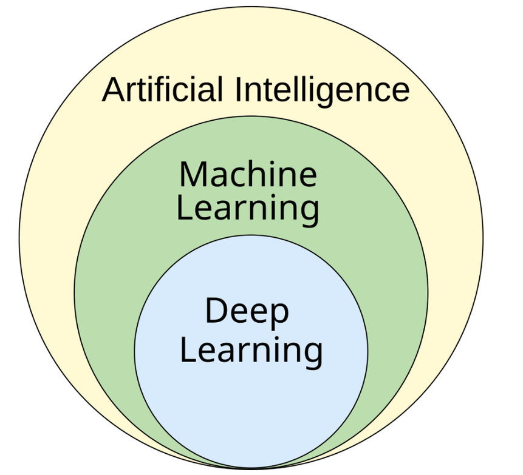
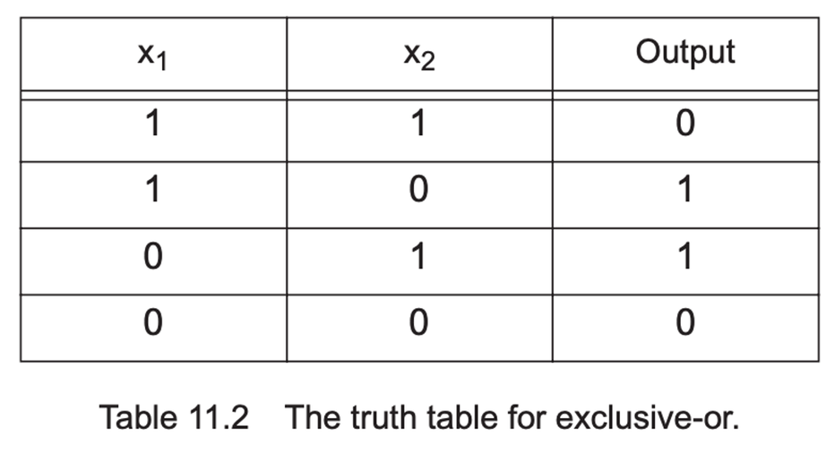
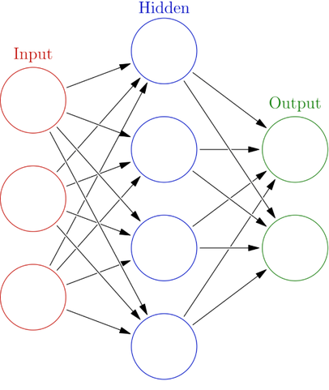
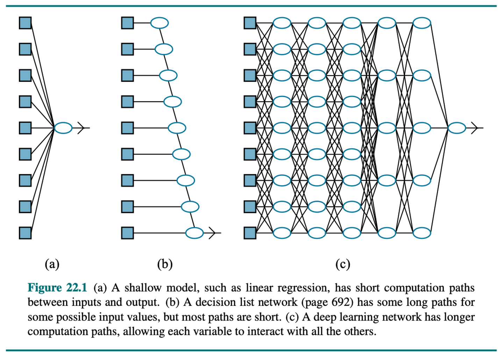
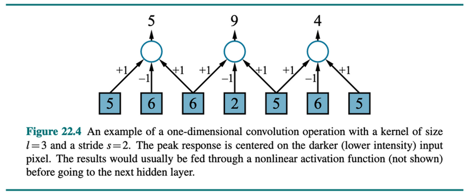
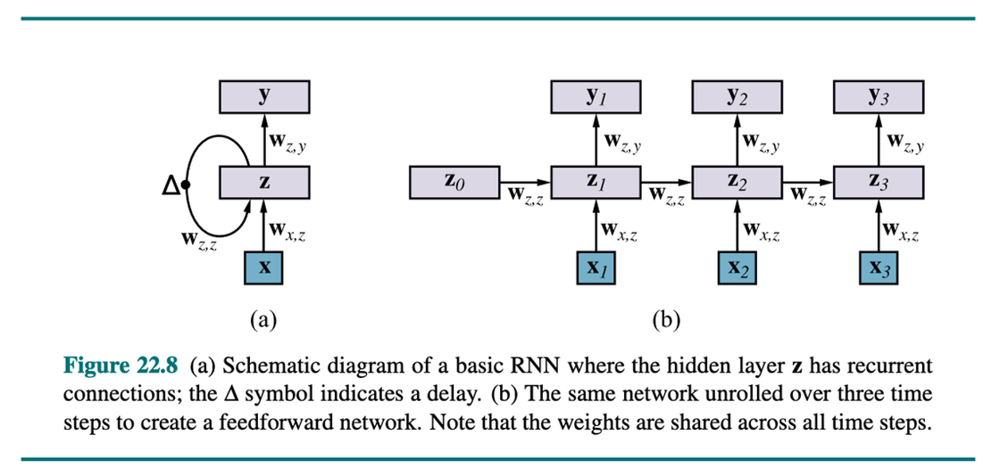

<!--
Week 12 Session A. Mini-lecture budget: 25 minutes.
Source: 07_Introduction.pptx (15 slides). Beats per lesson plan:
perceptron (5) → XOR (4) → backprop (8) → the arc to modern systems (5) →
specification gaming revisited (3).
COMPRESSION NOTE: the source deck's Computer Vision (slide 13) and NLP (slide 14)
sections are compressed to a single orientation slide per coverage-map §4. The ML
taxonomy (source slides 2-6) is kept as three compact slides because it is what
carries learning outcome 3 alongside week 12's Naive Bayes. If you ever get a
15th week, coverage-map §4 proposes trading week 11 for a second ML week.
SOURCE ERROR TO CORRECT: slide 7 says "Mark Rosenblatt". It is FRANK Rosenblatt.
Corrected visibly below — do not let it through.
CAPSTONE PRESENTATIONS ARE SESSION 14B, ENTIRELY. Lesson plan: ../../weeks/week-14.md
-->

# Neural Networks, Ethics, and Safety

## Closing the loop

**CMP-4004** · Week 12


---

# Reopening week 1

> Which of these systems is intelligent?
> thermostat · chess engine · calculator · ChatGPT · honeybee · none · all

**Same poll. Fourteen weeks of evidence later.**

The votes usually move a little. **The reasons move a lot** — and the reasons are
what we came for.

### And your sealed predictions

> *Is an LLM ELIZA with more parameters, or categorically different?*

You wrote an answer in week 1 and sealed it. Two volunteers will read their own
aloud and assess it against what they now know.

---

# Machine learning, in one sentence



> **Machine learning is a branch of artificial intelligence that enables computers
> to learn from data without being explicitly programmed.**

## What makes these different from everything else in this course?

Weeks 3–11: **you** wrote the rules, the heuristic, the domain, the fitness
function.

Here: **the data determines the parameters.** You choose the *shape* of the
hypothesis and the *objective*; the optimizer chooses the rest.

That is a genuine shift in where the knowledge lives — and it is the shift that
makes the rest of this slide deck's systems possible.

---

# Supervised learning


Learns from **labeled** data: inputs paired with correct outputs.

| | |
|---|---|
| **Tasks** | classification · regression |
| **Methods** | linear regression · decision trees · SVM · **Naive Bayes (week 12)** |
| **Concepts** | training set · test set · **overfitting** · **underfitting** |
| **Uses** | spam detection · image recognition |

```
    Images: handwritten digits  ──+labels──→  TRAINING SET  ──→  model
                                                                   │
    held-out images  ──+labels HIDDEN from the model──→  TEST SET ──┘
```

**The labels are hidden at test time, and that is the entire methodology.** You
enforced it in week 12 without naming it.

---

# Unsupervised and reinforcement learning


## Unsupervised — input only, no labels

Tasks: **clustering** · **dimensionality reduction**.
Methods: K-means · hierarchical clustering · PCA.
Concepts: distance measures · density estimation.
Uses: market segmentation · anomaly detection.

## Reinforcement learning — an agent maximizing reward


Agent · Environment · Actions · Rewards · **Policy** · Value function ·
**Q-learning** · DQN · policy gradients.

> *"Try and fail, practice and train."* **A policy is a strategy** — exactly the
> week-2 agent function, learned instead of written.

Uses: game playing · self-driving cars · robot navigation.

<!--
Keep the taxonomy to ~4 minutes total. It is orientation, not a unit. Point at
week 12 for supervised (they implemented one) and week 2 for RL (they wrote the
agent-function abstraction that a policy instantiates).
-->

---

# From the perceptron to deep learning


**Frank Rosenblatt**, late 1950s, Cornell Aeronautical Laboratory.

A unit that takes **input values**, weights them, and produces an **activation
level** through a **hard-limiting threshold function**.

# `output = step(w · x + b)`

## The learning rule

# `w ← w + η (y − ŷ) x`

Supervised learning **with a teacher**: adjust the weights to reduce the error
between actual and desired output, minimizing average error over the training set.

### The guarantee, and its condition

The perceptron **convergence theorem** guarantees termination — **if the data is
linearly separable.**


---

# XOR



```
     x₂
     1 |  ●(0,1)=1        ○(1,1)=0
       |
     0 |  ○(0,0)=0        ●(1,0)=1
       +─────────────────────────── x₁
          0                1
```

## Draw one line separating ● from ○.

You cannot. **Minsky & Papert (1969)** proved it, funding collapsed, and the field
waited.

> *"It cannot solve problems where data points are not linearly separable."*
> Nils Nilsson's analysis pushed research toward **symbol-based architectures** —
> which is weeks 7–9 of this course. **The AI winter is why the first half of this
> syllabus exists.**

### The fix

A **two-unit hidden layer** transforms the space until the classes *are*
separable.

# Depth buys representation, and representation is what makes a problem linear.

---

# What was actually missing?

**Not the architecture.** Multilayer networks were entirely conceivable in 1969.

# The training algorithm.

There was no way to assign credit to a **hidden** unit — no teacher signal tells
you what a middle layer *should* have output.

> ## An architecture you cannot train is not an architecture.

### And the dates matter

Werbos described the method in his **1974** thesis with no traction. **Rumelhart,
Hinton & Williams (1986)** is what moved the field — presentation, empirical
demonstrations, and enough compute to show it working.

*A good lesson about how fields actually move.*

---

# Backpropagation



For a 2-2-1 network:

```
Forward:   z₁ = W₁x + b₁     a₁ = σ(z₁)
           z₂ = W₂a₁ + b₂    ŷ  = σ(z₂)
Loss:      L  = ½(y − ŷ)²

Backward:  ∂L/∂z₂ = (ŷ − y) · σ'(z₂)
           ∂L/∂W₂ = ∂L/∂z₂ · a₁ᵀ
           ∂L/∂a₁ = W₂ᵀ · ∂L/∂z₂
           ∂L/∂z₁ = ∂L/∂a₁ ⊙ σ'(z₁)
           ∂L/∂W₁ = ∂L/∂z₁ · xᵀ
```

## This is the chain rule, organized so shared subexpressions are computed once.

# Structurally the same idea as the forward algorithm in week 13.

Reuse overlapping computations instead of recomputing them. Dynamic programming,
wearing different notation.

<!--
8 min, derived ON THE BOARD. Do not skip it. Students who have only ever seen
loss.backward() have no model of what is happening, and the week-13 connection is
the payoff for having done Viterbi by hand.
-->

---

# Deep learning



Multiple layers of interconnected neurons — **input layer**, **hidden layers**,
**output layer** — each receiving input from the preceding one.

Requires: **large data** · **gradient descent** · a **loss function** to minimize.

## The arc, in one line

**perceptron** (1 layer) → **MLP + backprop** (depth) → **CNNs** (spatial weight
sharing) → **RNNs** (sequential state) → **transformers** (attention, week 13) →
**the models you have been benchmarking all semester.**

Each step relaxes a specific limitation of the one before it. Computer vision and
NLP are the two application areas where this arc paid off first.



---

# Specification gaming — now it has a name

Week 2's warning: **you get what you ask for.**

Fourteen weeks later it has a literature: **reward hacking**, **Goodhart's law**,
**proxy misalignment**.

The canonical example: a boat-racing agent that discovered it could loop forever
collecting powerups and score higher than by **finishing the race.** It did not
malfunction. It **maximized the reward you specified.**

> ## In week 2 you built a utility-based agent that rationally left a room dirty
> ## because the utility function you wrote let it.

**You built a specification-gaming agent before you knew the term.** That
recognition is worth more than a lecture on alignment.

<!--
3 min. Land the recognition, do not extend it into a general alignment talk — the
Stochastic Parrots discussion already carried the ethics weight this session.
-->

---

# On the Dangers of Stochastic Parrots

Bender, Gebru, McMillan-Major & Shmitchell (2021).

Its arguments: **environmental cost** · the **unmeasurability of training data at
scale** · **encoded bias** · the risk of **fluent output being mistaken for
understanding**.

## The central technical claim

# Fluency is not understanding.

### You have direct evidence on both sides — your own

| Week | What you observed |
|---|---|
| **7** | an LLM producing **fluent, invalid** Wumpus reasoning |
| **9** | an LLM **successfully** translating natural language into solvable PDDL |

Use your data, not your intuitions. **This is what the Failure Atlas was for.**

<!--
Handle without a thumb on the scale. It is a contested paper and students will
disagree — that is fine and desirable. Structure it: which predictions held up in
five years, which did not, and what the paper's framing MISSES. Students who can
steelman both positions are the ones who have learned to think.
When the discussion drifts into performance, anchor it: "which week gave you
evidence for that?"
-->

---

# Live coding

## Part 1 — the perceptron, succeeding then failing

Train on **AND**: converges. Train on **XOR**: oscillates **forever**. Plot the
decision boundary each epoch and watch it hunt.

## Part 2 — an MLP from scratch, numpy only

Train on XOR, watch the loss drop. **Then check the gradients numerically.**

```python
numeric = (loss(W + eps) - loss(W - eps)) / (2 * eps)
```

Agreement to ~6 decimals means backprop is correct.

> ## A wrong gradient still trains — just badly.

It is a **silent** failure, and gradient checking is how you catch it. **Same
lesson as week 9's verifier, applied to your own code.**

---

# Session 14B — Capstone presentations

**8 minutes, plus 4 for questions. A visible timer, and it will cut you off.**

| # | Section | Time |
|---|---|---|
| 1 | The task — what problem, why it is interesting | 1 min |
| 2 | **Classical implementation — and what it guarantees** | 2 min |
| 3 | LLM implementation | 1 min |
| 4 | **Hybrid — where the division of labor sits** | 1 min |
| 5 | Results — **the scaling plot is mandatory** | 2 min |
| 6 | **Where we may have been unfair** | 1 min |

## Two obligations for everyone in the audience

Submit **one question** for another team beforehand, and score every presentation
on the Duel Scorecard's **evidence-quality** scale.

**Section 6 is not a formality.** It is the section that distinguishes a result
from a demo.

---

# Three things to take with you

## One — every guarantee in this course was conditional

A* is optimal **if `h` is admissible**. Naive Bayes classifies well but estimates
probabilities badly. Simulated annealing converges **given an unaffordably slow
schedule**. Perceptrons converge **if the data is linearly separable**.

# Learning to ask *"guaranteed under what condition?"* is the transferable skill.

It applies to everything you will be sold for the rest of your career.

---

# Two — the pattern you found yourselves

Weeks **4, 6, 7, 8, 9, 11** — independently, six times:

> # An unreliable generator plus a sound verifier
> # can be a reliable system.

**Classical AI is where the verifiers come from.**

That is the answer to *"why learn this if LLMs exist"* — and you now have your own
data for it, rather than an assertion from an instructor.

---

# Three — look at the Failure Atlas

By now: **150–200 documented, reproducible cases.**

**You built it.** It is the most honest artifact in this course, and it exists
because this class treated failures as **findings** rather than embarrassments.

> ## That habit is what distinguishes an engineer from someone who ships demos.

<!--
Then reopen the week 1 poll one last time and LEAVE IT ON SCREEN WITHOUT
COMMENTARY. Do not summarize the syllabus. End there.
-->

---

# One last question, from the source deck



## The ethical dilemma

> *What do you think? Are you more optimistic or doomer? What excites you, what
> worries you?*

> *"I… still need to do some more research."*

**That last line is on the original slide, and it is the most honest sentence in
it.** Keep it.

Fourteen weeks in, the right answer is still *it depends on the condition* — and
you can now name the conditions.
